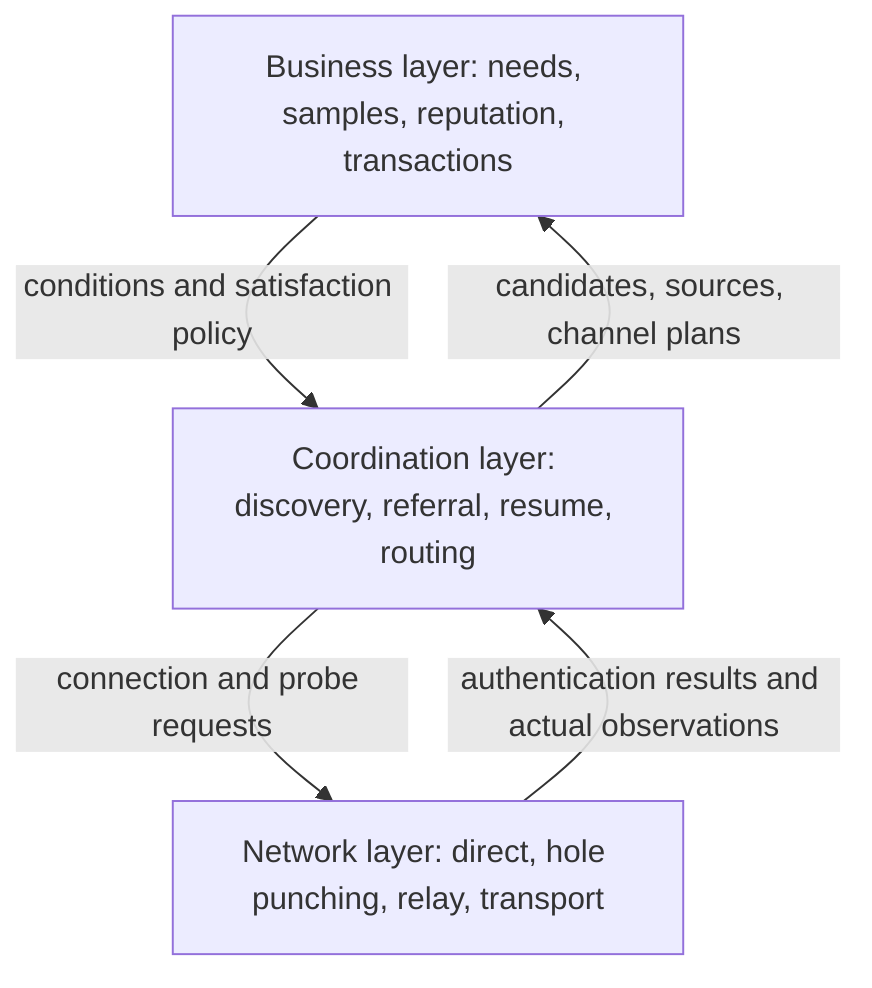

<!-- source: e536454831a2 -->
# A2N coordination layer rules

Version: v0.1 · established 2026-09-29, interface contract added 2026-09-30. Status: a rule design draft for development and acceptance. **Batch C0 of section 16 (contracts and stable identity) landed on 2026-10-01** (interfaces and signature primitives, see below); the remaining batches are still pre-implementation design.

The product direction confirmed in this round: every online node on the network shares the burden of public discovery; A can learn of C, D and E from B and explore level by level; the caller stops when it judges the result good enough and may keep going when it does not; channel information accumulates during discovery and improves later connections. The originator further specified: **discovery belongs to the coordination layer, between the network layer and the business layer.**

This document turns that direction into executable rules. "Must" and "must not" are constraints of this design; "recommended" marks implementation advice; numeric parameters and message fields are v0.1 proposals that need pilot validation. The new direction replaces the goal in older documents that "public discovery may be switched off at will"; the switches, interfaces and actual capabilities of older code are still recorded as they are. Business rules continue to follow [VISION.md](VISION.md): public benefit, zero transaction commission, reputation over evidence, and the first 10 calls forming a sample by default.

## 1. Goals and boundaries

The goal of the coordination layer is: **find supply that is good enough, whose information has a traceable source and whose usable channels exist, within an exploration cost the caller can bear, while keeping the ability to explore further.**

The coordination layer does not promise a complete catalogue of the network, the best goods on the network, or the shortest path on the network. The result of one search is the candidate set that this caller obtained under its information, budget and preferences at that moment.

### 1.1 Three layers of responsibility

| Layer | Responsible for | What it provides to its neighbours |
|---|---|---|
| Business layer | Goods description, pricing, free trials, samples, mutual reviews, reputation, acceptance conditions, acceptance and settlement | Public business summary; local filtering, ordering and satisfaction policy; final confirmation before starting a transaction |
| Coordination layer | Joining the network, node referral, level-by-level discovery, candidate verification and deduplication, pause and resume, leads for samples and review summaries, channel selection | Candidates with source and freshness; search progress; usable channel plans and their limits |
| Network layer | Connection, encryption and identity handshake, direct connection, hole punching, relay, transport, connection faults and measurements | Authenticated sessions; actual reachability; observations such as latency, errors and bytes consumed |

The business layer tells the coordination layer "what to look for, which conditions must hold, and when the result is good enough"; the coordination layer arranges queries and verification; the network layer performs connection and transport. Whether to call at all, and at what price to transact, is decided by the business layer.

Business confirmation may be automatic under prices, budgets and trust rules the user has authorised in advance; it does not require a human click or a signed document for every transaction. The coordination layer can only deliver candidates and channels; it may not expand authorisation or close a deal on its own.

The coordination layer must keep the following boundaries:

- It does not execute buyer tasks to test discovery, does not consume trial counts, does not change prices or free quotas, and does not take money.
- It does not write goods quality scores or buyer integrity scores, does not adjudicate transaction disputes, and does not record a successful network connection as a passed business acceptance.
- It may read and pass on published business summaries that carry a source, and may call local business policy to evaluate candidates; it must not execute code or evaluation policy supplied by an unfamiliar node.
- Discovery, browsing samples and probing paths do not create a transaction; a transaction is started explicitly by the business layer.
- The information version used by the discovery layer must correspond to the goods and channel that are actually about to be called; before the deal closes, the business layer confirms price, trial status, version and acceptance conditions again.

### 1.2 Three identities are stored separately

1. Node identity: `node_did`, identifying who published, forwarded or answered a piece of information.
2. Goods identity: `(provider_did, service_id)`, identifying which piece of supply is the responsibility of whom; changes to address, port, description, price and version must not change the goods identity by themselves.
3. Channel identity: `route_id`, identifying one connection plan to that goods; the same goods may have several channels.

The content hash of a Card distinguishes declarations; it is not the permanent identity of the goods. Several DIDs do not mean several independent natural persons. The goods version is declared by the supplier, and the coordination layer does not decide on its own that two versions are of equal quality.

## 2. Public duties of every online node

### 2.1 Minimum responsibilities

A node that participates online under the new coordination protocol must provide the following capabilities:

| Responsibility | Minimum requirement |
|---|---|
| Accept discovery requests | Handle bounded queries over an authenticated connection or a secure public entry point, returning an explicit result or status |
| Declare its own public supply | Return enabled goods leads that are allowed to be public; a node with no supply may still participate normally |
| Refer relevant nodes | Return records of relevant nodes it knows, that are still valid and that it is allowed to forward, stating the source and time of the information |
| Assist access | For an established neighbour connection that permits cooperation, forward small coordination messages aimed at an explicit target within quota; this is a baseline duty. Extra methods such as hole-punch assistance are declared according to actual capability |
| Manage caches | Deduplicate, mark as stale, cap size, keep the original publisher, and never pass forwarded information off as its own supply |
| Report honestly | Return explicit states such as rate-limited, busy, temporarily unreachable or unsupported |

A node in normal online state must not be configured to "use everyone else's discovery capability only and permanently refuse all public queries". A node may go offline, and may pause selling its own Agent; pausing sales does not switch off its online coordination duty.

These are rules for protocol participation; they cannot guarantee that arbitrarily modified software behaves honestly. For abnormal nodes, each node adjusts its connections and query choices based on observation; there is no central role that controls admission to or bans from the whole network.

### 2.2 Resource and privacy boundaries

Every node must enforce a local overall quota plus quotas split by connection and by identity. When resources are short it may return `BUSY` or `RATE_LIMITED` with a suggested retry time; reaching the local quota may pause cooperation, and no node is required to stay online forever or to contribute unbounded compute, bandwidth and storage.

While participating online, the public coordination budget must be positive, and fair scheduling must prevent a node from serving only its own local requests and starving neighbour requests indefinitely. Quotas must not be set to zero, and an open-ended `BUSY` must not replace protocol participation. Temporary refusal should come with a bounded retry time; a long-term effective response rate only affects how other nodes choose whom to cooperate with, and must not be used to deduct business reputation directly. When resources are genuinely exhausted, protecting the local node still comes first.

The mandatory discovery duty covers only public information and bounded coordination messages. Capabilities such as full task data relay, large-file caching and receipt witnessing declare their resource quotas separately; where actual fees are involved, the business layer must confirm before use. A2N does not charge for discovery, exposure or ranking.

Private accounts, credentials, wallet balances, task text, full inputs and outputs, private collections and complete connection history must not become public merely because the node participates in discovery. Public neighbour referral contains only forwardable node records; it does not disclose the node's full neighbour table.

## 3. Joining, internal nodes and leaving

1. First joining requires at least one entry point: local network discovery, a node address supplied by the user, or several independent bootstrap entries configured in advance.
2. The handshake confirms node identity, protocol version, the coordination operations it can provide, the message size limit and the connection method. Capability declarations must correspond to the authenticated identity.
3. After joining, further nodes are referred as needed, maintaining a neighbour set with a bounded size and sources spread as widely as possible; not every node ever discovered needs to stay connected at the same time.
4. When no connection can be made, show `ISOLATED`. Having no neighbours must not be explained as the market having no supply.
5. An internal node receives and answers coordination requests over a session it established itself. If a relay must be used, there must be a dedicated coordination message channel or a directory snapshot that carries a source; existing task relay capability must not automatically be treated as support for coordination requests.
6. Information about an internal node returned from a cache must be marked as cached and carry the observation time; it must not be passed off as the target being online in real time.
7. A normal exit may send an offline notice; an abnormal disconnection expires by timeout. Going offline does not clear business reputation, trial counts or goods history.

A bootstrap entry introduces participants; it has no authority over goods approval, ranking or final evaluation. Internal-network restrictions, device sleep and brief faults do not by themselves constitute business dishonesty.

## 4. Coordination information model

The table below is a logical model; field naming may be unified when the protocol is implemented, but the semantics must be preserved.

| Object | Minimum information | Constraints |
|---|---|---|
| Node record `NodeRecord` | DID, protocol version, contactable coordination endpoint or relay session description, supported operations, issue and expiry time, signature | Declared by the node itself; a third-party referral must retain the declarer |
| Referral `Referral` | Referrer DID, target node record and its hash, relevant capability, lead type, observation time, expiry time, referrer signature | The signature binds these fields; a second forwarding keeps the original declaration. It only means a lead is offered, and cannot establish that the target is online or that its service quality is acceptable |
| Supply lead `OfferHint` | Provider DID, stable service ID, capability tags, Card fetch reference, Card hash, source, time | A query lead only; a lead whose signature has not been verified does not enter the callable set |
| Verified supply `Candidate` | Stable goods key, verified Card, description, sample and review references, version information, verification state, source set | Several sources of the same goods are merged, keeping source differences and multiple channels |
| Channel `RouteDescriptor` | Target goods key, `channel_type`, channel Card or authorisation signed by the target side plus its hash, relevant relays, validity period | A referrer may not substitute the call URL of the target goods at will; the channel type must correspond to the actual transport protocol |
| Channel observation `RouteObservation` | Measurer, target, channel, time, probe method, round-trip time, success or failure, sample count | Distinguish local measurement, third-party reports and self-reports; a declaration must not impersonate a measurement |
| Search session `SearchSession` | Local conditions, policy version, visited state, pending queue, page cursor, candidates, budget, state | Held locally; the full search history and preferences are not required to be published |

A signature proves the source and integrity of a declaration; it does not guarantee that the capability, price or reputation summary in that declaration is true. A referral record cannot replace verification of the supplier's Card.

The lead type of a referral must distinguish "I observed this directly" from "I received this by forwarding". A self-signed record of the target node only proves that it published a declaration, not that the referrer actually connected to it; the referrer's signature also does not automatically prove that its observation is true. A reply used only within one authenticated session may have its source bound by the session; a referral that needs caching or further forwarding must retain an independently verifiable signature.

The direct Card and the relay Card of the same goods may have different hashes; the coordination layer should group by stable goods key and keep each verified channel binding. Old versus new is judged only when verifiable version rules exist; arrival order alone must not overwrite.

## 5. Discovery requests and local business policy

### 5.1 Local inputs

The business layer should provide the coordination layer with:

- The capabilities needed, plus necessary conditions that can be checked explicitly.
- Optional preferences: price range, language, format, sample requirements, reputation performance, delivery deadline and so on.
- Satisfaction policy: manual selection, or a local policy deciding that "the number or quality of acceptable candidates is sufficient".
- An exploration budget, and whether another round may run automatically; by default the search stops after one round.

Price, trial and payment availability are interpreted by the business layer. A missing price must not automatically be treated as free; a missing reputation must not automatically be treated as a bad review; missing information should be marked and may be fetched further.

### 5.2 Minimum outward disclosure

An outward discovery request contains by default only the capability identifier, the necessary coarse-grained conditions, page size, request identifier and validity period. The buyer's full requirement, prompts, exact budget ceiling, private preferences, account information and satisfaction policy stay local.

The business layer may allow extra public filter fields to be disclosed, but must not bypass the private data boundary for the sake of "easier searching". Samples are read on demand from previews that are already allowed to be public, and are not propagated in bulk with every discovery request.

## 6. Level-by-level discovery algorithm

### 6.1 The initiating node holds control of the search

A is the scheduler of this search. On receiving a query, B returns one page of candidates it knows plus referrals; **in v0.1 a query reply does not trigger B to spread the query downstream on its own.** A decides whom to ask next based on the reply.

If A needs to reach internal node C through B, A names C explicitly and B forwards that request over an established connection that permits cooperation, within quota. B does not copy one query to all its neighbours. Forwarding control messages still counts against resource limits and is kept separate from "B searches without limit on behalf of A".

### 6.2 One round of search

1. Create a local `search_id`, freeze the conditions and policy version for this round, and load valid caches and available entry points.
2. The pending queue selects a small number of nodes by relevance, source diversity, recent reachability and fair rotation.
3. Before sending each remote request, reserve this round's request and concurrency quota; send nothing when there is no quota left.
4. Receive one page of results, first validate size, format, freshness and identity, then store the leads.
5. Add verifiable new nodes to the pending queue; when several sources refer the same node, merge the sources to avoid repeated expansion.
6. Fetch the supplier's Card as needed, verify its signature and bind it to the stable goods identity. For candidates that pass the local initial screening, read the necessary public summary and probe the channel.
7. Business policy re-evaluates candidates and the satisfaction condition. If satisfied, stop dispatching new requests; otherwise continue within the remaining quota.
8. When any limit of time, requests, bytes or depth is reached, end this round, save a resumable position and return an explicit reason.

A stores only the limited local graph needed to complete this exploration; it is not required to synchronise the whole network topology. Referral depth is the number of lead-propagation levels; call hops are the number of relays an actual channel passes through; the two are recorded separately.

### 6.3 Deduplication and loop prevention

- Network requests are deduplicated over the short term by `request_id`; a repeated request gets the original response or an explicit statement that it was already handled.
- Node visits are recorded by `(node_did, query_fingerprint, snapshot_revision, page_cursor)`, so different pages may still be read; "I have seen this DID" alone must not skip its later pages.
- Pending nodes and source paths are deduplicated separately; a referral A→B→C→A does not expand A again.
- Goods are merged by `(provider_did, service_id)`; version, source and channel are stored separately.
- The risk of bypassing limits with many fake identities is still bounded by the per-connection, per-source and local overall quotas together; the number of DIDs must not be claimed to equal the number of independent participants.

### 6.4 Paging and breakpoints

Returned results must have a size limit. A page cursor binds the answering node, the request conditions, the snapshot version, the page size and the validity period; a cursor for a private session must also bind the requester. A cursor is a credential for continuing to read, not a business authorisation.

A should commit a page of data, the deduplication state and the next-page cursor together. After a crash and restart, requests that were reserved but whose dispatch cannot be confirmed are treated as consumed; a restart must not grant extra quota. Repeated reads do not increase the candidate count twice.

An expired cursor returns `CURSOR_EXPIRED`. A may re-read that node and recover progress through candidate deduplication; an invalid cursor must not be interpreted as that node having no supply.

## 7. Stopping, continuing and states

| State | Meaning | Next action |
|---|---|---|
| `CREATED` | Local session created, nothing dispatched yet | Start the search |
| `RUNNING` | Querying, verifying or probing | May pause or end |
| `SATISFIED` | Local business policy or the user considers the candidates sufficient | May use the results, or keep exploring |
| `PAUSED` | The user paused deliberately | Queue and candidates are saved; may continue |
| `BUDGET_REACHED` | Some quota for this round is exhausted | Show the quota used and partial results; another round may be added |
| `FRONTIER_EXHAUSTED` | The currently known, explorable queue is used up | Add entry points, adjust conditions, or refresh later |
| `ISOLATED` | No usable entry point | Join at least one node before starting |
| `CANCELLED` | This search ended explicitly | Keep the caches that were allowed to be saved; resuming needs a new session |
| `EXPIRED` | The session's retention period ended | Create a new search; valid caches may be reused |

`SATISFIED` is decided by A; B has no right to declare "good enough" on A's behalf. After the satisfaction condition is met, the unexplored queue is retained, and choosing to continue adds one round with an explicit budget; it will not secretly widen the price range, lower identity requirements or change the original business conditions.

Pausing and stopping first block new dispatch and attempt to cancel coordination requests that have not completed; the few responses already sent may enter storage within the remaining receive limit, but must not trigger new queries. Cancelling a search does not cancel any business task already created.

When capabilities or necessary conditions change, create a new condition version for the search and re-evaluate existing candidates; relevant caches may be reused, but the earlier screening conclusions must not be carried over directly. Multi-round searching by an automatic agent must have a total budget in advance and must not continue indefinitely just because the user is not interacting.

## 8. Candidate verification, samples and fairness

Each candidate displays the following states separately, rather than mixing them into one "trusted" badge:

1. Whether the source is verifiable; whether the publisher matches the goods identity.
2. Whether the Card is valid, whether it is expired, or whether there are conflicting declarations.
3. Whether samples and reviews are available, what their source is, and how many records they cover.
4. Whether a measured usable call channel currently exists.
5. Whether the buyer's local business conditions are met; which information is still unknown.

Many goods returned by one node must not automatically crowd out other sources. The search queue must keep cross-source rotation and opportunities to explore new nodes; the recommendation order is decided by local policy and is not allocated as a commercial ranking by relay contribution, payment for exposure or response packet size.

A new Agent without reviews is marked as having insufficient information, and may still enter the exploration set when it meets the necessary conditions. Records that are explicitly unusable or invalid do not enter the automatic call set, though the diagnostic reason may be kept. A business side may block nodes or goods on its own; the coordination layer must respect that.

Public samples are associated by stable goods and version, and only safe previews published by the business layer are fetched. No sample, a temporarily unreachable sample and redacted content must be expressed separately. Seeing only the review summary supplied by the seller does not allow inferring that it has no negative reviews.

The coordination layer does not change the rule that the first 10 free services form a sample by default, and does not count searching, probing or browsing samples as one of the free calls.

## 9. Channel discovery and optimisation

### 9.1 What a path means

A referral A→B→E means A learned of E through B; it does not follow that B can forward A's business task to E. A channel plan must have an explicit transport method, target authorisation, reachability and validity period.

The recommended initial support is two kinds of plan for the same goods: a direct Card signed by the supplier, and a relay Card signed by the supplier. Multi-relay chains are included only after every hop supports the protocol, authorisation, quota and end-to-end protection; known adjacency edges must not be pieced together at will into an executable channel.

### 9.2 Establishing and verifying

1. Treat the URL given by a referral as a lead. When fetching, restrict the target address class, protocol, redirects, response size, timeout and DNS resolution changes.
2. A referral supplied by a public node must not drive the local machine to access loopback, management ports or unauthorised internal addresses; local and LAN connections that the user configured explicitly keep a separate authorisation scope.
3. Verify that the channel is bound to the target's identity, goods and Card. A relay must verify that the target is registered or authorised, and must not accept a third party rewriting the URL at will.
4. Confirm the channel with a control probe or a safe metadata request that does not execute a business task. A successful TCP handshake alone must not be taken as the target protocol being usable.
5. NAT rendezvous, UDP hole punching success and HTTP/A2A task reachability are verified separately; a successful hole punch at the control layer must not be recorded as the business channel being open.

A successful `PROBE` on the coordination entry only proves that the coordination port responds. A business channel must be verified separately with a safe metadata operation or control operation of the corresponding protocol; if the protocol has no such operation, it should be marked as not yet verified, and a real task must not be executed automatically just to probe.

### 9.3 Selection rules

First exclude plans whose identity or authorisation does not match, that have expired, that are known to be unreachable, or that exceed the cost the business allows; then compare the remaining plans:

- Locally measured end-to-end round-trip time and its variation.
- Recent success rate, timeout rate, sample count and measurement time.
- Actual number of relays, available bandwidth and costs that have been stated.
- Business constraints of the request, such as deadlines or the need to transfer large files.

v0.1 recommends an explainable layered comparison first: satisfy the necessary conditions → compare stability where measurements are fresh enough → latency → cost and hop count. Insufficient samples are marked separately and probed in a limited way; the specific preference is configured by local policy.

A control probe cannot stand for Agent reasoning time, and the RTTs of several links must not simply be added up to pass as business end-to-end time. Third-party reports are used only to prioritise probing, and must not directly override local measurements.

After new leads are found, verify valuable candidate channels within the probe quota; update the local channel plan when a better one is confirmed. The result is called **the preferred channel under currently known, verified conditions**. When nothing improves, keep using the existing plan; no promise is made that every round shortens the path.

### 9.4 Switching and task safety

New tasks use the updated plan. A task already in execution is bound to its original identity, goods, task ID, authorisation and task control channel; discovering a better path does not migrate a running task automatically.

When a business task is created, persist the target goods key, the chosen Card and its hash, `channel_type`, the transport adapter or `route_name`, the local task ID and the remote task ID. The transport adapter must match the declared channel type; the same relay URL must not be retried under a direct-connection protocol at will; and task IDs of the same name in different local projections do not automatically constitute cross-channel idempotency.

If a connection failure is confirmed before the call is sent, another plan may be tried under equal authorisation and business conditions. If the request has already been sent and the outcome is unknown, the original task status must be queried first; it must not be executed a second time just to "take a faster road". The task control channel may be changed only when the protocol supports it and both idempotency of the same task and transfer of control are confirmed.

A signature, permission or protocol validation failure must not be bypassed by degrading to a channel with weaker identity checks. Search optimisation does not change the transaction price and does not trigger automatic payment.

## 10. Caching, freshness and stable identity

| Information | Caching principle |
|---|---|
| Node referral | Kept short term, with referrer and most recent observation time; after expiry it is only a lead awaiting refresh |
| Card | Keep signature and content hash; respect the publisher's validity period and apply a local refresh ceiling on top |
| Channel measurement | Valid short term; expires early after a connection is re-established, the network changes or failures repeat |
| Sample and review summary | Keep goods, version, source, update time and coverage; do not pass it off as the full history |
| No results found | Valid only for that source, those conditions and that time window; cached short term |
| Search session | Has a retention period and a total size limit; partial progress is kept, and connections and cursors are verified after a restart before continuing |

An address change updates only the channel; a description or price change updates the declaration; a version change keeps the old samples and the goods identity. The same goods across all sources may be merged; discovery must not create "a new seller without history" by re-importing.

For an old favourite that points at a dead address: first look for a new signed channel by stable identity and offer a refresh suggestion to the local projection; when none is found, show "the original channel is dead, no new channel found yet", and never quietly substitute a different seller of the same name.

## 11. Resource budget and suggested initial values

The quota must be computed centrally by A. Each sub-request may use only a part of the quota already allocated to it; the full budget must not be copied to several downstreams. The answering node still enforces its own local overall quota, and no remote signature can bypass local rate limiting.

**The values below are v0.1 pilot suggestions only; they must be configurable and their policy version recorded, and must not be treated as capacity already proven by measurement.**

| Parameter | Suggested initial value | On reaching it |
|---|---|---|
| Total time for one round | 5 seconds, including queries, Card fetches and active probes | Return partial results plus a way to continue |
| Total remote operations per round | 24, with connects, queries, Card fetches and probes all counted in a measurable quota | Stop dispatching |
| Concurrent remote operations | 3 | Queue |
| One coordination forwarding channel | At most 4 intermediate nodes recommended, each hop with an already verifiable cooperative connection | Return that this channel is unsupported; A may look for another entry |
| Initial referral depth | 3 levels; may be raised on continue, with a suggested per-session safety ceiling of 16 levels | Keep leads beyond the range |
| One page of referrals / supply leads | At most 8 / 10 respectively, also bounded by bytes | Use a cursor |
| One response / one round of received data | 64 KiB / 1 MiB; full sample attachments are fetched separately on demand | Abort the oversized read and record the reason |
| Pending queue / candidate set | 256 nodes / 256 goods | Rotate for diversity, evict duplicates and stale records, show truncation |
| Visit records per session | 1024 paged visit records | Require the session to end or an explicit new exploration |
| Concurrent active searches | 2 per local node, bounded by the local overall quota | Queue or refuse explicitly |
| Request rate per authenticated neighbour | 1 per second, with a short burst of 4 | `RATE_LIMITED` with backoff |
| Local coordination request rate | 8 per second, with a short burst of 16 | `BUSY` with backoff; tune against machine measurements before deployment |
| Local refresh ceiling for referrals / Cards | 5 minutes; expire earlier if the declaration expires first | Verify again |
| Channel measurement validity / failure backoff | 60 seconds / increasing from 5 seconds up to 60 seconds | Limited re-probing, no tight retries |
| Search session retention | 30 minutes | `EXPIRED`; valid caches may still be reused |

Signature verification, handshakes and invalid messages also consume resources, so the network entry point must limit message size and unauthenticated connections; rate limiting must not wait until a business query is reached. Service quota exhaustion and discovery failure should be counted separately.

## 12. Cooperation quality and business reputation

The coordination layer may record the query response rate, lead validity rate, expiry rate, rate-limit states and connection stability that it observes locally, in order to choose whom to ask next and which path to take.

These metrics must not directly add to or deduct from an Agent's delivery quality score or a buyer's payment reputation, and must not be exchanged for commercial exposure. A high-bandwidth node has no inherent privilege in goods ranking.

Behaviour such as a known forged identity, illegal address steering or persistently oversized messages may trigger local dropping, backoff, reduced referral weight or disconnection. Temporary offline status, being busy, insufficient samples and normal privacy restrictions are not directly classified as malicious.

A third party's report of bad behaviour is only a report with a source. A node should avoid blocking a target on the strength of a single report; restriction and recovery policies should be explainable, and normal performance after recovery can rebuild local trust. The system does not promise to eliminate sock puppets and collusion entirely.

## 13. Messages and interface conventions

The local ports, HTTP paths, field types, signature scope, idempotency, state concurrency and JSON examples that can be wired up are in [the coordination layer interface contract](COORDINATION-API.en.md). This document defines behavioural boundaries; the interface contract refines message formats. The signed public protocol, local sessions and channel plans were wired up on 2026-10-05; current parameters, concrete paths and the remaining acceptance scope are in [the full SDK architecture](SDK-ARCHITECTURE.en.md).

The logical operations below are mapped to a dedicated public coordination namespace and reuse node identity authentication; the local `/v1/runtime`, account and management interfaces do not serve as public discovery entry points.

| Operation | Request semantics | Response semantics |
|---|---|---|
| `HELLO` | Negotiate identity, version, supported operations and message limits | This node's capabilities, session parameters, or the reason for incompatibility |
| `FIND` | Query capability leads and related nodes, optionally with a page cursor | One page of candidates or referrals, snapshot version, cursor, truncation and limiting reason |
| `GET_CARD` | Fetch the public Card of a specific supplier, goods and declaration | The original signed Card, or an expired or unavailable state |
| `RESOLVE_ROUTES` | Fetch known channel declarations for the given identity and goods | Channel leads with source and validity period; real-time reachability is not promised |
| `PROBE` | Perform a bounded control probe against an explicit target | A verifiable response for local observation; must not execute a goods task |
| `FORWARD_COORD` | Forward a coordination message to one explicit and authorised target | The target's reply or the relay state; no automatic spreading |

Every request has its own `request_id`, protocol version, sender identity, validity period and type; the request identity is bound by a signature or by the authenticated session. A response binds the original request, the responder and the condition fingerprint. Forwardable Cards and node declarations must retain the publisher's signature; expired messages, pages for mismatched conditions and replayed messages must not advance the search state.

`FORWARD_COORD` must additionally bind `origin_did`, `target_did`, `parent_request_id`, the hash of the forwarded request, the ordered forwarding path chosen by A, the deadline, the response byte limit and the operation quota. Each forwarding has exactly one explicit next hop; one intermediate node is preferred, and a longer channel advances only along the limited path that A has verified and chosen explicitly. Each hop checks its own position in the path, the previous authenticated connection, the target authorisation, the deadline and the remaining quota; it must not add nodes, copy to other neighbours or create new downstream discovery queries on A's behalf.

Before dispatching, A reserves operation quota for target processing and for each forwarding along the path, and reserves bytes conservatively by path length; the original request fields stay bound by signature, and each hop records its own consumption separately. Every node still enforces its local quota, and no self-reported remaining budget can be trusted. Forwarding deduplication binds the original request, the target and the current position; responses return along the loop bound to the request, and expired or duplicate responses do not trigger a new search. An explicit forwarding chain and a recursive spreading query are two different operations.

Local pause and resume operations control only A's search session; an outward page cursor belongs only to the node that produced it. Local resume state must not be treated as an object that a remote side may modify at will.

Errors distinguish at least: `INVALID_REQUEST`, `UNSUPPORTED_VERSION`, `UNVERIFIED_IDENTITY`, `NO_MATCH_IN_SNAPSHOT`, `CURSOR_EXPIRED`, `RATE_LIMITED`, `BUSY`, `UNREACHABLE`, `RESPONSE_TOO_LARGE`. An error from one source does not erase the results already verified from other sources.

## 14. Local persistence and interface

The coordination layer stores at least: valid node records, public referral sources, candidates and their declared versions, channel descriptions and measurements, search breakpoints and quota used. Private business conditions and search history are stored under the node's local storage protection rules and do not enter the public directory.

The normal interface shows description, samples, business conditions and availability first. Coordination details are folded into expandable items; the actions the user needs to see are:

- "Found N candidates; M of them meet your conditions."
- "This round has ended; you can continue discovering." with an explanation of whether the budget ran out, the search was paused, a target was temporarily unreachable, or the current leads are exhausted.
- "Use current results", "Continue discovering", "Adjust conditions", "Stop".
- Information that affects the decision, such as unconfirmed reachability, unknown price or unavailable samples.

The diagnostic interface shows the number of nodes visited, source distribution, lead depth, errors, actual traffic and current channels. It must not claim "searched the whole network" or "best in the world", and must not present probe RTT as the delivery time of a finished product.

## 15. Current code locations and migration

As of writing, the existing foundation includes: neighbour identity handshake, bounded-hop queries, signed Cards, a verified Card cache, a public directory, partial route observations and an explicitly configured task relay. Level-by-level resumable search and the mandatory public coordination of these rules are not yet wired up.

| Current location | Future responsibility or adjustment |
|---|---|
| `a2n_p2p` | Keep connections, authentication messages, deduplication and rate limiting; provide coordination message transport under an explicit protocol |
| `a2n_node.p2p_service` | Wire referral, safe Card fetching and node verification into the coordination adapter; keep the address safety boundary |
| `a2n_node.public_directory` | Extend the fixed-entry query adapter into a coordination source that can page and return referrals |
| `a2n_sdk` | Define the coordination ports and the local session and candidate models, keeping zero a2n dependencies; local business policy is injected through the ports |
| `a2n_node` | Assemble coordination scheduling, identity signing, network adaptation, the public interface and the protected local control interface |
| Call transport adapter | Accept a verified channel plan and preserve the original task identity and idempotency control |
| Console | Candidate and sample display, condition setting, pause and resume, limits and unknown-state notices |

Establish clear interfaces first; there is no requirement to split out a new package first, nor to rewrite the whole network stack.

The migration must satisfy:

1. The new protocol explicitly declares the public discovery duty, and the upgrade notes tell online nodes that they will carry limited cooperative traffic; it must not silently open remote management or change task privacy.
2. The former "allowed as a public service" switch is split: basic discovery is enabled by joining the network; witnessing, task relay and large-file caching declare capability and quota separately. The existing switch must not simply be flipped to `true` as a whole.
3. Old nodes may keep providing their original protocol capabilities and are marked as compatible sources; they must not be claimed to satisfy the new protocol, and must not lose business reputation for being on an old version.
4. Existing goods, trials, samples, receipts and buyer favourites are retained; channel updates match by stable identity, and records whose ownership cannot be confirmed are not merged automatically.
5. Multi-hop discovery needs a new safe remote verification flow; the existing protection of "accept only directly connected neighbours' Cards" must not simply be deleted.
6. These rules supersede the former future product setting of "public discovery opt-in"; the description of the historical implementation is still kept as it is. The first 10 samples, mutual feedback and zero transaction commission do not change because of the migration.

## 16. Development batches

| Batch | Deliverable | Required dependencies |
|---|---|---|
| C0 Contracts and stable identity | Three-layer interfaces, stable goods key, node capability declaration, state and quota model | Goods identity fix; clear distinction between new and compatible nodes |
| C1 Level-by-level discovery | A holds the queue; B returns bounded referrals; safe verification; deduplicated paging; pause and resume | C0; existing usable connection transport |
| C2 Cooperation by all | Basic online discovery default and required; coordination message channel for internal nodes; rate limiting and backoff | C1; validation in real NAT scenarios |
| C3 Channel optimisation | Several channels per goods, safe local probing, expiry and preference, task channel constraints | C0; explicitly authorised direct and relay capability |
| C4 Business integration | Buyer-local satisfaction policy, description, sample and review summaries, continue-exploring experience | C1; R1 public samples; gradual integration once R2/R3 provide feedback and reputation data |

**C0 has landed (2026-10-01, `a2n_sdk.coordination` + `a2n_node.coord_identity`)**: three-layer ports (`CoordinationPort`/`LocalCandidatePolicy`/`CoordinationNetworkPort`), all public data shapes, the stable goods key (`CandidateKey.of_card`, reusing `stable_service_id`, so changing copy, version or address does not change identity), node capability declaration (basic discovery plus separable optional services), the state enum and the quota ledger `BudgetLedger` (a reservation is booked immediately, `probe` is a sub-quota, a restart does not reset it), node identity signing and verification for three kinds of object (NodeRecord / Referral / envelope, with domains `a2n-coord-node/1` / `a2n-coord-referral/1` / `a2n-coord/1`), and strict JSON parsing. Verification: `tests/test_coordination_contracts.py` + `tests/test_coordination_identity.py`. **Update 2026-10-05**: the runtime implementation of C1–C3 and the local quantity policy and resume console of C4 have landed; the specific limits and verification scope are in [SDK-ARCHITECTURE.en.md](SDK-ARCHITECTURE.en.md). Policy integration of sample quality and reputation conditions, and a real cross-internet pilot, are still pending later batches.

C1 can validate the algorithm on reachable nodes first; only after C2 passes may it be said that "all online nodes can take part in public coordination". Filling in the samples for R1 can proceed in parallel with C0/C1; searching should not have to wait for a complete reputation algorithm.

## 17. Acceptance rules

| ID | Scenario | Result that must be observed |
|---|---|---|
| A01 | A knows only B, and B can refer C/D/E | A can discover E within a sufficient budget, verify its goods and read public samples |
| A02 | B itself has no goods, or has paused sales | B still answers bounded coordination queries and clearly reports that it has no supply of its own |
| A03 | A has already found acceptable candidates | New dispatch stops; the queue is kept; continuing explores the unfinished part |
| A04 | A and another buyer have different local conditions | They may stop at different depths, and candidate ordering need not agree |
| A05 | A→B→C→A circular referrals, and several sources return the same goods | No unbounded spreading; one goods may keep several sources and channels |
| A06 | Several nodes each return many referrals | Total requests, bytes and concurrency all stay within A's per-round limits, with a truncation reason returned |
| A07 | Pause during paging, restart, cursor expires | Existing candidates are kept; nothing is counted twice; a restart does not reset quota already consumed; the source can be resumed or explicitly reopened |
| A08 | Internal C has no public listener and A needs to ask C | A gets a live reply through an authorised coordination session, or a clearly marked cache; task relay is not passed off as coordination capability |
| A09 | E is directly reachable, and A first learned of E through B | After verification A→E may be used; B going offline does not affect an established direct plan that is still valid |
| A10 | A route with fewer hops but congestion competes with a stable route with one more hop | Routing follows an explicit local policy, shows the measurements used, and keeps a fallback plan |
| A11 | A task times out after being sent, and another route is discovered | The original task status is queried first; changing route causes no duplicate execution or charge |
| A12 | B forges E's Card, gives a dangerous address or an expired lead | Invalid leads do not enter the callable set; unauthorised management or internal addresses are not accessed |
| A13 | The buyer's input contains private requirements, account information or an exact budget | These private contents do not appear in coordination requests or public caches |
| A14 | Repeated discovery, sample fetching and path probing | Free trial counts, sample counts, transaction records and fund state are unchanged by these operations |
| A15 | A new Agent has no reviews; a node has low bandwidth | Unknown and resource states are shown, reasonable exploration opportunities are kept, and goods reputation is not deducted automatically |
| A16 | No neighbours, one source fails, all known leads are used up | Isolated, source error and current-scope-exhausted are shown separately; no claim is made that the whole network has no supply |
| A17 | Description, version or price is changed, or the port is switched | The goods identity and history stay continuous; old and new Cards and channels correspond explicitly |
| A18 | Old nodes and new coordination nodes coexist | Capability differences are stated, compatible calls still work, and full support for the new protocol is not falsely reported |
| A19 | A channel with a bad signature and a fallback channel with weak authentication | An identity failure does not trigger automatic degradation that bypasses verification |
| A20 | A source tries to buy ranking advantage with many goods or high bandwidth | Queries still rotate across sources; network contribution does not enter the commercial reputation bonus |

Acceptance also records the successful path, the failure reason, the budget consumed and the network environments not yet covered. Results from in-process simulation, local containers and different public network environments are recorded separately and cannot substitute for one another.

## 18. References and design attribution

For level-by-level lookup and guided joining, see [libp2p's description of iterative DHT lookup](https://libp2p.io/docs/dht/); for internal connections, hole punching and bounded relay, see [libp2p Hole Punching](https://libp2p.io/docs/hole-punching/). These are technical references; they do not mean this project adopts their protocols, nor that these rules have passed interoperability tests.

The product positioning, mandatory cooperation scope, satisfaction and resume semantics, initial resource values and development batches in these rules are an A2N design proposed according to this round's user direction; parameters and fields may be adjusted during implementation, but implementation convenience must not be used to remove the caller's freedom of choice, the public discovery duty, the budget boundaries or stable identity.
