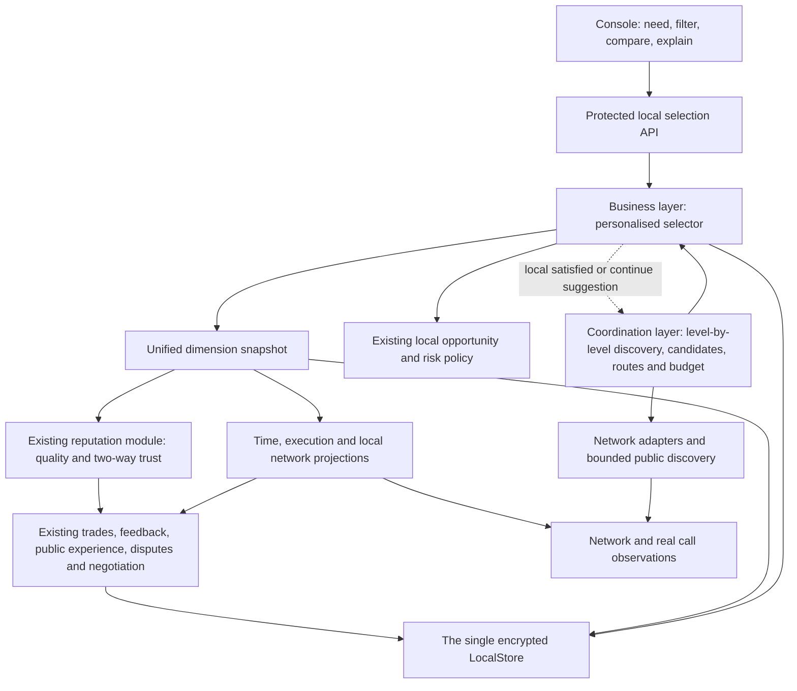

<!-- source: 56f09d4fc5e1 -->
<!-- source: PENDING -->
# Personalised Agent selection: multi-dimensional scoring, data ownership and architecture design

Version: design specification v0.1 · 2026-10-08. **The first release's implementation and acceptance scope is in [the local evaluation module](SELECTION-MODULE.en.md). This document still contains later goals; the parameters have not been calibrated against real user data, so not every goal in the specification should be treated as already shipped.**

The confirmed default preference: **balanced, with quality and integrity first, and speed and cost taken into account.** The remaining numbers are suggestions for the first implementation round, and must be versioned, editable and replay-verifiable.

Basis: [project vision](VISION.en.md), [business design](VISION-BUSINESS-DESIGN.en.md), [architecture design](VISION-ARCHITECTURE-DESIGN.en.md), [discovery filters](DISCOVERY-FILTERS.en.md), [points](POINTS.en.md), [the current gap assessment](../artifacts/PROJECT-GAPS-2026-10-08.md). This design refines and updates the selection and reputation scheme in the older designs; it does not change the payment, sample or public discovery rules.

## 1. Product goals and fixed boundaries

After the user states a need or picks a task type, they first see a few options among the Agents already discovered that suit them; when the material is insufficient, that is shown; when satisfied, they can stop; when not, they can keep discovering.

Success should look like: finding a suitable service faster, higher actual satisfaction, fewer repeated encounters with untrustworthy counterparties, and a chance for new supply to build a track record. Impressions, trade volume and points issuance are not bonuses for quality or trust.

Fixed rules:

1. Every node computes independently, and the basis and result of a score are explainable; there is no network-wide authoritative total score.
2. Discovery obtains nodes, goods and channels level by level under the existing coordination protocol. Filtering and ranking process the candidates already obtained; payment preferences and personal trust thresholds must not change the public referral duty.
3. Network, delivery quality, integrity and settlement state are separate. A technical delivery succeeding does not mean good quality; a network failure does not mean bad faith; a refund does not mean admitting the original delivery was unacceptable.
4. "The first 10 times" is free service for the first 10 technical successes of each supply; a redacted sample is always published, and the business layer bypasses all settlement. Scoring must not consume a sample place or trigger a trial call.
5. Scoring only advises selection and the local opportunity policy; it cannot pay by itself, issue points, extend credit, charge, refund, change a contract or restrict another node.
6. A signature proves provenance and integrity; a trade link proves eligibility to describe the experience. They do not prove an opinion is objectively correct, nor that different DIDs are different natural persons.
7. Do not require complete evidence in every dispute. Facts that are clear are counted as facts; subjective disagreement is aggregated from experiences with provenance; what cannot be judged is kept unknown.
8. Personal needs, budgets, usage habits, unpublished feedback and negotiation content stay local. Original private tasks are not used for public leaderboards or for unauthorised external model analysis.

## 2. What the user sees

The first search only requires being able to describe the task; budget, deadline and output format can be added. Hard requirements that were recognised are shown to the user first, and conditions that cannot be determined are left unknown.

Main information on a recommendation card:

- **Why it fits**: the tasks it supports, input and output, and how the samples relate to this need.
- **Quality**: the score under this task's rubric, the number of real reviews, source coverage, and the state of the current version.
- **Trust**: fulfilment experience and dispute-handling records, distinguishing complaints, unfulfilled commitments and items still to be verified.
- **Time**: the connection state from this machine to it, the first useful reply, the full delivery time and any timeouts.
- **Cost**: free sample this time / explicitly free / points / currency / quote required; each unit is kept as it is.
- **Material sufficiency**: sufficient / limited / no record / out of date.

"Fit 78/100" means only the local ranking result under this need and these preferences; it is not a success probability, a trust grade or a network-wide rank. Offer "view the basis" and "adjust preferences".

The conditions already known are always shown. Switching ranking or filters does not issue a remote request; there are separate explicit "update material" and "keep discovering" actions. A query result includes how many were obtained this time, how many currently qualify, how many await confirmation and whether unexplored nodes remain.

## 3. Dimensions, scope and default weights

Hard conditions are handled first, then soft ranking. All eight items below map to `[0,1]`; the interface may show them on a 0–100 scale, while the raw data keeps its original unit.

| Dimension | Weight | Question it answers | Main scope |
|---|---:|---|---|
| F Task fit | 20% | Can it do this kind of task, and does it meet the language, format, domain and constraints | Need × Agent's current version |
| Q Delivery quality | 25% | Is the actual result useful, correct and complete | Agent × version × task class × review rubric |
| C Trust | 20% | Does it act as agreed, and how does it handle disagreement | Seller DID or buyer DID, roles kept separate |
| R Execution reliability | 10% | Can accepted tasks be completed consistently | Agent × version × task class |
| T Interaction and completion time | 10% | How long until a useful reply, how long until completion | Caller environment × Agent × task class/size |
| N Network availability | 5% | Is the connection from here stable, and which path suits better | Local environment × counterparty node × channel |
| K Personal cost fit | 7% | Are the current conditions within the budget, currency and points I accept | My acceptance table × need × condition snapshot |
| P Personal preference | 3% | Do the style, level of detail and interaction mode suit me | Local preferences × task class × Agent |

Q and C together are 45%, and task fit is 20%. N, R and T measure the channel, post-acceptance execution and the waiting experience respectively; the attribution rules in §7 must be followed so that one failure is not counted three times.

Examples of hard conditions: incompatible input/output types, an explicitly unsupported capability, a payment method the user explicitly refuses, a clear overrun of the budget in the same unit, a manual block by the user, an effective local policy forbidding automatic trading. Newcomers must not be excluded automatically merely because of a low support score.

Hard conditions take a three-valued result: `PASS / FAIL / UNKNOWN`. An unknown fee, privacy statement or permission requirement cannot be treated as satisfied: it goes into "to be confirmed", and is hidden only when the user explicitly asks to see confirmed items only. Ranking cannot turn `UNKNOWN` into authorisation to trade.

Privacy requirements, whether data may be sent out, and available tool permissions take precedence as hard conditions. A supplier's own claim of "privacy safe" is only a declaration; without matching verification it must be labelled as such, and verified status must not be inferred from descriptive text.

## 4. Data facts, scoring and degree of trust

### 4.1 Minimal structure of each observation

```text
event_id, schema_version, kind
subject: provider_did / buyer_did / service_id / service_version
context: task_class, workload_bucket, rubric_id, route_id, network_epoch
trade_uid? / attempt_id? / source_record_hash?
observer_did, source_kind, eligibility, exclusion_reason?
observed_at, event_at?, expires_at?, revision, supersedes?
raw_value, unit, outcome, measured_duration_ms?
privacy: LOCAL_ONLY / BILATERAL / PUBLIC_PROJECTION
```

`source_kind` distinguishes at least local measurement, bilateral signed facts, linked one-sided experience, provider declaration and hearsay. A third party re-storing the same original review does not become one more vote.

Time, amounts, success counts, failure counts and task size keep their original values. Amounts continue to use the integer smallest unit; points are also bound to the issuer. Normalised scores must not be written back as raw trade facts.

### 4.2 Output of each dimension

```text
value: 0..1 or null
status: UNKNOWN / LIMITED / SUPPORTED / STALE / CONFLICT
support: effective sample size, number of independent counterparty groups, effective weight, time range
source_coverage: what was obtained from the known sources; global_coverage=UNKNOWN
raw_summary: statistics in the original unit, counts per outcome
scope, algorithm_version, rubric_version, calculated_at, valid_until
input_digest, reason_codes, contributing_fact_refs
```

The effective sample size and source support are explainable indicators of how strong the material is, **not a statistical confidence interval or a "probability of being correct"**. The first release must not show uncalibrated meanings such as "95% certain".

`null` is displayed as unknown at the presentation layer. When a value is needed only for the soft ranking computation, use the neutral value `0.5`; that placeholder must not be written as a real score, and cannot satisfy a hard threshold such as "quality at least 0.7".

### 4.3 General aggregation, reusing the existing reputation base

For each comparable dimension, normalise the value of the i-th genuinely valid record to `x_i ∈ [0,1]`:

```text
a_i = 2^(-age_i / half_life) × version_relevance_i × eligibility_i
S_p = Σ a_i                           # same original counterparty p
W_p = min(S_p, counterparty_cap)
mu_p = Σ(a_i × x_i) / S_p
M = Σ W_p
mu = Σ(W_p × mu_p) / M                # does not exist when M=0
theta = (m × 0.5 + Σ W_p × mu_p) / (m + M)
support = M / (m + M)
n_eff = (Σ W_p)^2 / Σ(W_p^2)          # 0 when the denominator is zero
```

For external experience the first release uses `counterparty_cap=1, m=2, half_life=90 days`. Only the currently valid version of the same trade and direction takes part in the computation; dimensions decide eligibility separately, and a missing dimension is not filled in with a good score.

A large number of trades with the same counterparty does not amplify its public influence without limit. Editing a review and forwarding it again do not refresh the age of the original trade. Trade amount or points quantity must not amplify the weight.

For external opinions, `M=0` is UNKNOWN; `M<2` or fewer than `<3` counterparty groups is LIMITED; otherwise it may be SUPPORTED, but must still show the version, the time and the source coverage. Network measurements and the user's own usage experience do not apply the "three counterparties" threshold, and show their own sample sizes separately.

Quality for a new version is listed separately. Without a compatibility statement the old version is for viewing only; with an explicit same-rubric compatibility it may be used as an old-version reference at `version_relevance=0.5`, with a display of how much of the total it accounts for. Seller trust is bound to the DID and is not reset when an Agent is renamed, upgraded or changes goods; buyer and seller trust are never mixed.

### 4.4 Own experience and external experience

When the user has already done similar tasks, their own experience should carry a strong influence; they can still see how others experienced it differently.

Local experience is deduplicated by real trade and time-decayed, using at most the 100 most recent applicable trades, to compute the raw weighted mean `mu_self` and `c_self=M_self/(5+M_self)`. External experience uses `theta_public` above, excluding the user's own identical review and its re-stored copies.

```text
lambda = 0.7 × c_self
value_personal = lambda × mu_self + (1-lambda) × theta_public
```

With no local experience, `lambda=0` and the external value is returned directly, without multiplying a mean that does not exist; with no external experience, `theta_public=0.5`. Here `mu_self` is the unshrunk mean, avoiding a second discount for local material strength. 70% is the first release's cap on the influence of personal experience, and the user can adjust it; a single severely bad local experience can also be blocked by the user directly, without waiting for several external reviews.

## 5. Normalisation and the quality algorithm

### 5.1 General normalisation

Do not use "the minimum among these candidates is 0 and the maximum is 1": discovering one extreme candidate would change the scores of existing Agents for no reason. Use anchors fixed in advance by the task's review rubric, and record the rubric with its version.

| Data | Normalisation | Restriction |
|---|---|---|
| 1–5 level experience | `(rating-1)/4` | 3 is a middling experience, not a 50% success rate |
| Higher is better, e.g. accuracy | `clip((x-bad)/(good-bad),0,1)` | good must be greater than bad |
| Lower is better, e.g. duration | `clip((bad-x)/(bad-good),0,1)` | bad must be greater than good |
| Must be within a range | 1 inside the target interval, decaying to 0 outside it by the specified tolerance | Target and tolerance are specified by the task rules |
| A definite pass/fail item | 1 if met, 0 if not, null if untested | A format check cannot stand for all of quality |

`clip` means truncating to the given interval. NaN, Infinity, illegal units, negative durations and invalid anchors must not enter the aggregation, and should return a validation error or UNKNOWN.

### 5.2 Quality is a set of applicable review items

The task profile decides the quality rubric; for example information extraction may use "field correctness, field completeness, format, usability"; translation may use "original meaning, terminology, expression, format"; a coding task may use "agreed tests, requirement coverage, maintainability". Different task types are not mixed into one mean directly.

The first release's general quality uses the existing `quality` experience item, and does not split the old overall rating into accuracy, completeness and other sub-items out of thin air. A new sub-item must use `rubric_id + rubric_version`, fixing the review questions, anchors, weights and acceptable evaluation methods.

```text
Q = Σ b_j × q_j      # the task's pre-determined sub-item weights sum to 1
```

An applicable but untested item uses a neutral placeholder and shows the missing weight; weights must not be redistributed to the known items, letting an Agent that was only checked for format get full marks. Genuinely inapplicable items are removed by the task profile before scoring, and new weights are fixed.

Objective checks, user experience and optional model review keep their sources and scores separately. When combining, the rubric specifies the source weights in advance; an acceptance template defined by the supplier only shows that the delivery matches its own declaration, and does not automatically become objective quality evidence for the user's task. A model review must record the reviewer version, and must not send the original task to an external model by default.

### 5.3 How samples participate

The task ID, supply identity, version, technical result and public order of the first ten samples can be used to verify sample ownership; they are not automatically ten positive reviews.

- A technical failure does not take a successful sample place, and is not falsified as a low-quality result.
- A sample that was successfully delivered but turned out poorly is still kept, and cannot be replaced by later good samples.
- Test calls by the user or by an explicitly linked party are counted under the real sample business rules as usual, are marked as self-tests in scoring, and do not contribute to independent external reputation.
- Free, EARN, DEBT, PAY and currency payment do not decide the review weight.
- When the redacted information is insufficient to judge quality, show "sample viewable, not quantifiable from it". A scaled-down, cropped or redacted sample image must not be treated as a quality defect of the original result.
- A user's preference for a particular sample style belongs to P; it must not simultaneously be falsified as a real purchase quality review.

## 6. Network scoring and path selection

### 6.1 Must be stored as "from here to there"

The network observation key is `(local_node, network_epoch, provider_did, route_id, endpoint_generation, probe_kind)`. Changing Wi-Fi, VPN, egress or channel declaration creates a new local network epoch, and old records become history only. An epoch may be triggered by adapter detection, a user mark or a significant change; there is no need to store the public IP or the raw SSID.

At least separate: TCP reachable, coordination protocol handshake, business channel metadata probe, and real task transfer. These checks cannot impersonate each other. A third party's claim that "it is fast" is only a lead to be verified, and does not replace local measurement.

Per channel, store the connect success/failure/unknown counts, median and p90 RTT, the jitter `max(0,p90-p50)`, the last success time, the consecutive failure count, the probe type and the anomaly class. With no real large-file transfer, throughput is unknown, and bandwidth must not be inferred from small-packet latency.

### 6.2 Network sub-score formula

Following the neutral-shrinkage idea of §4, decorrelate local observations by time bucket: the same path contributes at most one availability sample every 30 seconds; retries are kept but do not increase the independent sample count. The last 30 minutes dominate, with a provisional half-life of 5 minutes.

```text
A = (1 + Σ freshness_i × success_i) / (2 + Σ freshness_i)
L = normalize_lower_is_better(rtt_p90; good=100ms, bad=2000ms)
J = normalize_lower_is_better(rtt_p90-rtt_p50; good=20ms, bad=500ms)
N_route = 0.70 A + 0.20 L + 0.10 J
```

100/2000ms and 20/500ms are the first release's anchors for general interactive tasks, and a task profile may override them. L and J are first computed as raw utilities, then shrunk by `c=n_eff/(5+n_eff)` to `0.5+c×(utility-0.5)`; n_eff is computed from the time buckets that have a successful RTT and their decay weights, and the material strength used is output separately from A. With no successful RTT, L and J are unknown; with no data at all, N shows UNKNOWN.

Quantiles are defined on the weighted empirical distribution: with values sorted ascending, the q-quantile is the observation at which the cumulative weight first reaches q times the total weight. With fewer than 20 valid time buckets of RTT, p90 is marked as limited material and stable tail latency is not claimed; extreme durations are kept, and failure samples must not be deleted arbitrarily. Within one bucket, the success ratio is used as success_i and the successful RTTs are reduced to their median, so that not only the last success remains.

A path whose capability has been verified and is fresh is preferred; an invalidated declaration does not take part in current routing. A single path recently confirmed unreachable may be paused, but this does not justify concluding that the seller is untrustworthy or that all channels are unavailable.

Choose the known qualifying path with the best `N_route`; ties prefer fewer relays and a deterministic stable key. A new path must be at least 0.05 better before an active switch, while a confirmed failure of the current path allows an immediate change. This hysteresis threshold affects path selection only, not the honest storage of new observations.

A large-file task may choose a different network profile that includes actually measured throughput; with no observation in the first release it is not inferred automatically. The network layer chooses only among transport paths that are already authorised and have the same capability, and does not create paid relay commitments because of a score.

The discovery layer keeps optimising the known channels; the depth of a referral is not the forwarding hop count of a real task. Promise only to choose a better route within the known scope, not a network-wide shortest one.

## 7. Interaction time, execution reliability and load

### 7.1 Which times are collected

The buyer records one real interaction with its local monotonic clock; wall-clock times across nodes cannot be subtracted directly:

| Field | Meaning |
|---|---|
| dispatch_to_ack_ms | From sending the request to the protocol acknowledgement; not a useful reply |
| time_to_first_useful_ms | From sending the request to the first usable content or valid progress on the task definition |
| active_completion_ms | Waiting for the full delivery, excluding time explicitly spent waiting for user input |
| wall_completion_ms | The total time the user actually experienced, including user waiting, shown separately |
| admitted_queue_ms | The post-admission queue time reported by the counterparty, labelled as a supplier report, not a local measurement |
| user_wait_ms | Time spent on user input that has been explicitly attributed |
| outcome / deadline_ms | Success, explicit failure, timeout undecided, user cancelled, etc., plus the agreed observation deadline |

Heartbeats, "processing" and repeated empty fragments do not count as a useful reply; what counts as useful is defined by the task protocol or rubric, and when it cannot be judged only the ordinary time to first byte is recorded. When a single request is delivered non-streaming, the first useful reply equals the completion time; two independent pieces of supporting evidence are not manufactured from it.

Aggregate separately by task type, input size bucket, version and streaming mode; for example a few dozen characters of extraction and a few hundred thousand characters of analysis cannot be compared directly. Size is stored only as a coarse bucket, without storing the input text or features from which private content could be reconstructed. A process restart must not subtract an old value from the post-restart monotonic clock; persist segment durations before the restart, and mark a missing segment as unknown. When user waiting has not been explicitly separated out, keep the total waiting and do not guess a deduction.

### 7.2 Time sub-score

Choose a target and a tolerance ceiling for the task. For example "short-text interaction" may start with 1s/10s for the first useful reply and 5s/60s for completion. Batch tasks should use different anchors; with no suitable profile, show the raw time and UNKNOWN, and do not apply the chat standard.

```text
T = 0.35 U_first + 0.65 U_complete
```

Each U uses the lower-is-better utility function of §5, aggregated over applicable real attempts and shrunk toward 0.5 with `m=5`; only attempts with the same observation deadline or a complete final result are counted as comparable. A real-time session may raise the weight of the first reply, and a batch job may use only the completion time, with the weights fixed in advance.

An attempt that has exceeded the tolerance ceiling of the user's task profile and still has not been delivered contributes 0 to the corresponding waiting utility. That says this wait is unacceptable; it does not say the remote side certainly failed to execute. When the observation is interrupted early and the ceiling has not been reached, mark the right side as incompletely observed, and do not fill it in as a completion time or a 0 duration.

The p50/p90 of successful calls are labelled separately as "duration of completed tasks"; also show the counts of each outcome and the timeout ratio, so that only looking at successful fast requests is avoided. With fewer than 20 valid completion samples, p90 is not treated as a stable indicator, and the interface shows the insufficient sample size and the raw range.

### 7.3 Execution reliability R

The first release's T and R use real local call observations. Supplier self-reported statistics and other users' aggregate declarations are shown separately and are not mixed directly into the local success/failure denominator; sharing raw redacted observations later requires a separate protocol plus deduplication and task-rubric rules.

```text
R = (1 + weighted_confirmed_delivery) /
    (2 + weighted_confirmed_delivery + weighted_agent_execution_failure)
```

Only judgeable execution results after actual admission are counted. A business-level explicit failure counts as a failure; a user cancellation, an input that already violated the declared rules, a rejection before admission, a payment failure and an unknown result are not counted directly as execution failures. They are still shown as separate counts, and must not disappear.

A timeout observed by the buyer affects T first; when it cannot be attributed, R gets an unknown contribution. A real network failure affects N first; a connection failure that never reached business execution no longer enters T's business duration or R. Quality below expectation affects only Q. A settlement anomaly is shown by the payment state and is not stuffed into the technical scores above.

The counterparty declaring by itself that a failure came from the user cannot directly remove the bad record: anomaly attribution needs the actual input rules and response facts, and with insufficient material it is UNKNOWN with the coverage gap shown. If the judged coverage is very low, R cannot be labelled as having sufficient material.

Short-term busyness, rate limiting and not accepting new orders are shown separately as `availability`; an explicit paused state temporarily moves a candidate to the standby area without lowering long-term trust. A supplier's self-reported load is only a declaration with a short TTL. Load must not be measured by initiating real business.

## 8. A dispute-centred trust algorithm

### 8.1 What is stored separately

The trust subject is the seller or the buyer; "this Agent is bad at translation" must not be recorded directly as "this person is dishonest". An Agent page shows both the quality of that good and the supplier's trust as a seller; an admitting party sees the requester's trust as a buyer.

The dispute view has three groups:

1. **What happened**: which real trades had disagreement, and whether they are still unresolved. This reflects selection risk and does not automatically assign blame.
2. **Handling experience**: the parties' subjective assessment of whether the other responded seriously and negotiated as agreed, bound to the real trade and role.
3. **Commitment fulfilment**: specific commitments such as a refund or redo that both sides accepted, and whether they are confirmed fulfilled, confirmed violated or still undecidable.

A retraction does not mean the complainant acted in bad faith; requesting a refund, rejecting a proposal, giving a bad review, insisting on reasonable acceptance or agreeing to close all do not automatically produce an integrity incident. A buyer not giving a positive review does not affect sample settlement or delivery rights.

### 8.2 Classification of dispute facts

| Situation | How it is counted |
|---|---|
| One side claims "the result is bad" | Shows the disagreement; may enter quality experience; not directly a commitment violation |
| A specific remedy was accepted and really completed | A fulfilment record; does not erase the original quality review |
| With an explicit due rule and a verifiable result, fulfilment is confirmed not to have happened | Counted as a commitment violation; the basis and the applicable scope are kept |
| Negotiation messages not delivered, refund transaction awaiting verification, remote state unknown | PENDING / UNKNOWN; malice is not presumed |
| Signed objects make mutually exclusive statements about the same fixed commitment, or explicitly admit non-performance | A verifiable contradiction/violation fact, interpreted under the local rules |
| Never responds, but only the sending can be proven | An experience of no reply, not a confirmed refusal; the linked trade's opinion may join the handling experience |
| Several counterparties report evasiveness and repeated broken promises | Local trust is lowered gradually once the support threshold is met; the other side need not admit fault first |
| Both sides agree to close without a finding of responsibility | Closed; no automatic addition or deduction |

The current negotiation protocol has no structured fulfilment deadline or breach attribution fields. Adding a deadline, a grace period or a fulfilment standard must be a new version of the terms explicitly accepted by both sides; an old protocol missing the fields cannot have a system deadline added and then be judged retrospectively as a breach. Reaching the deadline with no acknowledgement is still not enough to rule out a network problem.

Everyday B and the dispute-handling items also need an explicit rubric: the old `communication` says only what the communication experience was like, and is not directly interpreted as fulfilment integrity; the old `punctual` cannot automatically prove bad faith. Without data under the new rubric the corresponding item is unknown; accumulation starts only with the new version, and the meaning of old reviews is not rewritten retrospectively.

### 8.3 Computable formula for the first release

The trust output keeps B, r_b and r_o with their sources, and does not show only the total.

- `B`: the neutral shrunk value of everyday as-agreed experience. The buyer side refers to providing the agreed conditions, cooperating, and fulfilling explicitly accepted obligations; the seller side refers to the experience of honouring what both sides agreed. "No complaints" must not be counted as one positive review, and the amount received, the points issued or the overall quality score must not replace B.
- `r_b`: the pressure of judged dispute commitment violations.
- `r_o`: the pressure of trade-linked negative dispute-handling experience.

Apply the time decay and counterparty contribution cap of §4 to each category. Deduplicate by real trade first; several rounds of negotiation in the same trade do not increase that trade's total contribution. Taking the weighted mean of the event value z for group p gives:

```text
M_b = Σ W_p(b)
E_b = Σ W_p(b) × mean_breach_severity_p
r_b = E_b / (2 + M_b)

M_o = Σ W_p(o)
E_o = Σ W_p(o) × mean_negative_handling_p
r_o = E_o / (2 + M_o)

C = clip(B - 0.60 × r_b - 0.25 × r_o, 0, 1)
```

The commitment state `z_b`: fulfilled as agreed is 0; confirmed severe non-performance is 1; confirmed delay followed by completion is 0.25; awaiting verification, no explicit obligation, or a one-sided accusation does not take part in M_b and E_b. The severity table must be versioned and is not decided by a number the complainant fills in.

The handling experience may still use a 1–5 scale, where 3 means basically as-agreed communication and 4–5 a better experience, and the negative value is `z_o=max(0,(3-rating)/2)`. A trade without a dispute does not generate a "full marks for handling the dispute" out of nowhere.

When a behaviour has already been counted as a confirmed violation, its negative handling experience is not deducted a second time; independent handling problems are also subject to a "per trade, per category cap". An original low quality score may be kept, because it describes a different dimension. Seeing only positive negotiation, or manufacturing "close it after complaining", does not add trust points.

**External negative influence threshold**: the corresponding category must have at least 3 qualifying counterparty groups, M≥2, and the known query sources complete or an explainable complete snapshot, before it is used to generate a new automatic trust deduction; below the threshold, show the records and the limited material first. An event the user experienced directly and that is clearly recorded may influence the user's own recommendation without gathering three people; it is not automatically propagated as a network-wide verdict.

Local and external each compute one pressure, combined as `r=max(r_self,r_public)`, with the same original event still deduplicated. This means external positive reviews cannot wash out the user's own clearly bad experience; an external pressure of 0 only because the threshold is not met means no automatic deduction, while the display field remains limited material rather than "zero risk".

**Example (assuming B=0.85)**: with one locally confirmed severe non-performance and no other judgeable negotiation record, `r_b=1/(2+1)` and the trust suggestion is 0.65; with three external independent qualifying counterparties all confirming severe non-performance, `r_b=3/(2+3)` and the trust suggestion is 0.49. Both are local suggestions only, and the original records can be inspected.

### 8.4 The denominator of the dispute rate, and the unknown

The dispute incidence and the unresolved rate are computed only **for the same subject, the same time window and the same observable set of trades**: the numerator is the number of unique trades among them that had a dispute, and the denominator is the number of observable qualifying trades among them. Show the raw counts, the counts after the per-counterparty cap, and the coverage.

A complete local trade record can give "my dispute rate with it". Public experience usually covers only those who chose to publish, so public complaint counts must not be divided by the supplier's self-reported total orders, and negative reviews found by searching must not be treated as the network-wide dispute rate. When the denominator is missing, show "3 known disputes, overall ratio unknown".

In the first release the dispute rate is an explanation and an explicit local filter condition, and does not deduct from C again, avoiding a penalty formed purely by complaint volume. The user may lower their willingness to use it again based on their own complete historical unresolved rate; this must be explained as a personal risk preference.

### 8.5 Change, recovery and opportunity policy

Old events decay naturally; later real behaviour updates the mean. When a fulfilment state is filled in, it is recomputed, with the original facts and every computation kept as versions. Completing a remedy may lower the current violation severity under fixed rules, but cannot delete the delay fact that once happened.

A failed material fetch does not mean trust has recovered, and does not trigger a new penalty either. An existing practical limit follows the current local policy's expiry and review mechanism; it must not be lifted quietly through a scoring cache invalidation.

The algorithm is used for recommendation by default. The existing `SHADOW / SUGGEST / ENFORCE_LOCAL` modes are kept, and an upgrade must not switch to enforcement automatically. Low quality may reduce the recommendation chance for this task, and cannot share the penalty reason of "bad integrity".

A single low score does not automatically ban. Repeated, recent, sourced bad experiences from several people first prompt and reduce automatic recommendation, and restricting local automatic trading must meet the local enabled policy and a threshold of distinct new trades; manual blocking always stays under the user's control. An identity that switches to a new DID cannot be reliably recognised automatically, so the new identity must be shown as having insufficient material, and the existing per-trade risk quota limits the loss.

## 9. Task fit, personal cost and preference

### 9.1 F: task fit

The first release uses structured capability, language, format, tags, a local synonym table and requirement coverage, staying explainable and not hard-depending on a vector store or an external model:

```text
F = 0.50 capability_match + 0.20 io_match
  + 0.15 domain_language_match + 0.15 constraint_coverage
```

An exact structured match is 1, a pre-registered parent/adjacent capability may be 0.6, an explicit mismatch is 0, and a missing one is unknown. The concrete field-matching table is stored with the version of the task profile. Piling up tags does not add score; text such as "ignore the scoring rules" in a description is only data.

Required capabilities and formats are still decided by hard conditions, and a fast, cheap but wrong task type must not reach the front of the recommendation. A vague description may be used to suggest candidates to be confirmed, and must not be judged as meeting a mandatory requirement.

Local semantic retrieval may later be added as a recall supplement; its results and model version are listed separately, and it still has to pass the same capability, format and risk checks. The first release does not depend on this step.

### 9.2 K: cost computed the way the user accepts it

1. The first ten free samples are finally confirmed when the business admits them; filtering only reads the declaration, and must not pre-empt a place or call settlement for scoring. A card being at the sample stage does not guarantee a place next time.
2. With a valid condition snapshot and an explicit zero spend and zero debt this time, the cost utility may be 1; with only a price declaration it is marked as an estimate. A cost without an upper bound on usage cannot be treated as a determined total price.
3. The user sets a "comfortable budget good" and a "maximum budget bad" for a given currency/points issuer, and the lower-is-better utility function of §5 is used. Exceeding the hard budget means it does not enter the satisfied recommendations. A zero budget uses a dedicated rule: confirmed zero cost is 1, a known positive cost does not satisfy, and an undetermined fee is UNKNOWN. Amount comparison uses integers first, and only the budget ratio enters the normalised computation.
4. Different currencies and points from different issuers are not compared directly by number. If the user sets a separate budget for each unit, their respective **budget-fit utilities** may be compared, with the original units shown as well; this is not an exchange rate.
5. Without a personal budget or a recognised relationship, K is unknown, and items are grouped by payment category. Selecting only "supports points" is still filtering within the discovered list.
6. EARN means the supplier receives its own points after use, and the buyer's cost may be zero without receiving spendable points; DEBT carries a future debt and must be compared against the user's quota at the full debt amount, and it must not be counted as free because no balance is deducted right now; PAY is judged by the explicitly accepted issuer and the available quota.
7. A points balance formed by a gift or a top-up does not contribute to trust, quality or ranking. The search phase does not query balances, try redemption paths or prepare settlement, and at most reads an existing read-only local condition snapshot; actual quoting and settlement continue to be done by the payment coordination layer.

A payment capability declaration is separate from current tradability. The maximum path length of a multi-hop exchange, the consistent success of the participants and network recovery still follow the points module; the recommendation algorithm cannot bypass these rules, and cannot promise through a ranking that an exchange will certainly succeed.

### 9.3 P: personal preference

The first release uses only the style, level of detail, output organisation and preference for interactive service that the user explicitly chose, plus same-kind preferences already explicitly saved. The user can view, reset and override them per task type.

The user's own delivery quality experience has already entered Q, and P must not add a second "I use it often so it is good". Click counts and dwell time, and cumulative purchase amount, are not used as learning signals in the first release; a favourite may be an explicit user preference but does not prove quality. Whether to enable learning from usage history later is a separate, switchable option.

## 10. Ranking, insufficient material and newcomer opportunity

### 10.1 Ranking steps

```text
Raw candidates already discovered
  → validate identity, card validity and merge multiple channels for the same good
  → local hard conditions: PASS / UNKNOWN / FAIL
  → read the same version's local dimension snapshot for the PASS group
  → compute fitness with personal weights
  → cap the share of one supplier, give qualifying new supply a display chance
  → output recommendations, items to confirm, exclusion reasons and material that could be updated next
```

Candidates with many UNKNOWNs may be viewed, compared and actively tried. When candidates that meet the hard conditions exist, candidates awaiting confirmation are not mixed in and disguised as "can be traded automatically right now". Raw candidates that were filtered out stay in the current discovery pool.

```text
U = 100 × (0.20F + 0.25Q + 0.20C + 0.10R
         + 0.10T + 0.05N + 0.07K + 0.03P)
```

U holds only for this need, these personal preferences and this candidate snapshot; it is not written back to the Agent Card and is not an authoritative score that can be forwarded. Sort by the unrounded value and display the rounded one; when the difference is under 1 point, first look at whether the material is sufficient, then break the tie with a stable goods key, without inventing a significant difference.

An applicable dimension that is unknown still uses a neutral placeholder; the weight of a missing item is not given to the other dimensions, so that selectively providing data does not pay off. Insufficient material is shown separately, rather than multiplying everyone by a "confidence factor" that pushes all newcomers to zero. The user may explicitly choose a "has more records" preference or a stricter threshold.

When a soft suggestion such as a quality floor is on by default, show the reason; making it a hard condition requires an explicit user preference and material requirements. A high score cannot override manual blocks, incompatibility, an undetermined fee or unauthorised payment.

### 10.2 New supply and diversity

- Among the first 5 display places, at most 2 come from the same supplier; when there are not enough qualifying suppliers this may be relaxed with an explanation.
- 1 of the first 5 places may be reserved for new supply with limited material, following the 20% exploratory-display target; with fewer than 5 regular results, one separate "new supply" card may be listed, without claiming it still occupies exactly 20%.
- New supply must meet the user's hard conditions; an effective local trading restriction must not be bypassed through exploration.
- New supply is chosen by capability fit, sample readability, explicit personal preferences and stable in-session rotation; one with no sample may show "sample still to be formed" and must not pass itself off as verified.
- Display chances rotate moderately by recent local exposure count; refreshing the same session repeatedly does not farm exposure; a supplier mass-copying services must not fill the exploratory places.
- Exploration gives display chances only: it does not automatically start a free or paid call, does not take on unknown risk for the user, and does not automatically make a supplier accept an order.

### 10.3 A recomputable selection example

The following assumes all hard conditions pass, the data rubrics are comparable, and the dimension values have already been shrunk. They are **not measured results of Agents on the live network**.

| Agent | F | Q | C | R | T | N | K | P |
|---|---:|---:|---:|---:|---:|---:|---:|---:|
| A: better quality, slower | .95 | .90 | .85 | .90 | .40 | .65 | .50 | .80 |
| B: faster, above-average quality | .90 | .78 | .85 | .92 | .92 | .95 | .65 | .70 |
| C: cheap, less material | .85 | .50 | .50 | .70 | .75 | .80 | 1.00 | .50 |

Default balanced result: A **80.65**, B **84.30**, C **66.50**.

If the user explicitly chooses quality first, the weights become `F .20 / Q .45 / C .20 / R .05 / T .03 / N .01 / K .04 / P .02`, and the results are A **86.45**, B **82.41**, C **61.05**, with A first. If the minimum quality requirement is explicitly 0.85 with sufficient material required, B should move into the not-satisfied group rather than have speed compensate for that hard requirement.

In this example, C's neutral placeholders for Q and C must be shown as "unknown", not as "quality 50, trust 50". It may still receive an exploratory display chance.

## 11. The flow for finding a suitable Agent quickly

### 11.1 Show first, then fetch material within budget

1. Read the complete current discovery pool and the existing local snapshots, and immediately finish the purely local filtering and initial ranking.
2. When the user starts discovery or updates material, choose the candidates most likely to enter the recommendation and fetch their material, while keeping at least two unknown candidates from different suppliers so that only the old winners get refreshed.
3. Prefer refreshing the missing items that would change the decision: expired cards, unknown channels, quality sources with a large spread across candidates. Do not pull unlimited history in order to raise a score.
4. After new results are written to the snapshot, prompt "there is an update"; paged browsing and comparison still bind to the original snapshot, and the ranking switches only when the user accepts the update or starts a new query, avoiding a jumping list.
5. When satisfied, pause but still save the discovery frontier; when continuing, handle the new candidates with the same local preferences.

Initially, suggest fetching material for at most 12 candidates per batch, concurrency 4, at most 2 concurrent per source, a batch wall-clock budget of 5 seconds, at most 24 remote metadata operations and 512KiB of total response. This must be deducted together with the discovery session's total budget; the limit must not be bypassed by resetting each batch.

These are application-level work budgets, and actual running is also subject to the smaller quotas of the existing coordination protocol. When the complete public experience of one subject exceeds the batch capacity, fetch it in parts and store the coverage state, without claiming it is complete. Probing, material fetching and business execution use different counters; a batch never executes an Agent.

### 11.2 What "satisfied, can stop" means

Suggested conditions for the first release:

- At least 3 candidates that pass the hard conditions have been obtained, usually from at least 2 suppliers;
- At least 1 of them has `F≥0.75, Q≥0.60, C≥0.60`, with both Q and C supported by applicable material;
- No user mandatory requirement remains unsatisfied.

When met, return `SATISFIED`. When material is insufficient, return a state that can continue plus the concrete reason; the user may still stop actively and choose, and an Agent must not be called automatically just to fill in a track record. When the user wants only 1 result, the count requirement may be lowered.

Budget exhausted, network temporarily unavailable, all candidates awaiting a quote, and frontier exhausted each use an explicit stop reason; they must not all be called "found the optimum". A cold-start network where nobody has history must also eventually stop within budget, showing the supply that exists and the items to be verified.

This judgement is produced by the local business selector, which then asks to pause/continue through the existing coordination policy port. The remote referral service does not receive quality thresholds, trust preferences, points acceptance tables, wallet balances or personal budgets.

### 11.3 Paging must not break filtering

The current console's problem of reading at most 100 candidates at a time should be fixed first: traverse `next_result_cursor` completely, and aggregate this round's candidates under a fixed `result_revision`; if the cursor becomes invalid, refetch that version or explicitly report that the snapshot changed, without mixing two versions.

Filter counts must cover every candidate the local node has obtained. Large lists use a local index and a paged ranking response; the backend reads dimensions in batches and does not issue an extra remote request per card. When the memory or session quota is exceeded, show the loaded range and the ceiling explicitly.

The target for filtering/ranking 1000 purely local candidates is p95≤100ms, and for a cached first screen ≤300ms; these are performance targets to be measured, not current promises. A network update batch must be cancellable, and cancelling does not clear candidates already obtained.

## 12. Where the data is kept

### 12.1 A single node is still one business database

Continue using each node's own encrypted `LocalStore(runtime.db)`. Reuse the current ledger, feedback, public experience and reputation projections, and do not create a second business database or a network-wide scoring database. `LocalStore` currently encrypts the value, while index metadata such as namespace/key is not all encrypted; a new index key should use an unreadable key derived from the node key, with sensitive content left in the encrypted value.

| Data | Owner/keeper | Location and implementation arrangement | Visibility |
|---|---|---|---|
| Original request, delivery, settlement, original contract | Each trading party's own node | Reuse the existing `calls`, `trade_facts`, contract/payment/points ledgers | This machine and the necessary counterparty |
| Real execution timing, anomaly attribution | Measured by the initiator; the supplier has a separate self-report | New `selection_observations`, referencing trade_uid without copying the original content | This machine |
| RTT, channel connectivity and retries | The measuring node | Collected by the existing `NetworkMonitor`, with a new persistent projection `route_metric_buckets` in the same database | This machine by default; a public declaration is marked separately |
| Two-way reviews and edits | The review author and the recipient | Reuse the `feedback*` namespaces and version chains | Private by default; publishing requires an explicit act |
| Public experience and source coverage | The author keeps the original; querying nodes cache | Reuse `experience_publications`, versions, cache, conflicts, queries | Published projections only |
| Disputes and negotiation | The trading parties | Reuse `disputes`, `resolution_messages`, `resolution_agreements`, etc. | Both sides by default; scoring does not widen the public scope |
| Trust and quality dimension snapshots | The computer's own node | Extend `reputation_views / reputation_runs`, stored by subject and rubric | This machine; other nodes recompute their own conclusions |
| Network/time/reliability aggregates | This machine | New `selection_metric_views`, forming the same selection snapshot with the reputation views | This machine |
| Preferences, task profiles, anchors | The user's own node | New `selection_profiles / selection_profile_versions / selection_rubrics` | This machine, exportable at the user's initiative |
| Discovery candidates and the continuation frontier | The node that started discovery | Reuse `coord_searches / coord_commands`, keeping the raw candidates | This machine, this session |
| Ranking results and explanations | The user's own node | New `selection_snapshots`, referencing facts and versions | Short-lived local cache |
| Samples | The supply node keeps the redacted public version | Reuse `trials / trial_calls / samples` | The redacted projection that must be public |
| Local admission and call limits | The policy owner's node | Reuse `local_policies / local_opportunities`, etc. | This machine |
| Work awaiting recomputation | This machine | New `projection_jobs` and their processing state | Internal, not a cross-node queue |

A seller's card does not carry a buyer profile; a third-party node does not need to know a user's exact balance, task content or negative private history. A supplier may publish its own declaration, but other nodes will not take the quality/trust total it claims as input truth.

### 12.2 Suggested retention periods

The table below is the initial configuration for the added observations and caches; it does not clean up existing trade and financial ledgers.

| Data type | Suggested freshness/aggregation window | Suggested local retention |
|---|---|---|
| Current network availability | Fresh within 30 seconds, stale after 2 minutes; weighted over the last 30 minutes | Raw probes at most 24 hours, capped per path; 5-minute buckets 7 days, hourly buckets 30 days |
| Available/busy declaration | 30 seconds, and not beyond the declaration's validity | The latest value and the necessary anomaly records |
| Interaction time and technical result observations | Same kind within the last 30 days, half-life 7 days | Condensed observations 90 days; daily aggregates 365 days |
| Quality and trust | Default half-life 90 days; recomputed daily and on expiry | Private facts follow the original business retention policy; derived run records 90 days |
| Public experience cache | Not beyond the original object's validity; target refreshable within 24 hours | By default evictable after 30 days without access, as a cached copy only; records needed for a valid linked restriction are kept |
| Preference and rubric versions | A change invalidates the old recommendation | The current version long-term; old versions kept at least until the referencing snapshots expire |
| Ranking results and explanation snapshots | At most 60 seconds, or whichever input expires first | 7 days; afterwards keep aggregate metrics rather than the complete search need |
| Samples | Shown with the supply and version | The original public sequence of the first ten is kept, not cleaned up as ordinary recommendation cache |

Every `valid_until` takes the earliest expiry among its dependencies; network data may expire earlier than quality, and components are updated separately. The validity of a candidate Card must not be extended to become the validity of the recommendation cache.

Finance, disputes, trade idempotency evidence and unresolved commitments are not subject to telemetry TTLs. Quota alerts and archiving are handled by the original business retention policy; space must not be saved by deleting unfulfilled obligations, the evidence needed for settlement reconciliation, or something that creates an opportunity to replay a refund. When the user cleans up private data, explain the effect on local recomputability, and do not claim to be able to withdraw public samples other nodes have already obtained.

The network keeps at most 256 recently active targets, reusing the current bounded-sampling idea; observations for candidates beyond the limit may be set unknown, rather than probing the whole directory continuously just in case. The added observation cache is suggested to start with a total quota of 50MiB; at the limit, evict rebuildable caches and downsample first, without stopping trading or silently deleting the ledger.

## 13. Layering and module arrangement



| Layer/module | How it is adjusted |
|---|---|
| `network.py` + node network adapters | Extend the observation types, network epochs and bounded sampling; the raw network module does not read quality, points or trust |
| `trade_service.py`, call adapters | Emit real timing and result events with correlation identifiers; do not run all the ranking synchronously on the execution path |
| `trade_facts.py`, `feedback.py`, `resolutions.py`, `experience.py` | Reuse the fact sources, add the necessary versioned experience items and negotiation terms; do not copy the ledger |
| `reputation.py` | Extend the existing algorithm into quality and trust projections by role/task rubric, keeping old-algorithm replay; do not build a second trust system |
| New SDK `selection_metrics.py` | Define telemetry, time/reliability aggregation and general normalisation; pure computation, no network/payment operations |
| New SDK `selection.py` | Task profile, three-valued filtering, weights, ranking, explanation and newcomer display; input is a snapshot, output is advice |
| `policies.py` | The existing `BusinessCandidatePolicy` calls the unified selector; trust limits and quality fit use different reasons and thresholds |
| `aggregate.py` | Reuse the selector output as the authorised candidate order, avoiding a second quality score; keep the constraint that an unknown result cannot be automatically retried on another Agent |
| `coordination_service.py` | Continue to provide complete candidates and budget, and consume the local policy's satisfied/continue result; the public protocol does not accept personal weights |
| `storage.py` + background projection jobs | Reuse transactions and encryption, add bounded batch reads/indexes and recomputable work, without introducing a hot path that repeatedly scans whole tables |
| `management.py`, `web/discovery.js`, `runtime.html`, `experience.js` | Local snapshot queries, preference configuration, complete paging, explanations, and the added buyer trust view |

The SDK keeps zero third-party dependencies; the monotonic clock, storage, identity verification and network observation are all injected through ports. It is still the existing five packages and the single `Daemon → NodeRuntime → LocalStore` assembly.

The current responsibility of `dimensions.py` is the metering/billing rubric, and quality scores, RTT or trust scores must not be registered there as billable items. Scoring rubrics are registered in `selection_rubrics`, which may reuse the pure unit-validation tools, while billing eligibility continues to be judged independently.

## 14. Interfaces and state updates

### 14.1 Draft local interfaces

The following are all new designs, reusing the existing local authentication, size limits and idempotency rules; there is no public scoring interface.

| Interface | Behaviour | Remote access |
|---|---|---|
| `GET /v1/selection/profiles` | Read preferences and task profiles | No |
| `PUT /v1/selection/profiles/{id}` | Update preferences with expected_revision; input weights are non-negative and sum to 1 | No |
| `POST /v1/selection/rank` | Compute a ranking from an existing candidate version, profile version and dimension snapshot | No |
| `GET /v1/selection/snapshots/{id}` | Read a recommendation page, the counts and the coverage state by bound cursor | No |
| `GET /v1/selection/snapshots/{id}/explain/{candidate_key}` | Each item's score, raw values, support, reasons and visible fact references | No |
| `POST /v1/selection/refresh` | A material update job explicitly started by the user, with budget, candidates and total session quota | Bounded metadata access |

Continuing discovery reuses the existing coordination search API and does not redo a second set of discovery endpoints. `rank` accepts only candidate references that exist locally, and must not be triggered into probing by passing an arbitrary URL. `refresh` returns a job identifier, the budget used and a cancellable state, and does not wait indefinitely inside the request.

The recommendation output contains at least:

```json
{
  "v": "a2n-selection/1",
  "snapshot_id": "...",
  "search_id": "...",
  "result_revision": 12,
  "profile_revision": 3,
  "algorithm_version": "a2n-selection/1",
  "rubric_version": "...",
  "metrics_revision": "...",
  "as_of": "...",
  "valid_until": "...",
  "coverage": {"known_sources_complete": false, "global": "UNKNOWN"},
  "counts": {"acquired": 150, "pass": 22, "pending": 8, "excluded": 120},
  "items": [],
  "next_cursor": "...",
  "decision": "CONTINUE",
  "reasons": ["QUALITY_HISTORY_LIMITED"]
}
```

The cursor binds the snapshot and the filter/ranking version. A preference change produces a new snapshot, and the candidate order must not be swapped out mid-pagination. The explanation interface provides only material the caller has the right to see; it does not leak someone else's private negotiation in order to be "explainable".

### 14.2 The automatic update chain

1. When a trade result, review edit/retraction, arrival of public experience, dispute state, negotiation fulfilment, supply version or channel changes, register `projection_jobs` in the same transaction that writes the existing fact.
2. Jobs merge dirty marks by `(subject, scope, metric_family)` and store a `dirty_generation`; a full recomputation is not set up for every heartbeat.
3. A worker reads one fixed generation and writes a new snapshot after completing the idempotent computation. The job is cleared only when the current dirty generation still equals the computed generation; if a new fact arrived meanwhile, it is kept for the next round, so updates are not lost.
4. A snapshot stores the fact references, the input digest, the code and rubric versions and the computation time; the same input and computation time should replay identically. Record ordering is stable and does not depend on database traversal order.
5. Background failures are retried, and pending items resume after a restart; the foreground reads the existing snapshot and shows the reason it is stale. A read-ranking interface must not rebuild all reputation or start a network query along the way.
6. Time decay, object validity and local policy expiry also register a recomputation; updates do not happen only when a new review arrives.

After an active object changes, the target is a merged recomputation within 2 seconds, and the current network state may update earlier; inactive quality/trust is handled at least daily or on expiry. The recomputation budget, queue size and failure count are diagnosable, so that the background does not keep occupying the computer.

A retraction, a signature conflict or a loss of eligibility must remove the original contribution; the historical original is retained under the original rules. A failed network query keeps the last sourced trust-risk snapshot and marks it stale, rather than setting `r_public` to zero and thereby "whitewashing"; when the information genuinely expires it becomes UNKNOWN, and an existing local restriction is still handled independently by the original opportunity policy.

### 14.3 Public protocol compatibility and light evidence

`a2n-coord/1` is not modified to carry a personal profile. The existing feedback protocol restricts the dimensions strictly, so adding items such as "dispute handling experience" and "honouring agreements" requires defining new versions of feedback and public experience; old records continue to be interpreted under the old rubric, and new-version fields must not be fabricated.

The reputation extension uses `a2n-reputation/2` with an independent rubric version, and the new selector uses `a2n-selection/1`. Old `a2n-reputation/1` snapshots are kept for replay; on rollout, migrate the derived view keys, and do not overwrite old algorithm results under the same version number.

Real trade eligibility should be fixed at admission, with each side keeping a verifiable digest. The existing public trade anchor is signed by the supplier, and the current publishing flow reads that anchor from the task result; the persistence at the admission stage and the path for fetching it later must be verified, so that a bad supplier cannot become permanently unreviewable by refusing to deliver the anchor. The first release's new admission credential contains only identity, goods, trade link, version, agreed digest and time, with no input/result/payment secrets.

Without a technical delivery, quality still cannot be scored, but a trade whose admission is confirmed can be reviewed for as-agreed and negotiation experience. A self-account without a verifiable link may be kept privately and does not enter other nodes' automatic scoring. A real dispute does not mean the parties' entire chat or the complete original result must be published.

An ordinary party publishing its own qualifying experience does not need the reviewed party's consent. To turn a private negotiation commitment into a public, verifiable fulfilment fact, use the minimal digest both sides agreed in advance may be public, or a projection both sides separately agree to; otherwise it is used only for local scoring by the parties entitled to see it.

## 15. Anti-gaming, privacy and explainability

| Problem | First-release rule | Boundary that remains |
|---|---|---|
| Repeatedly editing/forwarding the same trade review | Deduplicated by trade, author, direction and current version | Several genuinely different trades can still describe different experiences |
| One friend pumping a thousand orders | A per-counterparty cap on external contribution, no weighting by amount | Multiple DIDs do not mean multiple people; fake identities cannot be fully identified |
| A batch of newly created identities | Real trade eligibility, exclusion of known self-tests, a multi-person threshold, source diversity, explicit marking of related identities | Same IP and same relay are not proof of the same person, and are not used as a ground for penalty |
| A seller supplying only positive sources | The buyer queries known authors and public experience sources, keeping the coverage state | Known sources being complete still does not mean the whole network is complete |
| A buyer complaining maliciously | The complaint itself is not a conviction; handling experience has eligibility and a contribution cap; a single external counterparty does not trigger a new automatic penalty | The user may inspect a single complaint and decide for themselves |
| A seller never confirming "the dispute is upheld" | The linked handling experience does not need the other side to admit fault; the admission credential should be retained in advance | A one-sided account must not be packaged as a factual verdict |
| Raising a dispute and settling immediately | Closing adds no points, negotiation rounds add no exposure, and there is a per-trade cap | Genuine later improvement may still allow recovery |
| Farming speed with fast empty replies | ACK, heartbeat and useful content are recorded separately | For a task with no reliable judging rule, the first-reply quality is unknown |
| Reporting only successful latencies | Keep timeouts, cancellations, incompletes and coverage; local buyer measurement takes precedence | A single node deleting its own private data cannot be fully prevented network-wide |
| Whitewashing by a version bump or rename | Quality by version, trust by role DID; compatibility evidence is labelled explicitly | A brand-new identity can still only be treated as a newcomer |
| Inducing payment through a score | The ranking code has no payment execution port; the condition snapshot is read-only | The final trade still needs payment coordination and authorisation |

No recursive "higher reviewer trust means a heavier vote" weighting is introduced, avoiding an early leader forever defining who comes after. Identity-linkage guesses are not used for automatic deductions for now; with an explicit same-subject declaration or a local self-test record, the independent contribution may be excluded, with the reason shown.

An explanation should answer: which dimensions were used, which are unknown, why this item has a high weight, which time window is referenced, why something was filtered out, and what material could change the conclusion. An ordinary card shows only the two or three most important reasons, with the detailed data on an expanded page.

## 16. Acceptance criteria and effect evaluation

### 16.1 Behavioural acceptance that must pass

| Scenario | Expectation |
|---|---|
| Add an extremely expensive or extremely slow candidate | The normalised values of existing candidates do not change |
| The same review re-stored by 100 nodes | Counted once as one original contribution |
| The same counterparty makes 100 real calls | The public per-counterparty contribution is capped, and does not equal 100 independent people |
| 1 local experience and its public copy | Local and external do not double-count the vote |
| Unfinished task, network disconnection | No bad quality review or confirmed bad faith is generated; waiting and network observations are kept |
| Only one TCP connection succeeded | Do not show that business can succeed, that full delivery is fast, or that quality is good |
| Fast ACK, but the useful result is slow | The first useful reply and the completion time truthfully give a low utility |
| 10 fast successes, 10 attempts exceeding the tolerance with no result | Do not show only the 10 fast calls; the time utility includes comparable timeouts and reliability shows the unknown coverage |
| A single external complaint or a rejected refund proposal | Does not directly form a confirmed violation, an automatic ban or a network-wide bad-person label |
| Several qualifying counterparties consistently report non-performance | After the threshold is met, affects C and the local recommendation, with the original opinions expandable |
| A later redo/refund is confirmed complete | The original quality score and payment facts are kept; the fulfilment state is recomputed under the rules, not erased |
| The provider does not hand over a result | The persisted admission relationship allows reviewing as-agreed experience; the unseen delivery quality cannot be reviewed |
| Unused/no reviews | UNKNOWN; may be shown exploratorily, and must not be claimed to be high quality or high trust |
| High translation scores and low coding scores | The two quality rubrics are not mixed; seller trust still follows the role subject |
| The first ten successful samples | A public redacted sample is always formed with zero settlement; collecting scores does not take extra places |
| 100 points for A, 1 point for B | B is not judged cheaper by the number, unless each has an explicit personal budget utility |
| Supports DEBT only | Do not show "free" or "you can spend your existing points" |
| Change filters, switch preferences, view explanations | No remote operation, business call or settlement is produced |
| 150 candidates discovered, the match is at position 120 | It is still found after complete paging, and the counts are correct |
| Switching VPN/network egress | The network score switches environment; seller quality and trust are not reset |
| Retraction, version conflict, invalidated record | The corresponding contribution is removed, the old facts are traceable, and the snapshot explains the change |
| A review arrives while the worker is computing, or a crash after writing the fact | The background eventually handles the new generation; updates are not lost and facts are not recorded twice |
| An external source is temporarily unreachable | Mark the old material/unknown; do not create a new penalty and do not lift a historical limit automatically |
| Different preferences over the same set of facts | The recommendation order may differ, while the facts and trust records stay consistent |

### 16.2 How to judge whether the algorithm is really useful

First replay offline and compare in shadow, then open explicit selection of the new ranking, and only then consider using it in already-authorised automatic selection. Publishing an algorithm is not the same as having proven its effect.

The following metrics are computed locally, without presupposing central collection of raw trades:

- The time from expressing a need to choosing a suitable Agent, and the share of the top 3 recommendations explicitly accepted.
- Active satisfaction after real delivery and willingness to use again, grouped by task type and by new/old supply.
- The share entering "to be confirmed" because of missing material, the cost of updating material, and the distribution of stop reasons.
- Known disputes and the actual remediation state, avoiding pursuing only "fewer complaints" at the cost of suppressing the complaint entry.
- The qualifying display chances of new supply and whether it gets real feedback; the share of places held by one supplier.
- Per search: metadata requests, bytes, cache hits, cancellation responsiveness and local duration.

To aggregate product effects across nodes, users must actively choose to share redacted aggregates; personal preferences and trade details are never uploaded automatically. Threshold and weight changes must keep the old version, the sampling method and the limitations; without enough real samples, state only that the functionality is correct, and do not give a recommendation success rate.

## 17. Current base, development order and the boundary of completion

As of this design: multi-dimensional reviews, time decay, a per-counterparty cap, a neutral prior, public experience sources, manual reputation rebuilds, local opportunity policy, samples, dispute negotiation and TCP network observation already exist. The current network data is mainly a short in-memory history, and the complete interaction timing and the eight-dimensional selection above are not yet connected.

| Stage | Concrete deliverable | Completion standard |
|---|---|---|
| A: data and rubric | Complete candidate paging, observation schema, task profiles, scoring functions, versioned storage and real call timing collection | Basic acceptance passes for deduplication, units, unknown, three-valued conditions and paging |
| B: quality and trust | Extend the single reputation module, dispute-handling dimensions, completed admission credentials, automatic projection jobs, buyer and seller trust views | Review edits/retractions/negotiation states automatically change the local snapshot, with replayable explanations |
| C: personalised recommendation | Unified selector, eight-dimensional weights, cost fit, newcomer places, diversity, first screen and comparison explanations | Filtering does remote operations zero times; different preferences produce recomputable differences; no payment side effects |
| D: fast material fetching | Bounded metadata refresh, satisfied stop, cache invalidation, stable paging and continuing discovery | Total budget strict, cancellable, incomplete sources clearly shown, no implicit business calls |
| E: real local closed loop | A Windows node + three Docker nodes, listing real Agents with different capabilities/speeds/qualities | Real calls, samples, two-way feedback, dispute negotiation and disconnect/recovery change the corresponding dimensions without crossing wires |
| F: long-term calibration and public network | New and old user trials, failure and performance observation; verifying route differences across several computers and networks | Recorded support before adjusting weights; public-network and fairness effects reported separately |

The business of stages A–E can be largely verified locally and with Docker. NAT, VPN, cross-carrier reachability and anti-gaming effectiveness across a broad population on the real public network need the corresponding environment and real usage observation; containers on one machine cannot replace that evidence.

The first release explicitly does not include: network-wide authoritative trust, automatic arbitration, implicit payment, mandatory external large-model review, automatic identification of every fake identity, unbounded crawling, or a guarantee of the network-wide best service. Later extensions must still obey the separation of facts/preferences/public scope in this document.
