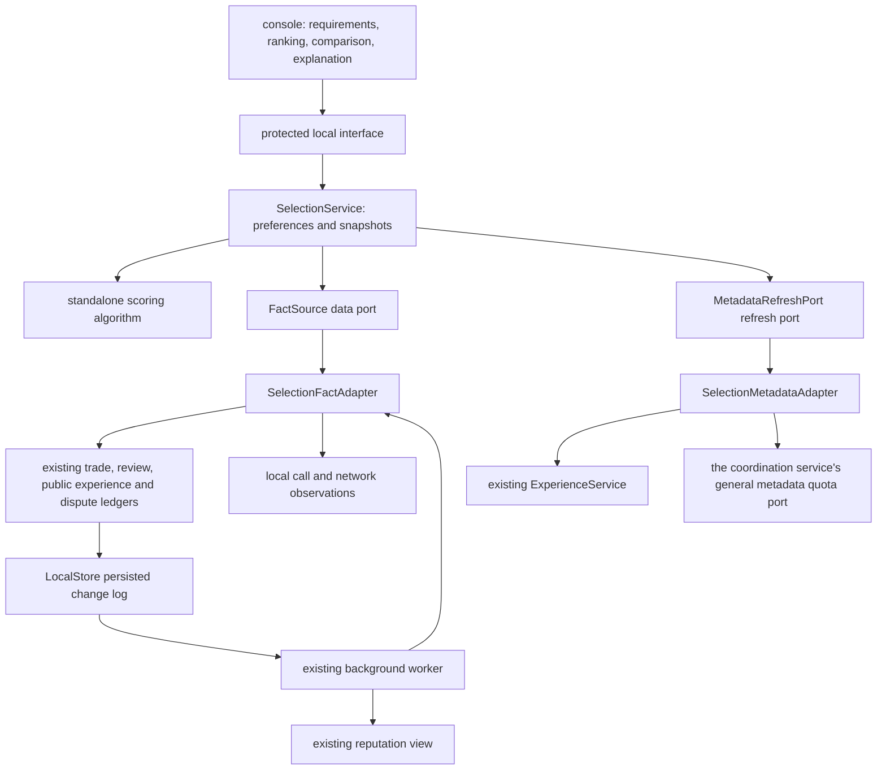

<!-- source: 28f409f74403 -->
# The local personalised evaluation module: implementation and interfaces

Version: `a2n-selection/1` · 2026-10-09.

Added private condition interpretation `POST /v1/selection/interpret`, selection binding `POST /v1/selection/choices` and actual outcome `GET /v1/selection/outcomes`. Natural language only gives deterministic hints; keyword matching, custom task categories and payment conditions are still handled in the display and evaluation layer after discovery. A selection may record the actual time from the start of this discovery to the confirmed choice; when an old session has no start time, it stays unknown. Outcomes are filled in from qualifying trades and local reviews, with human averages and assistant-acceptance averages counted separately.

This page describes what the current code implements and where its boundaries are. [The full business design](PERSONALIZED-AGENT-SELECTION.md) keeps the long-term goal; when the corresponding fact is not available, the current implementation explicitly returns unknown.

## 1. The business loop

1. Coordination discovery obtains signed candidates, referral relations and channels, and carries none of this machine's quality, credit or points preferences.
2. Local evaluation reads a fixed version of the candidates and the material this machine already has, checks the hard conditions first, then computes fitness.
3. The console shows candidates that meet the requirements, those awaiting confirmation and those that do not. Filtering never deletes the discovery pool; the user can display candidates that do not qualify.
4. Only when the user explicitly chooses to fetch more material does it query author-signed public experience. Refresh jobs and discovery share a quota.
5. After a call completes, local interaction observations are recorded separately; a valid review, an edited review, a public retraction and a dispute change enter the persisted refresh queue.
6. A background worker updates the existing reputation view and the local evaluation inputs. The ranking interface reads the existing inputs and shows how many items are still awaiting an update.

A recommendation does not execute an agent, does not consume one of the first ten free samples, creates no payment or points settlement, and never switches the local opportunity policy by itself.

The candidate-count stopping condition of discovery and the personal-fitness satisfaction condition are shown separately. With too little material you can fetch more, keep discovering, or deliberately choose an unknown candidate; there is no "I have searched the whole network" conclusion.

## 2. Module responsibilities and dependencies



| File | Responsibility | Allowed dependencies |
| --- | --- | --- |
| `selection/contracts.py` | data, storage, fact and material-refresh ports | standard library |
| `selection/metrics.py` | normalisation, de-duplication, decay, quality, credit, time and network computation | port data and the standard library |
| `selection/scoring.py` | hard conditions, the eight fitness dimensions, provider spread and newcomer exposure | a pure computation module |
| `selection/service.py` | local preference versions, immutable ranking snapshots, pagination, explanation | the pure computation above and injected ports |
| `selection_adapter.py` | converts existing ledgers and declarations into qualifying scoring facts | existing ledgers, coordination candidates, read-only opportunity state |
| `selection_refresh.py` | explicitly started public-experience refresh, job state, stopping | the existing experience query and the general quota port |
| `feedback_schema.py` | one definition of the review dimensions and their version | standard library |
| node `daemon.py` | assembles the ports and connects the existing background worker | the service implementations |

The scoring core imports nothing from networking, payment, points, disputes, node identity or a database implementation. An automatic dependency check limits what it may import. The payment submodules do not import the evaluation module.

The review ledger stores opinions only; public experience stores the opinions an author chose to publish; the existing reputation module stores public aggregates; the selector stores the derived recommendation for this machine's current need. They share one set of review originals and one dimension catalogue, and add no second trade, credit-issuance or financial ledger.

## 3. The algorithm and what the material means

Default weights: match 20%, quality 25%, credit 20%, reliability 10%, interaction time 10%, network 5%, cost 7%, personal preference 3%. The user may adjust them, and they must total 100%.

Each output carries `value`, `status`, the amount of support, the raw unit, the reason and a record fingerprint. The status is sufficient material, limited material, no record yet, stale material or conflicting material. An unknown value takes a neutral position in ranking, but the number in the interface stays `null`, and a minimum-score requirement cannot be counted as met from it.

| Dimension | Current facts and rules |
| --- | --- |
| Match | capability, input and output formats, tags, language declaration; a declaration matching is not a delivery guarantee |
| Quality | valid reviews of delivered trades, 1–5 normalised to 0–1; grouped by offering version and by known local task capability; personal experience may influence a personal recommendation |
| Credit | reviews that honour agreements, qualifying evidence of keeping promises, dispute-handling experience; the dispute count is shown separately and does not directly deduct points |
| Reliability | confirmed deliveries and failures attributable to the agent; an uncertain network outcome stays unknown and is not passed off as a failure |
| Interaction time | total wait measured on the local monotonic clock, bucketed by version, capability and input size; unknown and timeout are kept, and a complete span after recovery is never invented |
| Network | entry reachability, RTT and jitter from the current local observation window; 30-second buckets are de-correlated, and TCP reachability is not treated as task success |
| Cost | within one currency or one points issuer, computed from the personal ideal and the maximum budget; EARN, DEBT and PAY are distinguished and no cross-issuer rate is inferred |
| Personal preference | the output style the user explicitly chose; with no declaration or preference it stays unknown |

Normalisation uses fixed anchors, so adding one extreme candidate does not change the other candidates' scores. External opinions are de-duplicated by trade and author, the latest valid version is used, the original trade time is kept, and one author's total contribution is capped; different DIDs are not proven independent people.

Overall quality follows the original review, and an old review is not reinterpreted as accuracy or completeness. A multi-capability service without a task-level measure is marked as limited material. On 2026-10-09 [task-level review and local calibration](TASK-QUALITY-CALIBRATION.md) was added: when a rubric is named, reviews for the same offering version, capability, category and size are read through a separate read-only port. With no such record it returns unknown, never passing an overall score off as a sub-item and never quietly calling an external model.

### Disputes inside credit

- A low quality score does not automatically become a low credit score, and an old "communication" or "clear requirements" review does not automatically become "honours agreements".
- Only a recorded dispute allows filling in "dispute-handling experience" locally; merely complaining, closing or withdrawing a dispute produces no credit reward and no confirmed breach.
- Subjective handling experience is kept apart from a confirmed breach of promise. A confirmed breach already counted in the same trade is not deducted twice through a handling review of the same behaviour.
- A negative handling review from a single external author cannot trigger qualifying external negative pressure; it needs at least three counterparty groups, enough valid quality and completed source coverage.
- When a source is temporarily unreachable, only negative originals that already qualified in the last completed query, are still valid, not retracted and not conflicting are kept. Newly obtained incomplete opinions cannot borrow old coverage as proof.
- A real retraction, a conflict or an expired cache removes the corresponding contribution; keeping and expiring an opportunity limit is still managed by the original policy module.

By default, showing the top five limits how many slots one provider takes and reserves exploration room for new supply; exploration never crosses a hard condition or an explicit local block. Slots are only backfilled when there are not enough distinct providers.

## 4. Hard conditions and estimation

Supported: capability, input and output formats, payment method, points mode, provider, version, minimum quality, minimum credit, material-support requirements, and multi-currency / multi-issuer budgets.

Several options in one condition group mean any one of them is accepted, while different groups must all hold. The requirements of this task and the saved personal requirements are both checked. Every condition returns `PASS / UNKNOWN / FAIL`.

The current cost comes from a signed declared per-call estimate or from the points terms. With no usage, issuer budget or payment terms it stays unknown. An EARN consumer cost is kept apart from DEBT/PAY; after choosing PAY it does not pass the budget using EARN's zero cost. A non-zero money cost and a points condition can be shown separately; a zero money price on a points service is not automatically treated as free.

An estimate in a recommendation authorises no deal. Before the call the existing payment coordination layer still fixes the actual quote, trial eligibility, debt, acceptance terms and settlement plan. The first ten samples bypass all settlement through the business layer.

## 5. Data and recovery

All new private data stays in this node's existing encrypted `LocalStore`.

| Namespace | Data | Public? |
| --- | --- | --- |
| `selection_profiles`, `selection_profile_versions` | preferences and their historical versions | no |
| `execution_observations` | measured wait, capability, coarse input size, source and completion state | no; input text is not stored |
| `store_changes` | a general change sequence number and object reference, written in the transaction of the original object | no; no body text is stored |
| `selection_projection`, `projection_jobs` | consumption position and the generation awaiting update | no |
| `selection_inputs` | derived facts from qualifying originals | no; the subject index uses a secret local HMAC |
| `selection_snapshots`, `selection_snapshot_sizes` | recommendations and explanations for fixed inputs | no |
| `selection_refresh_jobs`, `selection_refresh_commands` | bounded material jobs and idempotent references | no |
| the original review, public experience and reputation namespaces | reuse the original ledgers | only an explicitly published experience object is served outwards |

Call requests, private reasons, credentials and settlement authorisations never enter the scoring input or an explanation. At most 64 source fingerprints are returned, together with the total and a truncated flag.

The background change flow: the original object and the change sequence number are written in one transaction → the cursor and a durable job are updated → the worker computes a fixed generation → derived material is saved → the job is cleared only if the generation is still the same. On failure the job stays; after a restart it resumes, and at startup the derived views of existing facts are rebuilt. Deadlines and decay are checked periodically even with no business event.

Network records use only the observation window since startup or since a manual reset. When a VPN, an egress or the connectivity environment changes, the old window can be cleared in the console. The first version does not claim to detect every change of network environment automatically and accurately.

A snapshot is valid for at most 30 seconds, or until an input expiry that comes first; pagination within one snapshot never changes the ordering quietly. At most 7 days, 128 snapshots and 50 MiB are kept, with at most 16 MiB per snapshot; exceeding the cache limit only evicts rebuildable recommendations and never deletes trades, financial records, disputes or samples. That quota governs recommendation snapshots only and makes no claim to cover every historical ledger.

## 6. Local API

Every interface reuses local management authentication; the public entry point cannot reach it.

| Interface | Behaviour | Remote access |
| --- | --- | --- |
| `GET /v1/selection/profiles` | list preferences | none |
| `GET /v1/selection/profiles/{id}` | preference and versions | none |
| `PUT /v1/selection/profiles/{id}` | update, requiring `If-Match`; an old-version conflict returns 409 | none |
| `POST /v1/selection/profiles/{id}` | a local compatibility entry point for the same update, with `expected_revision` in the body | none |
| `POST /v1/selection/rank` | build a snapshot from existing discovery references | none |
| `GET /v1/selection/snapshots/{id}` | paginate a fixed snapshot, with the cursor bound to the input fingerprint and page size | none |
| `GET /v1/selection/snapshots/{id}/explain/{candidate_key}` | the basis for this recommendation | none |
| `GET /v1/selection/subjects` | local credit material for an offering, provider or consumer | none |
| `POST /v1/selection/refresh` | an explicit public-experience refresh, returning a job reference; requires `If-Match` and `Idempotency-Key` | bounded |
| `GET /v1/selection/refresh/{id}` | the job and its quota usage | none |
| `POST /v1/selection/refresh/{id}/cancel` | stop further requests; a single item already sent may finish | no new access |
| `POST /v1/selection/network-context/reset` | retire observations from earlier network windows | none |

Example ranking request:

```json
{"search_id":"existing-search-id","result_revision":3,"profile_id":"balanced","task":{"workload_bucket":"small","output_mode":"application/json"},"limit":100}
```

A material refresh may pick at most two verified candidates from this discovery and reads service quality and provider credit separately. Per session it reserves at most 24 metadata operations, 512 KiB and 5 seconds of wall clock; it must also have both a round and a total discovery quota left. Quota is reserved before a request is sent, a failure, cancellation or restart does not return the reservation, and retrying or resuming may not reset the cumulative material cap.

The actual network work is done by the existing experience querier: at most four query jobs, two worker threads and at most two pages per source, with all sub-queries sharing the batch deadline. A source that is known but not read because of the source-count limit counts as incomplete coverage and cannot be passed off as "every known source was queried". Material completeness describes only the sources known in this round; completeness across the whole network stays unknown.

## 7. Review compatibility

- The old `a2n-feedback/1` and `a2n-public-feedback/1` are read with their original meaning.
- Using "honours agreements" or "dispute-handling experience" produces version 2; the original dimensions, signature digest, trade anchor, revision and retraction chain reuse the existing structures.
- Private feedback and a public short review continue to be stored separately; publishing needs an explicit choice by the user.
- Reputation outputs the algorithm version per actual dimension; existing historical calculation records are kept. Local evaluation uses its own requirement-scoped version and overwrites neither the original scores nor the financial facts.

## 8. What has been verified, and current limits

Verification material:

- `artifacts/selection-regression-2026-10-08.xml`: a full regression of 638 items passed.
- `artifacts/selection-boundaries-2026-10-09.xml`: evaluation, review, reputation policy, discovery and dependency-boundary tests after the closing changes.
- `artifacts/selection-runtime-2026-10-09.xml`: 72 call and evaluation tests; `selection-final-2026-10-09.xml`: the final 62 module and full SDK startup tests, all passing.
- `artifacts/selection-acceptance-2026-10-08.json`: acceptance with one Windows node, three separate Docker nodes and a real text-analysis agent.
- `artifacts/selection-console-2026-10-08.json`: preferences, ranking, explanation, pending confirmation and two-sided credit inspection verified in a real Chrome.
- `artifacts/selection-bundled-doctor-2026-10-09.json`: the new single-file Windows installer passed self-checks of the five product packages, the evaluation module and the underlying runtime.
- `artifacts/selection-rollout-2026-10-09.json`: an existing Windows node and three resident Docker nodes upgraded, with the original identity and historical calls, samples, reviews, disputes and points records checked.
- `artifacts/selection-installed-2026-10-09.json`: 30 business checks passed; those four actually installed nodes completed 12 text-service calls, the fixed public samples for the first ten, version-2 reviews from both sides, an automatic review edit, cross-node review signature verification and derived updates, the cumulative material quota, and recovery after restart.
- `artifacts/selection-installed-console-2026-10-09.json`: eight-dimension preferences, score explanation, read-only ranking and browser error checks in the real console of the new installer.
- `artifacts/selection-upgrade-tests-2026-10-09.xml`: 16 signed-upgrade and concurrent desktop-launch regressions passed.

Verified: ranking does not call again or consume a sample, a review edit only updates the current contribution, a public retraction removes the external contribution, a complaint does not directly establish bad faith, stopping and restarting keep the state, snapshot pagination is stable, an unauthenticated request is rejected, and read-only ranking touches no remote interface.

The bounded check of a task rubric, the manual sub-item review and the local calibration of actual experience are wired in, and the defaults are kept when real material is insufficient. The eight initial weights, the shrinkage strength and the credit thresholds are not claimed to be calibrated. Independent execution verification of arbitrary code, model semantic review, the exact first useful chunk of a stream, objective cross-task benchmarks and real cross-network behaviour cannot yet be replaced by the current controlled acceptance. A metric without the corresponding fact returns unknown or limited support, honestly.

On 2026-10-09 the existing development environment was upgraded to this implementation: Windows uses the original `data/desktop-sdk` directory, actually running the new complete `A2N.exe`, with the local entry point at `http://127.0.0.1:8771/console`; the three resident Docker nodes keep their original data volumes, encryption keys, ports and coordination network settings. The original identity of all four nodes is unchanged, the existing business records were checked, and the original default preferences and reputation policy are preserved. The earlier temporary-node acceptance and this resident-node acceptance keep separate reports.

The Windows update went through the existing signed-upgrade flow: this node's identity signs this local maintenance build, the program is switched after a backup, the digest of the actually running file is checked, and the installation is then recorded as successful. This is a locally self-signed maintenance record and does not mean a public publisher trust system or OS code signing has been established. The old installer and the encrypted backup are kept; the automatically generated backup recovery passphrase is sealed with the Windows encryptor in the original node's `backups` directory and appears in neither the acceptance report nor the log. The current-user login entry point now targets the new installer; the existing protected scheduled task still hands over to the installer by reading `installation.json`.

The Docker image version is `a2n-selection:20261009`, compatible with the existing deployment name `a2n-node-test`; the original image is kept as `a2n-node-pre-selection:20261009`. Before the upgrade each data volume had an encrypted business database snapshot taken and checked with SQLite integrity checks. The upgrade touched only the three node containers, and the real agent services and other applications kept running.

The same day the task-review and local-calibration version was upgraded further; the current image is `a2n-task-quality:20261009`, still compatible with the deployment name `a2n-node-test`. A full regression of 654 items, 18 resident-node business checks and 10 browser operations all passed. The new module boundaries, data eligibility, measured calibration thresholds and current default state are in [the task review and calibration notes](TASK-QUALITY-CALIBRATION.md). Earlier acceptance records are kept.

The resident-node acceptance script is `scripts/installed_selection_acceptance.py` and the read-only browser check is `scripts/installed_selection_console_check.js`. Each business acceptance run creates its own service and private preference and uses the existing real text agent; a successful controlled service stays available, and samples and feedback are clearly marked with the acceptance source. A failed run only removes the services it created, keeping the real calls and samples already produced. The service is priced at zero, the first ten go through the free sample stage and after that a zero-price stage; no controlled call produced a points settlement. Default preferences, the existing reputation policy and the points ledger were identical before and after acceptance.
