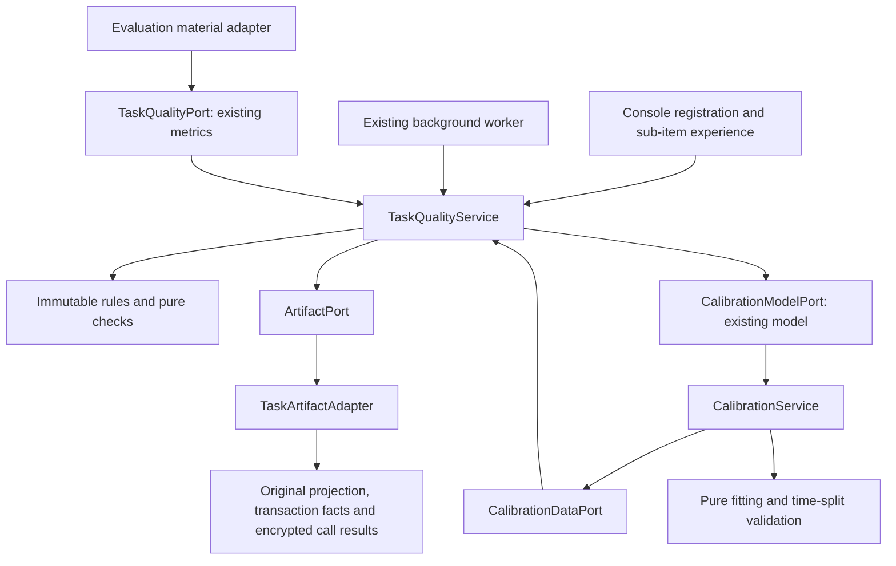

<!-- source: 2b89fcc7d15e -->
# Task-level quality review and calibration against actual local experience

Version: `a2n-task-review/1`, `a2n-local-calibration/1` · 2026-10-09.

This round adds an independent code case, an authorised semantic interface and actual image/audio/video/document specification checks; see [review and execution boundaries](WORKFLOW-MEDIA-MAINTENANCE.en.md). Background checks and payment recovery run separately, and parsing does not occupy a transaction. `POST /v1/task-quality/plans/{id}/recheck` uses If-Match to re-check the original delivery under the original rules, keeping the person's experience, source and history, without calling the Agent again. An existing valid check is not overwritten by a temporary unavailability.

## 1. Business flow

1. The consumer chooses a task basis and registers the checks it cares about before the call; the rule version, sub-items and source weights are fixed.
2. Quoting and execution keep using the original payment coordination flow. Registration, review, fitting and ranking themselves execute no Agent, consume no sample and create no settlement.
3. After actual delivery, the background reads the qualifying result held locally and runs bounded JSON/text condition checks.
4. The consumer fills in sub-item experience, or may explicitly delegate the assistant to act and review on their behalf. The `HUMAN`/`ASSISTANT` source is stored; unfilled items stay unknown, a revision replaces the original contribution with the old version retained; the whole review may be stopped from use.
5. The user separately chooses whether this actual experience may be used for local calibration. Unauthorised by default; a controlled test does not enter production calibration even if the box is ticked.
6. Once enough material has arrived, an explicit trial fit is run and validated against later records that took no part in fitting. Only a model that passes the threshold may be applied, and the default can also be restored.

The original bilateral reviews, public short reviews, credit, disputes and opportunity policy keep working under the original rules. Task sub-items are not automatically copied into an overall review, not automatically published, do not directly deduct credit and do not change the points ledger. The first ten samples are still published by default, and the business layer bypasses all settlement for them.

## 2. Fixed task bases

Each rubric fixes `id + version`, the category, sub-item weights, objective and consumer-experience source weights, and an independent calibration target. The original `human` field is retained for compatibility, and the actual evaluator is described by `label_source`. The content of the same version cannot be overwritten, and the definition digest enters plans, reviews and models.

| Built-in basis | Sub-item weights |
| --- | --- |
| Structured result | correct 35%, complete 25%, format 20%, useful 20% |
| Text extraction and expression | correct 30%, complete 25%, expression 20%, useful 25% |
| Code delivery | requirement coverage 35%, format 15%, maintainability 25%, useful 25% |

Human scores of 1–5 are normalised to 0–1. Objective sub-items are normalised by the pass ratio of the chosen conditions, supporting field presence, value equality, text containment, type, numeric range and length range.

Items that apply but were not measured occupy a neutral position when synthesising, and unknown plus missing weight are returned explicitly rather than giving the remaining weight to the known items. Checking only the format does not earn full marks. Different bases, goods versions, capabilities, task categories or input scales are not mixed into the same average. A single revision does not add a vote, and a small number of records still shows limited material.

The actual result must belong to a delivered transaction where this node was the consumer, the association must be verified, and the result digest must match the delivery ledger. No delivery means no rating. A retroactive review of a transaction that already existed at registration is marked as limited material and does not enter production calibration. Known self-supply and self-use do not count as an independent supply-and-demand contribution.

The input scale may be determined after delivery from the original call's observation; when it does not match an explicitly preset goods, capability or scale, the basis is marked as inconsistent. Check results store only the rule digest and pass/fail; derived material and ranking explanations contain no original task or result body.

At most 64 checks per review, with results at most 1 MiB. This module does not execute programs supplied by the supplier. The code basis supports structural requirements and human experience; a supplier's self-reported "tests pass" cannot stand in for an independent test. Arbitrary code execution and model semantic review need an independent controlled reviewer and explicit authorisation, and tasks are never sent to an external model automatically.

## 3. Data eligibility for calibration

The fitting interface cannot upload arbitrary training data; it only reads the data port of existing reviews. Qualifying data satisfies all of:

- explicitly marked as actual use, with the user's permission to use it for calibration;
- the rule was registered before the call, the actual association is a completed delivery, and there is no known self-supply and self-use;
- the same basis, category, capability and scale, with objective measurable sub-items covering at least 80%;
- an independent "usefulness" label given by the consumer personally or by an explicitly commissioned assistant, and that label does not take part in computing the objective predicted value;
- the record and label times are valid, within the last 90 days, not withdrawn; the same transaction uses the current revision.

The acceptance calls actually executed are still controlled tests. Call counts, sample counts, dispute counts, transactions without a label and old overall scores are not guessed into a target label for that task.

An explicitly commissioned actual task may form assistant-use material, which must state the evaluation source and use an independent task category. Personal reviews and assistant reviews are not fitted together; a mixed source returns `EVALUATION_SOURCES_REQUIRE_SEPARATE_CONTEXTS`. Task quality for assistant material keeps limited support, and the source is shown in score explanations, calibration statistics and model support counts; it does not represent the person's satisfaction or an independent user population.

## 4. Calibration algorithm and application

1. Take at most the most recent 100 per supplier node, and at most 1,000 in total; each supplier node carries the same total weight in training and validation.
2. At least 40 qualifying records, 3 supplier nodes and 3 days of records. Different nodes do not mean proven independent natural persons.
3. Human targets need enough variation; a batch of identical labels cannot prove a valid relation.
4. Split by label creation time: the earlier ~80% for training, the later at least 8 for validation. Training needs at least 3 supplier nodes and validation at least 2.
5. Use monotone regression (isotonic regression), interpolating between fixed knots, with output limited to 0–1, preserving the original objective prediction order.
6. Validation mean squared error must improve by at least 5% relative to the default mapping and by at least 0.000001 absolute, and the mean absolute error must not get worse.
7. After validation the validation set is not added back into the fit; what is applied is the validated knots.

The threshold is a versioned conservative admission rule, not a guarantee about the overall population. A model describes the relation between local checks and the person's utility in use, not an objective probability of correctness, and it does not prove network-wide or future performance.

A trial fit does not change recommendations automatically. Applying requires an explicit operation and version conditions, and history is kept. Calibration only replaces the utility mapping of the measured objective source within quality; human sub-items, unknown weights, original check values, personal eight-dimension weights, budget and credit thresholds keep their original values.

A model is valid for at most 30 days. When reading the active model, the material references, rule digest and current eligibility are checked; withdrawing consent, changing a review, stopping use, material expiry or an invalid basis returns the original model to default. New records may be used for the next explicit trial fit.

## 5. Architecture and isolation

Rules, lifecycle and the calibration service depend only on the standard library and injected ports. Only `task_quality_adapter.py` knows the structure of the existing business ledgers; the node does the assembly, and the payment page connects through an optional front-end registration interface. The transaction, payment, points, network and legacy review modules do not import the new service.

Ranking only reads existing reviews and the active model, and performs no checks, fitting, calls or network queries. Checks run in the background with failures caught independently, and cannot interrupt legacy review updates, call recovery or points recovery.

## 6. Local interfaces and data

All interfaces are protected by the original local management authentication; there is no public task-review or training-data interface.

| Interface | Behaviour |
| --- | --- |
| `GET /v1/task-quality/rubrics` | Read bases |
| `POST /v1/task-quality/rubrics` | Register an immutable version |
| `GET /v1/task-quality/plans` | The 100 most recent plans and reviews |
| `POST /v1/task-quality/plans` | Register; repeating an identical plan is idempotent |
| `GET /v1/task-quality/plans/{id}` | Local detail |
| `POST /v1/task-quality/plans/{id}/review` | Sub-item revision or withdrawal, requires `If-Match`; may state `label_source` |
| `POST /v1/task-quality/plans/{id}/cancel` | Cancel a waiting plan |
| `GET /v1/calibration/status` | Material eligibility and active state for the given context |
| `POST /v1/calibration/fit` | Explicit trial fit, requires an idempotency identifier |
| `GET /v1/calibration/models`, `.../{id}` | Fixed models and validation reports |
| `POST /v1/calibration/activate` | Apply or restore default, requires `If-Match` |

New private namespaces: `task_rubrics`, `task_review_plans`, `task_reviews`, `task_review_versions`, `task_quality_diagnostics`, `calibration_models`, `calibration_commands`, `calibration_active`, `calibration_active_versions`. The original encrypted database is reused. Limits are 100 waiting plans, 5,000 plans and 128 trial models; reaching a limit gives an explicit notice and does not delete real transactions or financial records.

A recommendation request may specify `task.rubric` (e.g. `structured-output@1`) and `task.task_class`. The explanation contains the basis digest, scope, measured weights, material digest and active calibration version. General reviews continue to be read with their original meaning.

## 7. Boundary between engineering acceptance and actual calibration

Rule registration, delivery association, background checks, human revision and withdrawal, task recommendation, real eligibility screening, fitting, later validation, application, rollback and invalidation form a runnable closed loop.

Algorithm tests use explicit fixtures to verify the fitting effect, and the fixtures do not import a long-running node. Long-running node acceptance uses a real text Agent, marked as a controlled test, verifying scoring, privacy, recovery and eligibility exclusion. When actual-use material is insufficient the deployment state keeps the default, and engineering acceptance must not be written up as completed calibration against real parameters.

This version learns the relation between task checks and personal utility; it does not automatically learn eight-dimension preference weights or credit penalty thresholds, and it does not replace real cross-computer network verification with local measurements.

### 2026-10-09 actual installation acceptance

- `artifacts/task-quality-full-regression-2026-10-09.xml`: 654 full-regression items pass, with no failures, errors or skips.
- `artifacts/task-quality-final-boundaries-2026-10-09.xml`: 15 task-review and calibration tests pass, additionally checking that calibration changes only measured objective contributions, preserves human scores and unknown weights, and that model expiry, review-change invalidation and idempotency conflicts behave correctly.
- `artifacts/task-quality-bundled-doctor-2026-10-09.json`: the Windows full program passes self-checks of the five packages plus task review and calibration capability.
- `artifacts/task-quality-rollout-2026-10-09.json`: 12 upgrade checks pass; the original Windows node and three Docker nodes enable the new module, the original identity, calls, samples, reviews, disputes and points records are checked, and the pre-upgrade backup is retained.
- `artifacts/task-quality-installed-2026-10-09.json`: 18 long-running node business checks pass. Reusing an already listed real Python text-analysis Agent, two consumer nodes each completed one actual call; verified registering rules before the call, background checks, human re-review, version conflicts, recommendation after withdrawal, restart recovery, exclusion of test data and refusal to apply an unvalidated model. Both calls bypassed settlement, and the existing ten public samples stayed at ten.
- `artifacts/task-quality-console-2026-10-09.json`: 10 real Chrome checks pass, including the three task bases, retention of an unsaved draft, revision of human experience, calibration eligibility notices, the registration interface on the call page and cancelling an unexecuted plan; no script errors.

The console entry is `http://127.0.0.1:8771/console`; on the discovery page expand "Task review and actual experience calibration". Tick registration for the next call, choose a basis and add requirements, then quote and execute on the payment and call page; after delivery return to task review to fill in personal experience. Allowing calibration must be ticked separately. The ranking "quality basis for this call" can choose overall quality or a specific task basis.

The Windows program digest upgraded in this round is `53714d6cffe8b6e3931814f278c847ff0f2b91452173776a3f62ff7d8b1a32e9`, and the image is `a2n-task-quality:20261009`; the original node directory, network and payment configuration keep their original values.

At the close of this round's controlled acceptance, qualifying real-use records under the default basis numbered **0**, the active calibration was **DEFAULT**, and no test plan was waiting. Controlled acceptance records and revision history stay on the local machine and are not used for production training. Later commissioned use is described in the next section.

### Same-day addition: the user commissioned the assistant to actually use it

After the user explicitly asked the assistant to call and verify on its own, using an inventory of the project documentation as the actual purpose, the assistant called the real Python text-processing Agents on three Docker supplier nodes from the Windows buyer node and completed **42 deliveries of different documentation fragments**. Each supplier node received 14; the first thirty were published as samples under each node's own first-ten rule, and the remaining twelve were called at zero price. All bypassed settlement, and the points ledger digest was identical before and after.

The results of this batch were used to generate `artifacts/project-document-inventory-2026-10-09.md`, and the human-style sub-items were reviewed by the commissioned assistant and stored with `label_source=ASSISTANT`. The limitations of Chinese single-character word frequency and truncated previews were judged from the actual output, and usefulness scored 2–4; the objective structural checks all passed. This experience is kept separate from the default personal basis, under the category `project-document-inventory-assistant`. The source and eligibility of the earlier `CONTROLLED` acceptance records were not rewritten.

Material status for this batch: **42 qualifying commissioned-use records, 3 supplier nodes, 1 actual date, 42 assistant reviews, 0 personal reviews**. The count and node number reach the trial-fit threshold, but actual dates fall short of 3 days, so this trial fit returned `INSUFFICIENT_DATA` and the active model remained `DEFAULT`. Dates are computed from real call times; the clock was not rewritten. After the date threshold is reached, later records are still needed to validate that improvement is real. The three nodes are on the same computer and use the same text-processing service; this batch does not count as independent natural persons or real cross-network data.

New evidence:

- `artifacts/task-quality-delegated-use-tests-2026-10-09.xml`: 43 module and interface regressions pass, including correct counting of commissioned calls, retention of the evaluation source, refusal to fit mixed sources and refusal of an unknown source.
- `artifacts/delegated-use-rollout-2026-10-09.json`: 12 long-running node upgrade and original-record retention checks pass; the new Windows digest is `98c93310d1e57e50a91291d1cfb3380030f69f5c48aabc11fbc698427e2f86c0`, the current Docker image is `a2n-delegated-use:20261009` (the deployment name is still `a2n-node-test`), and the original image is retained as `a2n-node-pre-delegated-use:20261009`.
- `artifacts/delegated-use-bundled-doctor-2026-10-09.json`: self-checks of the five packages in the full program pass.
- `artifacts/project-agent-usage-2026-10-09.json`: 42 actual uses, returned results, independent sub-item judgements and the calibration trial fit.
- `artifacts/project-agent-usage-verification-2026-10-09.json`: 11 installed-node checks pass, including actual counts, ten samples per node, sources, task recommendations for the three suppliers, retention of old test eligibility and fallback to default.
- `artifacts/delegated-use-console-2026-10-09.json`: 5 browser checks pass, showing 42 records, 3 nodes, 1 day and the personal/assistant sources, with the apply button not unlocked and no script errors.

Running the collection script again reuses this batch's task and review identifiers, so completed tasks are not called twice; it does not manufacture a new date by re-running the same data. Later calibration needs later real purposes, actual deliveries and new usage experience.
