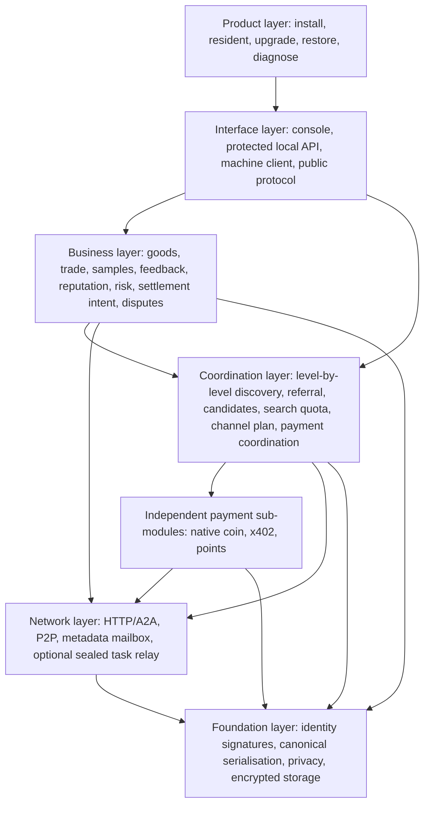
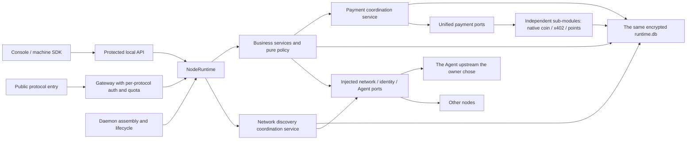

<!-- source: d326a4553d64 -->
<!-- source: PENDING -->
# Vision completion: detailed architecture design

Version: v0.1 · 2026-10-05 (Asia/Shanghai). Status: **an architecture design draft awaiting implementation**.

Implementation note, 2026-10-08: payment coordination belongs to the coordination layer; the specific payment rules belong to the independent sub-modules it calls; the first ten samples skip settlement at the business layer. The business service has been split into `TradeService`, and points have been split into a coordinator plus an independent issuance ledger. For the current rules, interfaces and implementation boundary see [the points module](POINTS.en.md) and [the payment coordination layer](PAYMENT-COORDINATION.en.md). The rest of the implementation list below keeps the semantics of the original design draft.

For the companion business rules see [the detailed business design](VISION-BUSINESS-DESIGN.en.md). For the current implementation boundary see [the existing SDK architecture](SDK-ARCHITECTURE.en.md), [node unification](NODE-UNIFICATION.en.md), [this round's assessment](../artifacts/REVIEW-2026-10-05.md) and [the fix record](../artifacts/FIX-2026-10-05.md). The new modules, protocols and APIs in this document are implementation targets; they do not mean the current node supports them.

## 1. Architecture goals and constraints

1. Keep a single product assembly: `Daemon → NodeRuntime → LocalStore(runtime.db)`. Every node is the same platform; Docker, Windows and a server differ only in how the product is deployed.
2. Keep five packages. Do not restore a central trading platform, a network-wide scoring server, or a second business runtime.
3. SDK business rules can be recomputed without a real network, real payment or a GUI; the node package owns identity, networking, cryptography and product adaptation.
4. Business facts, public projections and local decisions are stored separately. Scores can be recomputed; payment facts must not be rewritten by a rescoring.
5. Public discovery stays a bounded metadata service; the added review, dispute and payment capabilities do not change the authority of the discovery protocol.
6. By default a public sample contains only a safe projection; private tasks, inputs, credentials and payment accounts do not enter the directory, the mailbox log or the reputation cache.
7. Cross-node interaction uses idempotency and reconciliation. Do not promise exactly-once delivery, absolutely complete reviews, or a network-wide shortest path.
8. After installation the modules are all present; which capabilities are actually opened, what spending is authorised, and the runtime state are still decided by the owner's configuration and real network conditions.

## 2. Six logical layers and five code packages

### 2.1 Logical layering



A layer is a boundary of responsibility, not six independent services. Business policy supplies pure evaluation results to network discovery coordination; public discovery must not run an Agent or initiate settlement. Payment coordination receives only settlement intents the business has already authorised, orchestrates settlement through independent payment ports, and does not decide trial eligibility or run an Agent. The first ten samples go straight through the free business flow, skipping the settlement flow of payment coordination and all payment sub-modules. The public and private entry points of the interface are assembled separately; the whole local API must not be proxied to the public internet.

### 2.2 Package boundaries

| Package | Current responsibility | Responsibility added here | Must not take on |
|---|---|---|---|
| `a2n-kernel` | Base types, canonical data and pure utilities | Reusable commitment digests, protocol error types | Network requests, databases, a global scoring service |
| `a2n-p2p` | Identity, signatures and low-level connection capability | Identity and transport primitives for the new protocols | Goods ranking, trade conditions, payment policy |
| `a2n-acceptance` | Declaration templates and acceptance implementation | Versioning and explanation of result rules | Standing in for the buyer's subjective review, declaring payment |
| `a2n-sdk` | Runtime, Store, calls, coordination contracts, samples, feedback | Trade facts, experience index, reputation, opportunity policy, quota, dispute state machine | Importing `a2n_node`, binding a payment vendor, hard-depending on third-party libraries |
| `a2n-node` | Daemon, network/identity adapters, public entry, CLI | New protocol gateways, payment adapters, asset transport, install and lifecycle | Reimplementing a second set of reputation and trial rules |

The dependency direction continues the existing rule: the node assembles the SDK and the foundation capabilities; the SDK receives identity, network, acceptance and payment ports through `Protocol`. Drivers that genuinely need third-party libraries go in the node adapter layer, while pure algorithms and state machines stay in the SDK. New files are not mechanically split into new packages.

### 2.3 Single-node assembly



Each deployment holds only its own identity and private records; neighbours, mailboxes and optional caches are not a higher-level platform. One node leaving does not transfer control of its funds, and does not stop the local scoring of other nodes from running.

## 3. Module implementation list

The file names below are **suggested landing points**; apart from the "reuse" items they do not exist yet, and they may be merged during implementation according to actual complexity.

| Module | Suggested location | Main responsibility |
|---|---|---|
| Goods and declarations | Reuse SDK `cards.py`, `management.py`; node `supply.py` | Stable goods key, forms, versions, publicly safe fields and fixed-price declarations |
| Trade contract | New SDK `trade_contract.py` | Quote, mutual acceptance, business fingerprint, condition snapshot and protocol version |
| Trade facts | New SDK `trade_facts.py` | Execution/quality/free/payment/refund/dispute axes, fact append and compatible projection |
| Trade orchestration | New SDK `trade_service.py`; reuse `calls.py`, `pipeline.py` | Admission, idempotency, quota reservation, execution, results and subsequent reconciliation |
| Trials and samples | Reuse `trials.py`, `privacy.py`; extend `media.py` | Free conditions at admission, the first ten fixed slots, self-test marking, safe preview |
| Two-way opinion | Reuse `feedback.py`; new `feedback_public.py` | Original opinion, revision chain, public safe projection, source verification and visibility scope |
| Experience query | New SDK `experience.py`, `experience_service.py` | Multi-source query session, budget, deduplication, coverage and missing-item explanation |
| Reputation computation | New SDK `reputation.py` | IO-free dimension aggregation, per-counterparty contribution cap, support mass, explanation and version |
| Local opportunity policy | New SDK `business_policy.py` | Hard conditions, newcomer visibility, satisfaction conditions, admission risk and limit/recovery |
| Risk quota | New SDK `risk.py` | Atomic reservation, release, UNKNOWN retention and reconciliation by currency and authorisation scope |
| Payment coordination and orchestration | SDK `payment_coordination.py`, `payments.py` (now implemented, see the payment coordination document) | Sits in the logical coordination layer: negotiation, fixed plan, driving results and reconciliation; contains neither sample eligibility nor vendor implementation |
| Dispute negotiation | Extend SDK `disputes.py` | Counterparty reply, proposal, mutual confirmation, offline delivery and linked remediation |
| Persistent events and delivery | New SDK `events.py`, `outbox.py` | Facts and pending deliveries in the same transaction; at-least-once send, idempotent consumer |
| Public experience adaptation | New node `experience_gateway.py`, `experience_identity.py` | Envelope, signature, safe projection, address and byte limits |
| Trade/dispute adaptation | New node `trade_gateway.py`, `resolution_gateway.py` | Remote quote, admission conditions and the negotiation protocol between authorising parties |
| Independent payment sub-modules | Node `evm_payment.py`, `x402/`, `points_service.py`; SDK `points.py`, all implemented | Submission, query, receipt verification, refund or points bookkeeping per method; attached through coordination-layer ports |
| Media asset adaptation | New node `asset_gateway.py` | Bounded streaming preview, access token, encrypted file and cleanup |
| Product lifecycle | Reuse node `product_cli.py`, `desktop.py`; new `lifecycle.py` | Single instance, unified home, install/upgrade/backup/restore, self-check |

The Runtime is responsible for assembly, calling services and state snapshots; it must not stuff every rule into one ever-growing management handler. HTTP handlers only authenticate, validate input, call the service and map the response.

## 4. Core entities and persistence

### 4.1 Stable identity and idempotency

```text
candidate_key = (provider_did, service_id)
trade_uid = sha256(canonical_json([
    "a2n-trade-identity/1", buyer_did, provider_did, service_id, task_id
]))
business_fingerprint = hash(skill + input + business_options + accepted_contract_hash)
```

Algorithms use a canonical serialisation with an explicit version; the task ID is generated by the node by default with at least 128 random bits. Private context and input are not used directly in publicly enumerable paths.

The business fingerprint covers the input and options that genuinely affect execution, and excludes routing, connection nonce, authentication signature and diagnostic fields. Two inputs that differ only in transport fields should point at the same trade; a changed input or changed acceptance condition must return a conflict. The existing call fingerprint includes request metadata, so migration keeps historical fingerprint verification, and the new protocol explicitly separates business fields from transport fields.

A trade fixes the original Card, the route and the remote task reference. A new channel is used for new trades. Only when the supplier explicitly declares and implements cross-channel lookup of the same trade may the original trade be looked up on a new channel; the lookup still must not resubmit. For a task where it is unknown whether the upstream already executed it, do not bypass UNKNOWN by changing the task_id.

### 4.2 Entities and unique constraints

| Entity | Key/constraint | What it stores |
|---|---|---|
| `TradeAgreement` | `trade_uid`; the original conditions cannot be overwritten | Both parties, goods/version, input commitment, fixed amount, free reason, time and condition signature |
| `TradeFacts` | `trade_uid`, monotonic `fact_revision` | Six fact axes, evidence provenance, event time, observation time, current projection |
| `TrialAdmission` | `trade_uid` unique | Progress at admission, free-policy version, concurrency/resource occupancy, reason granted |
| `SampleSlot` | `(candidate_key, initial_slot)` unique; deduplicated by `trade_uid` | Fixed slots 1–10, safe projection, self-test provenance, privacy changes, quality state |
| `FeedbackRecord` | `(trade_uid, direction, author_did)` plus revision chain | The original author's opinion, dimensions, visibility scope, linked facts and signature |
| `PublicTradeAnchor` | Opaque `anchor_id`; bound to an already-signed relationship | Publicly safe subject, goods/version, necessary delivery credential and safe-projection link |
| `PublicFeedbackProjection` | `(feedback_id, publication_revision)` | Redacted publicly safe dimensions/short review, original-opinion commitment, retraction/correction and author signature |
| `ExperienceCache` | Identity/version/digest of the originally signed object | The original author's object, source chain, receipt time, expiry state; not a new vote |
| `ExperienceQuery` | `query_id`, control/result versions | Subject, version range, budget, sources, cursor, coverage and failure reasons |
| `ReputationView` | Subject/dimension/algorithm version/fact digest | Recomputable result, contribution groups, exclusion reasons, information sufficiency |
| `LocalPolicy` | `policy_id`, immutable version | Local ranking, quota, automatic authorisation, exploration and recovery rules |
| `RiskReservation` | Trade/currency/purpose unique | Single amount, daily budget, in-flight and unsettled exposure; release reason and reconciliation state |
| `PaymentIntent` / `RefundIntent` | Original trade/purpose/driver idempotency key unique | Integer amount in the smallest unit, currency, driver reference, state and verification digest |
| `ResolutionMessage` | Dispute ID, author, message ID unique | Original signed reply/proposal/confirmation; there is no network-wide arbitration verdict |
| `LocalEvent` / `OutboxItem` | `event_id` / `delivery_id` unique | Replayable local event, protocol domain, target, attempts and delivery state |
| `AssetDescriptor` | `asset_id`; private file mapping | Type, size, safe preview, access scope, digest and retention policy |

Reuse a single SQLite business database. Small data starts in namespaced storage; trades, events, deliveries and quota get tables and the necessary indexes when queries or unique constraints require them. Content is wrapped by an injected encryptor, and only the non-sensitive keys, states and times needed for lookup are indexed; do not write complete Cards, short reviews or credentials into logs in plaintext.

Large media may be stored as encrypted files in the node's private asset directory, while the description and lifecycle are still managed by the same business database; a second trade database must not be invented. Files are written to a temporary object, verified and atomically committed before the descriptor is registered; orphan files from a crash can be cleaned up by retention period, and "registered" must not be taken to mean the file certainly exists.

### 4.3 Fact ownership and state progression

- Execution facts come from the executing node and from verifiable upstream results; the buyer keeps its own observation and the remote receipt.
- Rule acceptance comes from the caller's acceptance implementation; the seller's technical delivery signature precedes the buyer's acceptance, and a rejection must not prevent the delivery credential from being retained.
- Payment facts come from real driver queries; a refund must link to the original payment and is not generated by a quality score or a dispute in OPEN state.
- A subjective review is produced by its author; the counterparty can only reply.
- Remote statements and locally verified facts are recorded separately. Conflicts are not silently overwritten; a late record may fill in UNKNOWN, but a known delivery must not be turned back into not-executed.

For compatibility with the old `CallOutcome`, keep `state/ok/result/verdict/settlement` for old clients; new clients read versioned fact objects. New facts are not implemented by casually changing the old state enum, otherwise the old quality, feedback and trial judgements will keep misusing them.

## 5. Admission, execution and settlement flow

### 5.1 Normal flow

```mermaid
sequenceDiagram
    participant B as Buyer node
    participant P as Seller node
    participant A as Mounted Agent
    participant D as Real payment driver
    B->>P: Read-only quote: goods, input commitment, capability
    P-->>B: Signed quote, fixed price/free conditions, validity
    B->>B: Check automatic authorisation and atomically reserve budget
    B->>P: Signed acceptance conditions, same trade_uid
    P->>P: Idempotency check, admission conditions, fixed free reason and capacity
    P-->>B: Signed admission credential
    P->>A: Execute once
    A-->>P: Result or a queryable task reference
    P->>P: Transactionally write delivery facts, sample counts and pending deliveries
    P-->>B: Delivery, technical receipt, safe public anchor
    B->>B: Store the facts, then do rule acceptance and subjective feedback
    opt The accepted conditions require actual settlement
        B->>D: Submit one payment intent, or query the same reference
        D-->>B: Verifiable receipt / pending confirmation / UNKNOWN
        B-->>P: Settlement reference; the seller verifies according to driver capability
    end
    B-->>P: Optional feedback and dispute messages
```

The diagram shows settling after delivery as one optional mode. If the first channel uses prepayment, payment confirmation must happen before execution; implement one explicit mode only, and do not claim support for both funding flows merely by moving the steps around in the diagram.

The first round of the business draft recommends small-amount post-payment: a technical DELIVERED produces DUE, and a failure with no confirmed delivery is not charged. Rule acceptance and subjective opinion do not directly rewrite the payment obligation; an agreed refund or redo is handled through an independent intent. The charging rules are explicitly versioned with the contract; the old pipeline's "only call SettlementPort once acceptance passes" must not continue to stand in for the complete conditions.

### 5.2 Quote and trial consistency

A quote does not execute the Agent. A quote may state "accepted only if the initial free conditions hold at admission", and the buyer's maximum payable under a free authorisation is zero. If the state has already become chargeable at admission, return `QUOTE_CHANGED`; do not execute and charge.

Free conditions are fixed in the seller's admission transaction, and a quote's validity does not lock an unlimited number of places. With progress at 9/10 and a free concurrency cap of 2, one more can be completed; the first ten technical completion positions are fixed, and extra free deliveries are stored separately. The concurrency cap and the resource budget jointly limit the loss.

If a delivery is confirmed but the rules fail, the sample transaction still runs; an unconfirmed delivery stays UNKNOWN/FAILED and no sample is fabricated. Sample eligibility is decided by the fact axes, completely removing the implicit premise that a sample is only recorded when `ok=true`.

### 5.3 Crash and delivery consistency

At admission, commit the task placeholder, the conditions, the resource reservation and the persistent READY job together, subject to the existing execution concurrency/pending capacity limits. The in-memory queue only wakes the executor; it is not the sole task record. READY can be dispatched again after recovery; a job marked RUNNING whose result is missing is treated as an unknown execution, and only an upstream capability that can be queried or is idempotent may be continued — it must not simply be called again. Cancelling a job not yet dispatched can explicitly release the reservation; an unknown execution must not be treated as not dispatched.

The current `on_delivery` after completion is a best-effort hook. The target design changes it to:

1. `TradeFacts` update, trial count, fixed sample slot and `LocalEvent/OutboxItem` are committed inside the same `LocalStore.tx()`.
2. No network, no payment call and no large file transfer runs inside the database write transaction.
3. After commit, a background consumer delivers; failures back off, and a restart continues. The consumer deduplicates by event or message ID.
4. A failed public sample preview must not discard an already-delivered fact; register the slot and the pending-generation state first, and fill in the safe preview later.
5. A mailbox ACK means the target protocol received it; final business confirmation, payment verification and a plan agreed by both parties are listed separately, and "delivered" must not be used to mean "accepted".

This provides at-least-once delivery and local once-only counting. If the upstream already executed but the machine crashes before writing the result, and the upstream has no idempotency/query capability, UNKNOWN can only be kept; do not mask the problem by automatically calling again after a restart.

### 5.4 Funds and risk

Before payment, atomically store the intent and the idempotency key, then call the driver outside the transaction. A driver timeout is reconciled against the original reference and does not create a second payment; UNKNOWN keeps the corresponding reservation. An intent never sent, an explicit rejection, a confirmed refund and a confirmed completion each have a different basis for release.

The driver must support verification within each party's own scope of authority, or return a channel credential the payee can verify; the payment number filled in by the buyer alone cannot be trusted. Funding credentials are injected only into the payment service; the Agent upstream does not receive the root payment token. Exceeding the waiting window moves the case to manual verification and stops adding exposure of the same kind; reaching the deadline must not be falsified as not-charged or refunded.

The daily budget is counted separately per currency, in integer smallest units, with no floating-point amounts and no silent currency conversion. Confirmed spending does not restore today's spendable quota because an in-flight reservation ended. Quota still in flight across midnight keeps occupying the total risk ceiling; the midnight reset must not be used to bypass the control.

The buyer's prepayment exposure and the seller's post-payment unsettled exposure are managed separately. The seller also sets a ceiling on the total across all buyers, reducing the ability to bypass a per-person limit by switching DID. Private quota is not disclosed to stranger nodes, and a rejection returns only the necessary reason.

With no payment driver configured, free trades can proceed; a non-zero charge request returns `PAYMENT_UNAVAILABLE` before execution. A driver failure, a pending confirmation and a missing configuration must not be packaged as a successful charge. An unknown state may be verified manually, but a manual note and a driver-confirmed fact are at different levels of authority.

## 6. Signatures, privacy and the cross-node experience protocol

### 6.1 Three different objects

1. **Private trade record**: keeps the original input, the original delivery, the complete conditions, the credentials and the originally signed opinion, for both parties to see themselves.
2. **Public trade anchor**: generated only when a public sample or opinion is needed, containing the necessary subject, goods/version, role binding and technical delivery proof. The original input, original files, accounts and exact payment details are not published with it.
3. **Public opinion projection**: the author chooses the publicly safe dimensions and a safe short review, and the projection is re-signed after it is complete; it links the commitment to the original opinion and the revision chain.

By default a sample publishes the goods and a safe preview; the buyer's DID and the original task ID stay private, and only a safe opaque sample reference and a source category with a verification level are shown. If public feedback needs a role binding, the publishing interface explicitly states which author/trade subject becomes public. A sample source claim without public role evidence does not count as one more independent reviewer.

Do not rewrite the text of an already-signed object and keep the old signature. A projection signature proves "the author published this public opinion"; the necessary trade anchor proves a verifiable role and delivery relationship, and neither proves that a subjective opinion is necessarily fair.

The public publication chain contains `feedback_id/publication_revision/previous_publication_hash`; changing the public scope and retracting both append an author-signed object. Weighting is decided by the latest public state of a valid chain, and content is never inferred from an unpublished private revision. When the original author is offline, the last verification time is stated, and it cannot be guaranteed that a cache has picked up the latest retraction.

A public anchor prefers reusing the admission relationship both parties signed automatically and the seller's technical delivery credential, and does not require the counterparty to approve this low score. If there is only the author's own statement without a remote credential, the record can still be shown, but it is not mixed into the verified-delivery quality dimensions.

A bare hash of a low-entropy original input may be guessable, so it is not published by default. The original digest is kept internally; the public binding may use a commitment with a random salt, and the salt is provided only when there is authority to verify. The public preview digest covers the actually published content; the original file hash must not be passed off as making the preview verifiable.

### 6.2 The new `a2n-experience/1` protocol

This is a **proposed new protocol**, separate from the current `a2n-coord/1`. It reuses the identity, canonical serialisation and envelope primitives, and the signature includes the protocol domain to prevent cross-domain replay. The body has fixed fields, a version, a request ID, the target DID, a validity period and a paging budget.

| Proposed new public POST path | Operation | Returns |
|---|---|---|
| `/public/v1/experience/manifest` | `MANIFEST` | The public subjects, versions, count ranges and capabilities this node can provide |
| `/public/v1/experience/summary` | `SUMMARY` | A digest of the current public records, a coverage note, the update watermark; not a trusted network-wide score |
| `/public/v1/experience/feedback` | `GET_FEEDBACK` | One page of author-signed projections, the necessary anchors, revision/retraction records |
| `/public/v1/experience/samples` | `GET_SAMPLES` | Sample slots, safe preview descriptions and reasons for hiding; no large files embedded |

The query subject is explicitly split into `service/provider/buyer`, and a goods subject binds `(provider_did, service_id)` plus a version range. Private opinions must not be returned without authorisation; a public request must not look up the original task through an arbitrary task_id.

The cursor binds the query subject, the filters, the page size and the snapshot watermark. If results change, return `RESULT_CHANGED`, and already-fetched records are still cached; reopening the query takes a new snapshot. An expired cursor must not be used to extend a session indefinitely. A missing summary, a failed source and zero public opinions are three different results.

### 6.3 Multi-source discovery and verification

```text
Known goods and nodes → read the declared experience capability → query the seller + known authors/optional caches
              → verify signature and subject binding → deduplicate by original object → check the revision chain
              → local cache and coverage report → local reputation recomputation
```

A public author may publish bounded, time-limited subject hints to an already-chosen cache; the cache may only forward the original object. A hint contains its provenance and an index digest, and must not embed code to be executed. The first version searches only known sources and does not recursively copy the whole network's trade history in the name of "completeness".

When an independent source is unreachable, the missing item is reported; do not assume the seller's list is complete. A seller deleting its own cache cannot make an opinion stored by the buyer or published by the author disappear; but when the author is offline and nobody cached it, a stranger cannot be guaranteed to find it either.

Verification checks the signature, the trade anchor, the role, the direction, the dimension eligibility, the goods/version, the revision and the expiry one by one. Several caches holding the same opinion still make it one opinion. When the same author's same revision has different content, mark a signature conflict and isolate the related records; impersonation without a real signature must not be blamed on the impersonated party.

### 6.4 Compatibility boundary of the coordination mailbox

The current coordination mailbox supports only the six coordination operations and does not support the new protocols above. The extension should add a **metadata mailbox v2 capability**: explicitly negotiate the allowed domains of `a2n-coord/1`, `a2n-experience/1`, `a2n-trade/1` and `a2n-resolution/1`, and split queues and quotas by domain.

- Old nodes still use the original six operations; a new operation without negotiation returns `UNSUPPORTED_PROTOCOL`.
- A private-network node without v2 may use a supported direct experience entry; with no entry it shows experience as unavailable, and does not quietly pass queries through the Agent execution interface.
- The trade domain carries only quotes, admission and control metadata; Agent tasks and large deliveries continue to be handled by the explicitly authorised business channel.
- Dispute write messages must be authenticated as a trade participant; an experience query must not turn into an unrestricted inbox.
- Only the limited forwarding paths specified by the caller and permitted by the current implementation are used. An extended domain does not automatically allow arbitrary nested forwarding.

Protocol capabilities are published in a separately versioned signed declaration. The current v1 data classes and signature verification may validate fields strictly, so adding arbitrary fields to the old `NodeRecord` does not make it compatible. A new node handshakes using the shapes already supported, then negotiates the extension; with no common version, the original discovery capability is kept.

### 6.5 Capacity and address limits

Each domain independently limits request body, response body, concurrency, queue length, time and cache bytes; basic discovery keeps independent capacity. Suggested limits are: experience metadata requests no larger than 16 KiB, a single page response no larger than 256 KiB, at most 50 items per page — all parameters pending stress testing. Large files are transferred separately.

Basic discovery is scheduled fairly among authenticated counterparts, with a global cap; goods reputation and payment relationships do not decide a node's service priority. New public routes are added one by one to the allowlist with a matching authentication handler; do not expose management interfaces incidentally by opening the whole `/public/` prefix.

Only endpoints declared by the target's signature and permitted by the address policy are contacted. A public referral cannot grant loopback/private-network permission; DNS re-resolution, redirects, target DID mismatch and credential forwarding all need to be restricted. Control, experience and payment requests do not use the large business request body limit.

## 7. New ports and local API

### 7.1 SDK in-process ports

The following are logical interfaces and do not replace the signatures in the existing `ports.py`. New ports are injected as small interfaces first, to avoid adding every responsibility to one universal adapter.

| Port | Logical methods | Boundary |
|---|---|---|
| `TradeContractPort` | `quote(target, spec)`; `admit(agreement)`; `query_admission(trade_uid)` | Does not execute the Agent; may return FREE_CHANGED/UNSUPPORTED |
| `ExperienceNetworkPort` | `fetch(source, query, deadline, response_cap)` | Returns the original signed object plus the actual source/bytes; does not compute reputation directly |
| `IdentityProjectionPort` | `sign_public(domain, object)`; `verify_public(domain, object)` | The SDK does not hold a low-level crypto library; the signature covers the complete projection |
| `PaymentDriverPort` | `capabilities()`; `submit(intent)`; `query(reference)`; `refund(intent)` | Returns verification state and channel reference; does not decide trade quality |
| `ResolutionTransportPort` | `deliver(target, signed_message)`; `query_delivery(message_id)` | Confirms transmission only; does not produce mutual agreement |
| `AssetPort` | `store_private(stream, limits)`; `open_preview(asset_id, grant)` | Size-bounded, returns a descriptor/stream; does not accept arbitrary file paths |
| `ClockPort` | `now()`; monotonic clock reading | Makes expiry, decay, day boundaries and failure tests easier; external time cannot rewind a budget |

Keep the existing `TransportPort/TaskControlPort/UpstreamPort/AcceptancePort`. The existing `SettlementPort` is the simple shape called after acceptance and cannot directly carry prepayment and UNKNOWN reconciliation; a compatibility adapter maps the new payment states, and real orchestration uses persistent intents.

### 7.2 Proposed new protected local API

The following reuse the existing local-origin, Host/Origin and pairing-token protection. Change commands use `Idempotency-Key`; configuration and negotiation state use `If-Match`. Actual background progress has its own version, so the owner is never unable to change the configuration.

| Method and path | Purpose | Key response |
|---|---|---|
| `POST /v1/trades/quotes` | Read-only fetch/validation of the conditions for this trade | quote, capability, validity and the free pending-admission conditions |
| `POST /v1/trades` | Authorise and create a trade | The original trade or a new trade_uid, accepted conditions, fact axes |
| `GET /v1/trades/{trade_uid}` | Local fact snapshot | Execution, quality, free, funds, dispute and the reason for unknown |
| `POST /v1/trades/{trade_uid}/reconcile` | Query the same task/payment reference | Reconciliation progress; re-execution/new payment forbidden |
| `POST /v1/experience/queries` | Budgeted multi-source query | query_id, sources and progress |
| `GET /v1/experience/queries/{query_id}` | Read query state | Coverage, missing items, result watermark, budget consumed |
| `GET /v1/reputation` | Local reputation view | Dimensions, support mass, provenance and algorithm version |
| `POST /v1/reputation/rebuild` | Local recomputation at a given version | Background job; no network, no change to past facts |
| `PUT /v1/policies/{policy_id}` | Update local opportunity/risk rules | A new immutable policy version and its effective scope |
| `POST /v1/feedback/publications` | Publish/revise a safe projection | publication_revision and the author signature |
| `POST /v1/disputes/{id}/messages` | Reply or propose a plan | The original signed message and delivery state |
| `POST /v1/disputes/{id}/agreements` | Explicitly accept a plan | Own consent or mutual agreement; does not automatically produce a refund receipt |
| `POST /v1/payments/{id}/reconcile` | Verify against the driver reference | Verification provenance, payment state, reservation handling |
| `POST /v1/backups` | Create a recoverable snapshot | Snapshot scope and key-recovery conditions |
| `POST /v1/restores/validate` | Restore pre-check | Identity, decryption, version, space and conflict report |

Keep the existing `/v1/feedback`, `/v1/trials`, `/v1/calls/detail` and the coordination API as compatibility projections; do not maintain two sets of business state in parallel. The old call entry may delegate to the unified service in free mode; when the price is non-zero and the necessary acceptance conditions cannot be expressed, it refuses and prompts an upgrade.

### 7.3 Public trade and dispute protocols

The `QUOTE/ADMIT/GET_ADMISSION` of `a2n-trade/1` use signed envelopes; task calls still go through the existing HTTP/A2A or sealed relay adapter, binding the contract digest inside the signed request. The seller may execute only after verifying the buyer's identity, the input commitment and the admission conditions.

`DELIVER_MESSAGE/GET_DELIVERY` of `a2n-resolution/1` is accessible only to the participants of the relevant trade, and refuses to let anyone else modify a dispute. A refund or a redo is an independent authorised action, and the unified business service creates the linked intent; message text does not directly trigger a payment or run code.

### 7.4 Query response example

The following shows the field semantics and is not the current online response; signed objects are returned in full separately according to the protocol.

```json
{
  "protocol": "a2n-experience/1",
  "subject": {"kind": "service", "provider_did": "did:a2n:provider", "service_id": "svc_x"},
  "snapshot": "opaque_snapshot",
  "items": [],
  "coverage": {
    "requested_sources": 3,
    "responded_sources": 1,
    "seller_only": true,
    "known_sources_complete": false,
    "global_completeness": "UNKNOWN",
    "missing_reasons": ["SOURCE_OFFLINE", "UNSUPPORTED_PROTOCOL"]
  },
  "next_cursor": null
}
```

`known_sources_complete` says only whether the known sources were fully queried for this snapshot; budget exhaustion, unfinished paging or an unreachable source all make it false. Even when it is true, `global_completeness` stays UNKNOWN and does not mean the whole network's history is complete.

### 7.5 Errors and retries

| Error | Behaviour |
|---|---|
| `UNSUPPORTED_PROTOCOL` / `CAPABILITY_MISSING` | Use a known compatible read-only path, or show the capability as unavailable |
| `UNVERIFIED_IDENTITY` / `TARGET_MISMATCH` | Do not trust the result, and do not blame the impersonated subject |
| `IDEMPOTENCY_CONFLICT` / `CONTRACT_CONFLICT` | Same key with different business content; stop retrying |
| `QUOTE_EXPIRED` / `QUOTE_CHANGED` | Fetch a new quote and confirm again before admission; already-accepted conditions do not change |
| `RISK_LIMIT` / `CAPACITY_LIMIT` | Not executed; the user or an authorised policy may wait, and the quota is not raised automatically |
| `PAYMENT_UNAVAILABLE` | Non-zero price forbids execution; do not turn it into free or fake a receipt |
| `RESULT_CHANGED` / `CURSOR_EXPIRED` | Reopen a read-only snapshot; verified records are kept |
| `RATE_LIMITED` / `SOURCE_OFFLINE` | Bounded backoff, counted against the budget, and the missing item is reported |
| `EXECUTION_UNKNOWN` / `PAYMENT_UNKNOWN` | Keep the original reference and quota, query only, do not create again |
| `PRIVATE_CONTENT` / `ASSET_NOT_AVAILABLE` | Show a placeholder and a permission note; do not leak the original content |

Errors for authenticated protocol requests are signed per domain; when authentication is impossible, return only a minimal error. Network retries consume the original query/delivery budget and do not loop indefinitely.

## 8. Reputation computation and business satisfaction policy

### 8.1 Pure computation and explanation

`reputation.py` takes verified and already-projected records, fact eligibility, the clock, and the algorithm and policy versions, and outputs a dimension view; it sends no requests and executes no calls.

It follows the business draft's formula: deduplicate opinions in the current version → check dimension eligibility → exclude self-tests → time/version weighting → cap per-counterparty contribution → neutral-prior aggregation. The effective support mass is computed per counterparty group; repeated trades with the same counterparty must not each add an "independent sample".

The output records: included/excluded counts, each counterparty's contribution, decay factors, algorithm version, input digest, information sufficiency and data coverage. Integer/decimal rounding and the fixed random seed are explicitly versioned so that offline recomputation is comparable.

The opportunity threshold reads the total effective weight, the effective counterparty support mass and recent coverage together; a large number of very old, very low-weight groups must not satisfy the penalty condition on their own. A state change records the newly qualifying fact that triggered it, and a repeated scheduled recomputation does not fabricate evidence of persistent malice. The numbers in §9.4 of the business draft serve only as shadow trial configuration.

The heuristic for a large number of linked DIDs only produces a reason for applying a limit; it must not claim to have identified every independent user. For now the algorithm does not recursively use the author's reputation as a weight, and does not add votes because a caching node reports a high score for itself.

### 8.2 Policy execution

Coordination search still owns the frontier, candidates and path observation. Business policy reads the immutable candidate, the experience view, the price and the local authorisation snapshot, and returns `SATISFIED/CONTINUE/NEEDS_INPUT` plus a reason; it cannot create a trade.

A slow experience query runs independently, and the evaluation is repeated after the result version changes. A missing reputation view is treated as "unknown", and not every newcomer is excluded; whether unknown fits the current automatic-call risk needs an explicit decision according to the owner's configuration.

Display ranking, automatic selection and seller admission are three separate scopes of authority. The exploration ratio affects display only. Automatic selection still checks skill, price, authorisation and risk; seller admission still checks atomic capacity. A public node's service volume does not enter commercial ranking.

### 8.3 Shadow enablement and recovery

The stages are `DISABLED → SHADOW → SUGGEST → ENFORCE_LOCAL`. First store the shadow ranking and explanation without changing any deal; the user can compare the suggestions and enable them. An algorithm failure or a migration conflict can fall back to manual/old-count policy, and contracts already accepted continue to be performed under their original conditions.

NORMAL/OBSERVE/LIMITED/MANUAL_ONLY/BLOCKED_LOCAL are local opportunity states, and a change has a policy, a support mass and a reason. Revoking a private policy or changing parameters does not delete the original public opinion. Recovery is re-evaluated from later facts and decay; a single bad review and a normal dispute do not produce a permanent ban.

## 9. Media, Agent extension and authorisation

### 9.1 Staged media implementation

First support safe text, JSON, file metadata and confirmed thumbnails. Original files are private by default; a public description is not a path that can read a local file.

Full media needs bounded streaming, Range/type/size validation, a bandwidth quota and expiring authorisation. The current public proxy has a path that reads the response into a buffer; that path must be replaced before large media is added, and the limit for business JSON must not be raised to support video.

Preview rendering disables scripts and active content; HTML/SVG and similar must not be embedded directly as an executable page. Downloads are authorised separately, and credentials are not automatically attached to arbitrary third-party URLs. An access token binds the asset, the operation, the expiry and the necessary subject, and the root management token is not used.

### 9.2 Authorisation for automatic calls

Use a limited-scope authorisation object covering the goods/skill scope, single and cumulative amounts, validity, concurrency, and network and file access scope. A node signature cannot replace the owner's funding authorisation; the counterparty Agent's output cannot expand the authorisation either.

The file and process permissions an existing OS user already has are not automatically isolated by this design. When unfamiliar code must be executed, build a real sandbox, key isolation and resource limits separately; a signed package is not equivalent to safe code.

### 9.3 Later-stage sample Agent packages

Package management is separate from trade: signed manifest, locked dependencies, permissions/external costs, a real isolated environment, audit output, upgrade and rollback. Ordinary goods cards and samples must not embed installation instructions that run automatically.

Creator revenue sharing depends on real payment already settled and explicit multi-party allocation support. When the driver does not support it, only the agreement can be shown; automatic revenue sharing must not be declared complete. Template reputation and the reputation of a local instance are shown separately.

## 10. One-click complete SDK and real networking

### 10.1 Installation and single instance

The target installer carries a pinned-version runtime, the five packages and their dependencies, a self-check and the console; an ordinary user does not need to fetch the repository, install development tools or type JSON first. The release form and the supported systems are stated explicitly in the product batch, and multiple sets of business code are not built at the same time.

Installation performs: choose and validate the canonical home → create/read the same identity → validate the encrypted database → take the single-instance lock → configure resident-on-login → start → self-check → open the console. A failure shows a concrete repair path.

The current choice order `A2N_HOME → working directory .a2n-local.json → default home` must be frozen at service registration into a validated absolute directory; interactive start, the scheduled task and the upgrader all use the same value. Check the DID, the database path and the read/write visibility of the directory, so that different sessions cannot see the same path name yet generate a new identity.

### 10.2 Joining the network and public duties

LAN auto-discovery runs in parallel with several replaceable public seeds; a seed only provides an entry/referral. When the host has no public inbound, establish an outbound metadata mailbox with a lease; show the hosting node, the supported domains, the quota, the lease and the unreachable state.

Basic discovery has reserved capacity; pausing goods, having no payment configured or having no upstream does not shut down public discovery. Optional task relay, witness and large-file cache explicitly configure their quota; whether real trading on a private network is usable is decided by the verified business channel.

Path observation carries the target identity, the validity period and the measurement type. A successful coordination HELLO alone must not show the task as usable. Switching away from a failed mailbox changes only the control path; tasks and payments that may already have been sent continue to be reconciled against their original references.

### 10.3 Health state

Show local `LOCAL_READY`, discovery `DISCOVERY_JOINED/ISOLATED`, goods `TRADE_READY/UNREACHABLE`, and experience and payment capability `AVAILABLE/UNAVAILABLE` separately; the aggregate may be `DEGRADED`. These are different capability axes, not a single linear online level.

Running three containers on one machine to verify process isolation and the multi-node protocol is not the same as three independent networks. The current pass record for four local nodes is only a regression starting point; a fifth remote node, cross-carrier/NAT, sleep and reconnect, and continuous running must be measured separately.

### 10.4 Upgrade, backup and restore

An upgrade download verifies integrity and the publisher signature, and signature trust is distinguished from a bare SHA256. Pre-check disk/version → stop admitting new trades and drain or register unknown tasks → back up → migrate → self-check → switch; on failure, restore a compatible version. An application rollback does not automatically hand the new database structure to old code that cannot read it.

A backup uses a consistent snapshot and contains the database, the node identity/keys, the configuration, the necessary assets and restore instructions. Keys protected by Windows DPAPI cannot be recovered across accounts or machines by copying the database alone; a portable export needs the user secret to re-wrap the key, and must be verified to decrypt. Linux also needs its storage key retained correctly.

A restore first validates identity conflicts, version, decryption and checksums, then stops the service and replaces. By default the same DID does not write divergent histories on two devices in parallel; cloning a new node creates a new identity. An identity change does not automatically inherit the old reputation; if migration is genuinely needed, use a migration declaration both parties can verify.

## 11. Migration and release boundary

1. Do not delete the current database, call records, sample positions, DID or user upstream configuration. Keep a recoverable snapshot before migrating; the script can be run repeatedly and has a schema version.
2. An old task is migrated to DELIVERED only when delivery can be proven; `REJECTED` with a complete result/technical evidence can have sample eligibility filled in. Missing input, source or identity must not be used to guess evidence from existing averages.
3. Existing first-batch slots are not reordered. Deliveries the old implementation missed are marked as historical backfill during migration with the gap explained; do not silently fill them with old good samples and then claim compliance with the new first-ten rule.
4. The original v1 feedback signature is kept in full; when displayed, its original protocol and eligibility scope are labelled. A new public projection is generated by the original author who holds the signing authority; other nodes cannot re-sign on the author's behalf.
5. The old and new interfaces delegate to the same business service and fact store, and the compatibility layer only converts shapes. Paid and cross-domain mail are enabled through capability negotiation, so old nodes do not mistakenly execute a new chargeable contract.
6. New reputation is first recomputed locally, then shadowed, then trialled on a limited basis; payment, assets and the sandbox are enabled separately, and completing one batch does not enable all automatic capabilities.
7. Documentation, unit tests, Docker, four local nodes, the public internet and real business each record their conclusions separately. Technical arithmetic calls passing must not be used to prove that the user's vision is fully achieved.

## 12. Implementation batches, dependencies and deliverables

| Batch | Engineering deliverable | Depends on | Necessary verification |
|---|---|---|---|
| B0 Fact specification | Identity/fingerprint, fact axes, schema migration, persistent events, compatible projection | The current single Runtime | Delivery rejection, UNKNOWN, replay, crash consistency and history retention |
| B1 Sample experience | Fixed free conditions at admission, samples for poor results, self-test, public anchor/opinion, experience query | B0 | Boundary concurrency, privacy, original signatures, missing multi-source items, old-protocol degradation |
| B2 Reputation observation | Pure algorithm, eligibility and contribution explanation, counterparty cap, shadow comparison | B1 | Fixed mutual-pumping/repeated low scores/revisions/new versions/offline recomputation |
| B3 Local opportunity | Business satisfaction, newcomer visibility, limit recovery and admission policy | B2's trial data | No unauthorised calls, reversible, unknown not penalised, hard conditions not bypassed |
| B4 Lightweight trade | Complete fixed conditions, risk quota, payment intent/first channel, dispute delivery negotiation | B0/B1; risk control may precede B3 | Real receipt/refund, no double payment on UNKNOWN, both sides offline, total quota |
| B5 Product public network | Finished install, resident, unified home, signed upgrade, restore, cross-network trial | Basic functionality; can run in parallel from B1 | Fresh machine, NAT, sleep, restart, key recovery, long running |
| B6 Later extension | Reconnect sampling, full media, Agent package sandbox and verifiable revenue sharing | The relevant payment/asset/isolation capabilities | Independent capacity, safe permissions and allocation reconciliation |

B0 first defines the minimal free admission conditions, and B4 extends them into a complete chargeable contract; fixing the sample count must not wait for payment to be finished. B5's network/installation verification starts early, and B4 does not have to wait for reputation to be enabled by default. The next step is scheduled by the stage acceptance results, with no unverified timelines or completion percentages.

Reconnect sampling follows the range suggested in the business draft: granted per stable goods record, the lifetime cumulative cap includes the initial allowance and is not reset by a restart; node reconnect events are deduplicated, and the grant and the remaining quota are updated in a transaction on the same database. Existing tasks keep the free reason recorded at admission.

## 13. Acceptance matrix

This section states **acceptance requirements still to be implemented**; writing this design does not mean these tests have been run.

| Scenario | Result that must hold | Verification layer |
|---|---|---|
| Delivered in practice but the rules fail | Keep the result/technical credential, count the completion and the fixed sample, allow a quality review | Business, integration |
| Not delivered: failure or unknown | Not counted as finished quality; UNKNOWN is not automatically re-executed | Business, failure |
| Late result, duplicate callback | One trade records once only, free/charged according to the fixed conditions | Persistence, integration |
| Free 9/10 with two concurrent orders | The free conditions of the accepted orders do not change, and the first ten slots are not replaced | Concurrency, restart |
| Sample projection generation fails | The delivery and slot still exist, and a safe placeholder can be generated later | Failure |
| Self-test and fixed mutual pumping | Self-tests have zero independent weight, the same counterparty's contribution is capped, and support mass is not inflated | Algorithm |
| One author repeatedly scoring low | The current revision and contribution are bounded, without a direct network-wide ban | Algorithm, policy |
| New goods/new version | Insufficient information does not count as bad; there is a display opportunity when hard conditions match | Policy, trial |
| Ten caches holding the same opinion | Counted once for the original author, with a clear source chain | Protocol, algorithm |
| The seller only supplies positive reviews | Coverage is reported as insufficient; do not show that the whole network has no negative reviews | Query, UI |
| Review correction/retraction/conflict | The version chain is inspectable, the old version is not weighted again, and a real conflict is not silently resolved in favour | Protocol |
| Impersonation/target mismatch | A failed signature verification does not count towards the target's reputation, and private content is not leaked | Security |
| Text/file contains private data | Public safe projection or a placeholder; the original record stays private | Privacy, UI |
| Public projection changes | The new projection is re-signed, and the old signature is not reused wrongly | Protocol |
| Old coordination mailbox | The original six operations work, and the new experience domain is explicitly unsupported | Compatibility, node |
| Experience flooding | Bounded errors and backoff, and basic discovery still has reserved capacity | Capacity |
| Search satisfaction and exploration | Only candidates/display change; no task executed, no free place or funds used | Policy, integration |
| Path changes and the task is unknown | Query only the known task reference, do not resubmit on the new path | Network, failure |
| Same task with changed input/conditions | Conflict, with no second execution or charge | Idempotency, integration |
| Budget/capacity contention | Atomic reservation, and the total across all buyers stays within the ceiling | Concurrency |
| Payment driver missing | A non-zero charge is refused; free trades complete truthfully with no fake receipt | Payment, UI |
| Payment timeout/duplicate notification | Query the same intent; UNKNOWN does not release and then pay again | Payment, failure |
| Still unsettled across midnight | The risk reservation is kept, and the daily budget and total exposure do not cancel each other out | Business |
| Both dispute parties offline | Delivery and agreement are separate; one party saying it is resolved is not mutual agreement | Protocol, UI |
| Refund/redo | The refund is verified against the original payment, the redo is a newly linked task, and the original delivery is not modified | Payment, business |
| Old record migration/repeated migration | The original DID/task/slot are preserved, missing evidence is marked unknown, and it is idempotent | Migration |
| Installer/scheduled task/upgrader | The same canonical home, DID and database, with no hidden new identity | Windows product |
| Cross-machine restore | The key can be unsealed and identity conflicts are pre-checked, not merely that the database exists | Restore |
| Large multimedia response | Streamed and bounded, does not exhaust proxy memory, does not execute active content | Capacity, security |
| Real public network and real demand | Verify the network path, the actual result and the feedback quality separately | Public network, business trial |

Reuse the existing call/identity/management regression; do not add meaningless tests for Markdown or for rules that only mirror the implementation. Each batch widens verification only to cover the real risk it newly introduces.

## 14. Observability and parameter governance

Business metrics: search hits, samples viewable, technical deliveries, feedback coverage, re-selection, waiting time until a new Agent is first selected, limit false positives and recovery, post-payment settlement and unsettled exposure. Reports distinguish self-tests, test upstreams and real workflows.

Runtime metrics: protocol-domain requests/bytes/latency/rejections, queue backlog, mailbox lease, UNKNOWN duration, delivery retries, asset capacity and restore results. Logs contain only event IDs, states and safe digests; no credentials, complete inputs or payment accounts.

Algorithm/policy/protocol/database versions are separate: an algorithm change recomputes, a policy change affects future choices, a protocol change is negotiated first, a database change is migrated first. Original accepted conditions are performed under their original version. The H, priors, contribution caps, exploration ratio, free concurrency and quote validity suggested in the business draft are read from versioned configuration and are not scattered as hard-coded values.

## 15. Architecture decision record

| Decision | Choice | Rationale and cost |
|---|---|---|
| Platform shape | One node set, five packages, one business database | Fewer maintenance forks; requires strict adapter boundaries |
| Reputation authority | Computed locally from facts with provenance | Fits autonomy and public benefit; different nodes may reach different judgements |
| Fact model | Multi-axis facts with a compatible projection | Avoids mistaking rejection/non-payment for non-delivery; migration needs a careful review of old records |
| Free samples | Eligibility fixed at admission, fixed positions on completion, bounded overrun | Accepts a small loss; requires atomic capacity and placeholders |
| Public reviews | Author-signed safe projections and trade anchors | Protects privacy and verifies the source; cannot prove an opinion is absolutely fair |
| Experience exchange | A separate protocol, bounded queries over known sources | Avoids copying the whole network; must honestly show incomplete coverage |
| Discovery authority | Keep the metadata responsibility; extending domains needs negotiation | Basic public duties stay clear; an old mailbox cannot directly provide the new capabilities |
| Funds | Both parties choose a real channel; the node only orchestrates and verifies | A2N takes zero commission and holds no funds; the first channel and refund capability have limits |
| Failure recovery | Same-transaction events + idempotent delivery + query reconciliation | Recovers duplicates/offline cases; UNKNOWN may still remain without upstream idempotency |
| Newcomer opportunity | Exploration display within hard conditions, admission with limited risk | Reduces cold-start exclusion; must not pay to probe without authorisation |
| Installation | One product runtime, explicit data directory and recovery key | Aimed at ordinary computers; cannot ignore per-system resident and key differences |
| Later executable packages | Open only after permissions and a real sandbox exist | The installation vision stays complete; a package signature does not replace isolation verification |

**Recommended implementation order to start immediately: B0 facts and compatibility → B1 samples and cross-node experience → B2 reputation shadow running; public-network/installation verification in parallel.** The first payment channel, the reputation enablement threshold and the reconnect grant cap are calibrated through business trials and the product side's opinion.
