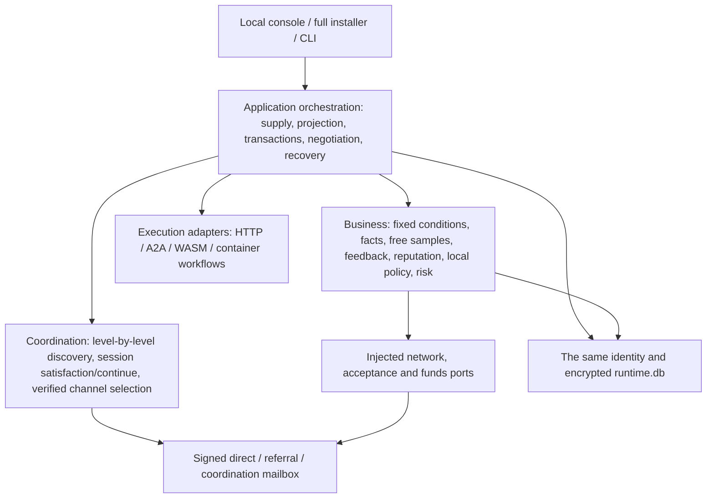

<!-- source: eaaed1d451d2 -->
# Vision item-by-item implementation record

> For the current version status see [project status](PROJECT-STATUS.en.md) in one place. The dated entries below are stage records; the new rules for automatic settlement, private preference learning, integrations and releases are in the current document index, and a historical "to be implemented" cannot be read directly as today's gap.

> 2026-10-09: filled in requirement-condition parsing, custom task categories, selection-effect records, independent code/semantic/media review ports, real streaming first-segment timing, audio/video and document previews, installable container workflows, dependency retry and version rollback, periodic backup, capacity reminders, encrypted archiving and project publisher signing. This machine and three Docker nodes are now connected to local Anvil test wallets. Current acceptance and limits are in [the completion record](VISION-COMPLETION-WORK.en.md), [module boundaries](WORKFLOW-MEDIA-MAINTENANCE.en.md) and [test payments](LOCAL-PAYMENT-TESTING.en.md).

> 2026-10-08 points update: the independent business service and the points payment submodule are complete. The first ten samples bypass settlement entirely; a real service may issue supplier points held by the supplier, or record a consumer debt; active grants, voluntary acceptance ratios, debt repayment, three-party rings, exchange of at most three hops, recovery of a persisted decision and refunds of original points are all wired into the full SDK. Current rules and verification boundaries are in [the points module](POINTS.en.md).

> 2026-10-08: B4 adds a complete [payment coordination layer](PAYMENT-COORDINATION.en.md), with unified order and channel registration, bilaterally fixed plans, paid order acceptance, real private-EVM payment in native coin and x402, two kinds of independent refund, recovery from a lost response and console operations all implemented. Mainnet funds, real users' long-term business and creator revenue splitting still await later verification.

> Same-day fix: when the source is incomplete, keep the most recently well-supported reputation limit, and the 30-day period is not extended by repeated recomputation; switching policy mode takes effect immediately. Payment channel versions are stored encrypted, setting changes do not lock things up, and an old order pins the original wallet and channel for reconciliation, restart recovery and refunds. The command line gained PUT and the policy revision header. Four-node business acceptance with real code Agents and data continuity are in [this delivery](../artifacts/BUSINESS-FIX-DELIVERY-2026-10-08.md).

Updated: 2026-10-09. For the business goals see [business design](VISION-BUSINESS-DESIGN.md), and for layering and protocols see [architecture design](VISION-ARCHITECTURE-DESIGN.md).

This record distinguishes code capability, isolated-node verification and live deployment. Without a real payment channel, charging, refunds or creator revenue splitting are not recorded as successful.

## 1. Implementation scope

| Batch | Code capability implemented | What still needs to be delivered |
|---|---|---|
| B0 Transaction facts | A stable transaction UID from both parties, the supply and the original task number; technical delivery, quality, payment, refund and objection recorded separately; enqueue/execute/project persisted; concurrent buyers with the same task number isolated; old records keep their original numbers | When an external Agent has no idempotency or query interface, an UNKNOWN result still needs manual handling |
| B1 Samples and experience | Free eligibility fixed before order acceptance; the first 10 free technical deliveries must be public; 10 fixed slots; concurrent boundary overflows archived separately; new and old switches and delisting/unmounting cannot hide existing samples; old samples projected by the current rules when read; bilateral feedback, safe public projection, signature anchors, withdrawal, source and revision; bounded multi-source queries and a NAT metadata mailbox; audio, video and document previews | Long-term real-user review coverage, anti-collusion effect, automatic privacy recognition of arbitrary media content |
| B2 Reputation | Pure computation, multi-dimensional, decay, per-counterparty contribution cap, old-version discount, self-test exclusion; support count, contribution, exclusion reasons and input snapshot are all queryable | Calibration on real business; the default shadow run does not enable limits automatically |
| B3 Opportunity governance | Local policy version and CAS; exploration exposure for newcomers; SHADOW/SUGGEST/ENFORCE_LOCAL; only well-supported new facts escalate limits; an explicit release path is kept; basic public discovery is unaffected by the business reputation switch | A continuing business pilot to verify false positives and recovery; there is no network-wide uniform penalty |
| B4 Transactions and negotiation | Bilaterally fixed free and paid contracts; channel capability negotiation, unified orders, risk control and UNKNOWN locking; real private-chain payment in native coin and x402 v2 EIP-3009; bilateral negotiation, independent reverse refunds, recovery of cached delivery and revocation before payment; explicitly starting one new linked task to redo the work; console operation entries | Mainnet funds and a long-term real-user pilot; more payment protocols, metered post-payment, multi-hop payment on behalf and creator revenue splitting; see [the payment coordination layer](PAYMENT-COORDINATION.en.md) |
| B5 Complete installation | Five packages and the Python runtime packed into a single file; browser installation/offline recovery; resident for the current user; portable backup with a separate passphrase; project publisher offline-signed upgrades, periodic backup, capacity reminders, encrypted archiving, program checks, keeping the same home, program rollback; Linux/macOS source installation entry | A native macOS installer and system certificates, public distribution channels, a pilot installing on an ordinary user's new computer; a fifth public server; public NAT, sleep and long-running residency verification |
| B6 Later capabilities | Optional reconnect grants, cumulative cap, no reordering of samples; signed WASM packages and container/Python workflows, explicit permission authorisation, an independent restricted worker process, fixed supply IDs, dependency installation tasks, historical version protection and rollback; private file chunking, signed and encrypted reads, an independent NAT file mailbox, HTTP Range, whole-file hash; metadata-stripped thumbnails, audio/video and document previews, real streaming time | Long-term public NAT verification, GPU hardware acceptance, more execution backends, actual creator revenue splitting |

## 2. The single implementation and its layers

The five release packages remain `a2n-kernel`, `a2n-p2p`, `a2n-acceptance`, `a2n-sdk`, `a2n-node`. The full-featured installed product uses `a2n-node` as its assembly root and depends on the dependency-free standard-library SDK business implementation. There is no second central platform ledger.

Core new modules: the SDK's `trade_facts`, `contracts`, `experience`, `reputation`, `policies`, `payments`, `resolutions`, `reconnect`, `agent_packages`, `assets`; the node's `experience_gateway`, `metadata_mailbox`, `resolution_gateway`, `secure_metadata`, `rework_service`, `asset_service`, `asset_mailbox`, `backups`, `upgrades`, `package_runtime`, `wasm_worker`.

## 3. Transactions and free rules

1. A repeated request with the same buyer, supply and task number reads the original result; different content produces a conflict and is not executed again.
2. Different buyers may use the same task number: private execution ledgers are isolated, while the online original task number and transaction UID stay stable.
3. READY is recoverable; a task already executed without a definite result must not be resubmitted through recovery. A projection failure can be repaired from the persisted completion event.
4. A technical delivery records performance. An acceptance rejection or payment failure does not erase the delivery. Unknown, failed and cancelled do not occupy a completion slot.
5. Free eligibility is fixed at order acceptance. The first batch's completion positions are fixed at 1–10; a concurrent boundary still enjoys the original free conditions but is placed in `INITIAL_OVERFLOW` and does not replace a first-batch position.
6. A local owner's self-test is marked `SELLER_SELF`; an anonymous public compatibility call is `UNVERIFIED_EXTERNAL`; neither is disguised as a verified independent transaction.
7. A free signed authorisation fixes the amount at 0 and the exact both parties/supply/version/input digest; the supplier signs the acceptance conditions and returns them with the delivery.
8. After the trial ends, an explicit free condition, a valid free quota or a fixed paid plan already accepted by both sides is required; no sudden charge after the call completes.
9. The current reconnect policy is off by default. When enabled, based on the locally verified communication interval, a 24-hour interval grants at most 5 calls, with an initial and cumulative reconnect cap of 30; unused or UNKNOWN grants do not stack. This observation does not prove a physical network disconnection.
10. Free sampling and public performance are one rule, with no separate declaration from either side about publication. Summaries and result text are redacted, while nested files, URLs and raw bytes stay in the private delivery; a public thumbnail accepts only a bounded, metadata-free RGB PNG produced by the node's encoder. Redaction does not guarantee automatic recognition of arbitrary trade secrets, so the fact that free sampling will be public must be stated clearly before the call.
11. An online node cannot switch off the sample service; an old setting is normalised to enabled at startup. After a supply is delisted or unmounted, existing samples are still readable. Old samples only update their read projection, keeping the original record and fingerprint; content that cannot be recovered from an old record must not be fabricated.

## 4. Feedback and reputation boundaries

- A private body does not automatically become a public body. Publication requires a separately written short review; an anonymous sample ID does not reveal the original task number or the buyer's DID.
- Public opinions keep the original author's signature, transaction anchor, revision chain, withdrawal and provenance; source conflicts are isolated and good reviews are not silently picked out.
- Reputation uses only the latest eligible, unwithdrawn opinion; contribution from the same counterparty is capped, and weight is not counted repeatedly from several caches.
- The local display shows support count, credibility, dimension estimates and exclusion reasons; incomplete source coverage does not display "no negative reviews network-wide".
- Reputation computation is in shadow mode by default. Enabling local opportunity limits requires an explicit setting; no network-wide ban list is published, and the basic discovery duty is not restricted.
- Node identity is not the same as an independent natural person; bounded algorithmic anti-gaming cannot eliminate collusion across multiple identities.

## 5. Negotiation outcomes

Negotiation messages are `a2n-resolution-message/1`, signed by both parties to the transaction; direct connections and the NAT metadata mailbox use separate X25519/AES-GCM encryption.

- `REPLY`: explanation; `PROPOSAL`: refund, rework or close; `ACCEPT`/`REJECT`: bound to the full proposal hash. A change of intent requires a new proposal and does not overwrite the original signature.
- The counterparty's signed receipt confirmation and acceptance of a proposal are recorded separately. A temporarily undelivered message has backoff and a manual retry entry.
- `CLOSE`: after both sides accept, each closes that transaction's open objection locally; the original delivery, original review and original objection body are retained.
- `REWORK`: after both sides accept, the buyer explicitly starts one new task with the original supply version and original input. The new task ID is determined by the proposal and the original transaction; a repeated start takes the original result, and the input cannot be swapped to extract extra execution. If the original conditions changed, it is refused and new negotiation is needed.
- `REFUND`: stores the bilaterally signed proposal and consent; the seller explicitly executes an independent reverse payment through the payment coordination layer, and a refund is only recorded as confirmed after real-channel verification, without overwriting the original payment, delivery or quality facts.

## 6. Files and Agent packages

### Private files

- The management interface uploads a raw stream; by default a single file is 16 MiB, total capacity 128 MiB, 128 files, with at most 2 concurrent uploads/downloads. The owner may configure capacity, with hard limits of 1 GiB per file, 64 GiB total and 4096 files; the upload interface and the server use the same setting.
- Chunks are 64 KiB and all are sealed by the existing encrypted ledger; an incomplete upload cannot be read, a failure cleans up the reservation, and an interrupted upload is cleaned up at startup.
- An Agent may return `{"assets":[asset_ref]}`; only a local file reference from a verified delivery to the exact buyer produces a read authorisation.
- Cross-node `a2n-assets/1` reads verify and decrypt chunk by chunk and finally verify the whole-file digest. When a direct connection is unavailable, the original signed request and the encrypted response are forwarded through `a2n-asset-mailbox/1`; the Agent need not be re-executed, and the coordination or metadata mailbox is not used to move the original file.
- File forwarding reuses the optional service field `blob_cache`, off by default; the current version only forwards ciphertext briefly in memory and does no persistent caching. The standalone queue holds at most 32 leases, 2 per node and 8 pending requests globally; per minute 32 MiB globally and 16 MiB per requester (raw chunk budget), with 512/256 forwards; a lease lasts 90 seconds. A chunk is at most 64 KiB, a whole download at most 120 seconds, and identity, transaction, chunk and whole-file digests are all verified. Encryption and JSON encoding increase actual network traffic.
- Turning the file service off or exhausting its quota does not change the quota for basic discovery and private negotiation; a forwarder cannot verify the plaintext digest, so the receiving party of the transaction verifies it.
- Management downloads support a single HTTP Range segment, forced attachment and `nosniff`; private previews are inlined only within format limits, and PDFs use a sandbox. Arbitrary result URLs are not downloaded and arbitrary result paths are not read automatically.
- Samples from the first ten free deliveries must be public; for processable results a new bounded thumbnail, waveform, video summary or redacted document summary is generated, without extra publication consent. Original files stay in the private delivery; when safe processing is impossible, the public slot and a format note are kept. A parse timeout or failure does not change the delivery or settlement facts.

### WASM packages

Package protocol `a2n-agent-package/1`, execution ABI `a2n-wasm-json/1`. A signed module is at most 256 KiB and explicitly authorises the exact preview digest; code runs in a separate child process and is given only `a2n.read_input` and `a2n.write_output`.

Limits cover input, output, linear memory, fuel, stack and execution time; no WASI, network, file or environment interface is provided. The compilation process does not set an operating-system-level RSS hard limit, so the risk of all runtime defects cannot be claimed to be eliminated.

The same publisher/package_id uses a fixed supply ID. Updates and rollbacks keep their history; installation is not listed by default. The creator revenue-splitting field only stores an agreement, with no actual payment.

## 7. Installation, recovery and signed upgrades

- `artifacts/A2N.exe` packages the five packages, the console, Python, encryption, WASM and image dependencies. The current artefact contains a manifest signed by an independent project publisher's Ed25519 key; a system software distribution certificate and public distribution channels still need to be configured.
- Double-clicking opens a loopback installation/recovery page; it reuses an explicit node data directory; login startup uses the current user, the same directory and port; a program in a virtualised directory stores its physical absolute path, so an old scheduled task does not wrongly fall back to the source entry.
- A portable backup re-seals all records and keys with a separate passphrase; an actual restore requires downtime. A different existing identity needs explicit permission to be replaced; restoring network configuration is a separate option.
- Upgrade protocol `a2n-release/1`: author signature, Windows/A2N.exe, size, SHA256, an increasing release sequence and compatible database schema=2. The trusted publisher is first made explicit locally, with no implicit global trust.
- Preparing an upgrade exports and fully verifies the backup, checks and copies the immutable program; applying it first checks the new runtime in an isolated directory, then stops the old node, switches the installation, autostart and program, and checks the original DID and the full program digest of the listening process; an old supervisor of the same identity grabbing the port must not be recorded as a successful upgrade.
- A failed attempt restores the old program path. A separate upgrade work lock prevents startup recovery from racing with a running upgrade program. On restart, QUEUED/APPLYING are verified: if not switched, return to PREPARED with an explicit retry; if the target program is running, complete INSTALLED; if the original program is running, verify and restore the original installation entry; when verification is impossible, mark RECOVERY_REQUIRED. Installation records are replaced atomically. The database has no automatic rollback; when a new version fails to start before node assembly, the original backup is still needed to recover.
- Linux uses the full source installation and systemd, Windows uses the single file; their business and database implementations are the same. `install.sh` also provides a macOS source entry and depends on the system Python; a native full macOS installer still needs the corresponding device to develop and verify.

## 8. Management interface index

Management interfaces all require local/pairing credentials; public protocols use node signatures and rate limiting.

| Area | Interfaces |
|---|---|
| Facts | GET `/v1/trades`, `/v1/trades/{uid}` |
| Experience | POST `/v1/experience/queries`, GET queries, POST `/v1/feedback/publications` |
| Reputation / local policy | POST `/v1/reputation/rebuild`, GET `/v1/reputation`, PUT `/v1/policies/{id}` + If-Match |
| Risk / reconciliation | GET `/v1/risk`, PUT + If-Match, GET `/v1/payments`, POST `/v1/payments/{id}/reconcile` |
| Negotiation | POST/GET `/v1/disputes/{id}/messages`, POST `agreements`, `decisions`; POST `/v1/resolutions/retry`, `rework` |
| Files | POST raw stream `/v1/assets/upload`, POST `/v1/assets/fetch`, GET `/v1/assets/{id}/content`, `preview`; POST `/v1/assets/limits` |
| Recovery | POST `/v1/backups`, POST `/v1/restores/validate`; offline installer or restore CLI |
| Upgrade | POST `/v1/upgrades/trust`, `preview`, `prepare`, `apply` |
| Reconnect | POST `/v1/reconnect/policy` + expected_revision |
| Agent packages | POST `/v1/packages/preview`, `install`, `rollback`; listing and delisting still use the original supply interface |
| Extension modules | Workflow, reviewer, maintenance and archiving interfaces are in [the module notes](WORKFLOW-MEDIA-MAINTENANCE.en.md); local selection interfaces are in [the selection module](SELECTION-MODULE.en.md) |

## 9. Verification and remaining dependencies

New integration tests use an isolated real Daemon, signed identities, HTTP calls and actual execution; demonstration data is not passed off as a delivery. The old encrypted ledger, old entry points and module boundaries continue to regress. The current acceptance index is in [the completion record](VISION-COMPLETION-WORK.en.md), and historical batches keep their original reports separately.

The existing Windows node and three Docker nodes all have independent encrypted test wallets, and native test-coin and x402 test-token payments, refunds and recovery from a lost response have been actually verified. Using real external funds requires the owner to configure their own channels and wallets; this round did not perform mainnet funds acceptance. Creator revenue splitting is not yet implemented. The fifth node and public networks are excluded by this round's scope; new devices, a native macOS package and GPU still need the actual environment. Quality calibration currently stands at 42 assistant-commissioned production records, three supplier identities and one actual date, with the active model still DEFAULT; controlled acceptance does not stand in for independent users or make up the three-day data.
