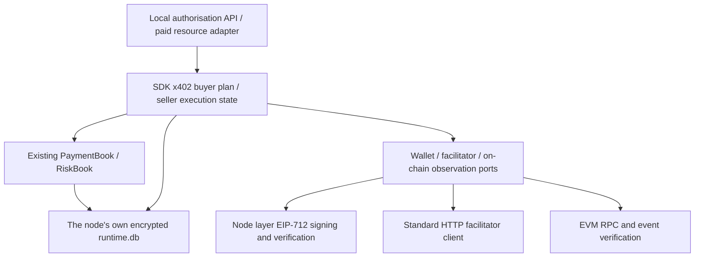

<!-- source: 5aa7dbc6f144 -->
# x402 standard payment module

Updated: 2026-10-07. Implementation scope: x402 v2, HTTP, EVM `exact`, EIP-3009, EOA wallets, the `authorization` flow.

## 1. Responsibilities in a peer-to-peer market

The buyer approves payment and controls the quota itself; the seller provides a receiving address; a facilitator acting as settler verifies the authorisation and broadcasts the on-chain transaction. The transferred amount goes directly to the seller address named in the authorisation. A2N does not hold either party's funds, charges no platform commission, and does not build in a mandatory payment platform.

Each deployer may choose the RPC and standard facilitator it trusts, including a self-hosted facilitator. This module provides a client adapter for a facilitator and does not include a facilitator service that holds a gas wallet; a self-hosted service may use the official implementation. A node's public service duty for discovery does not mean it must pay gas for other people's payments.

Payment, technical delivery, quality review and refund are recorded separately. A successful payment does not imply successful delivery, let alone quality satisfaction. An HTTP 200 alone does not prove payment success either.

This is a payment module that can be wired in on its own, and it is already wired into the local payment intent and quota ledger. The existing Agent marketplace contract is still `FREE_ONLY`; this round did not turn free calls into paid calls. The first 10 free technical deliveries must still become public samples. When paid contracts are wired in later, they should reuse this module rather than create another funds ledger.

## 2. Standard boundaries

Against the official specifications:

- [x402 v2](https://github.com/x402-foundation/x402/blob/main/specs/x402-specification-v2.md)
- [HTTP transport](https://github.com/x402-foundation/x402/blob/main/specs/transports-v2/http.md)
- [exact EVM](https://github.com/x402-foundation/x402/blob/main/specs/schemes/exact/scheme_exact_evm.md)
- [ERC-3009](https://eips.ethereum.org/EIPS/eip-3009)

| Item | Module behaviour |
| --- | --- |
| Protocol version | `x402Version: 2`; v1 requests are not defaulted to v2 |
| Request payment | HTTP 402, `PAYMENT-REQUIRED`, Base64 JSON |
| Authorise payment | `PAYMENT-SIGNATURE`, Base64 JSON |
| Settlement result | `PAYMENT-RESPONSE`, Base64 JSON |
| Network | CAIP-2, e.g. `eip155:84532`; bound by deployment configuration |
| Amount | Positive integer string in the token's smallest unit; floating-point conversion forbidden |
| Transfer | EIP-712 signature of EIP-3009 `TransferWithAuthorization` |
| Flow | Verify → execute business → settle → respond |
| facilitator | `GET /supported`, `POST /verify`, `POST /settle` |
| Querying payment | Verified through the configured on-chain RPC; no fictitious x402 `/query` standard interface |
| Extensions | Preserve and validate the information passed back; do not claim to execute unimplemented extensions |

`upto`, Permit2, ERC-7710, Solana, smart-contract wallet signatures, `upfront` and `escrow` are currently refused. They need their own adapters and cannot be enabled by changing one string. The parser also sets local limits of 8 KiB for protocol headers, 1 MiB for request and result, and a maximum authorisation of 3600 seconds.

## 3. Layers and modules



SDK `a2n_sdk.x402` keeps zero third-party dependencies:

- `protocol.py`: standard data, encoding and decoding, boundary validation.
- `ports.py`: wallet, signature verification, facilitator and on-chain observation interfaces.
- `client.py`: an explicitly approved request plan, bound to the existing payment intent and risk reservation.
- `server.py`: the paid resource state machine and persisted protection against duplicate execution.

Node layer `a2n_node.x402`:

- `http.py`: HTTP with size and timeout limits; payment authorisation is forbidden from following redirects.
- `evm.py`: real EIP-712 signing, signature recovery, on-chain receipts and authorisation event verification.
- `service.py`: configuration, wallet injection, PaymentDriver adaptation and local API assembly.

The encrypted wallet file is decrypted by `eth-account`; the private key signs in memory during operation. The SDK does not read the private key. New dependencies are included by the desktop, Docker, Linux and source installation entry points; the product doctor runs an offline sign/verify check.

## 4. Buyer rules

1. Read the resource's 402 response; only read the request, do not pay automatically.
2. The buyer explicitly approves one complete quote, including chain, token, EIP-712 domain, amount, receiving address, resource URL and request input.
3. The configured asset whitelist must match. A currency name is only used for local budget classification and cannot replace the chain and contract address. One currency budget key may correspond to only one on-chain asset.
4. Create a `PaymentBook` intent and reserve risk quota; the request input and the quote are persisted atomically together. When the risk limit is missing or exceeded, do not sign and do not send a payment request.
5. After explicit submission, generate a unique random authorisation nonce. The authorisation and the observation start point are written to encrypted storage first, and only then is the HTTP request sent.
6. Each intent sends at most one payment request to the resource. A timeout, process exit or abnormal response moves it to `UNKNOWN`. Submitting again does not call the resource again and does not generate a new authorisation.
7. reconcile only reads chain state: network, token, payer, payee, amount and authorisation nonce must match; the canonical block and confirmation depth must also be verified.
8. Once a matching transfer event and an `AuthorizationUsed` event are confirmed, the quota moves from `ACTIVE` to `CONSUMED`.
9. Only when the block time covered by the confirmation depth passes the authorisation deadline, the scan is complete and the on-chain authorisation is unused may the failure be confirmed and the quota released. Local time, an HTTP error or a single reverted transaction is not enough to release authorisation quota that can still be spent.

On-chain observation depends on an RPC the deployer trusts and the configured confirmation depth; it is not a mathematically irreversible finality proof. A scan covers at most 10000 blocks, read in segments; when the span exceeds the limit, the RPC is unavailable or the evidence is incomplete, `UNKNOWN` is kept. Historical queries after a long offline period need an extended observation adapter and cannot be solved by paying again.

## 5. Seller rules

`X402ResourceServer` is a paid resource handler that can be attached to any Python HTTP framework. Configure and reuse one handler instance, passing in the shared node storage, facilitator, signature verifier, on-chain observer and business handler; do not rebuild the state service on every request.

When unpaid, only quotes of this module that the facilitator declares supported may be returned outward. On receiving payment, the quote must match exactly, the authorisation signature is verified first, and then the facilitator performs read-only checks such as balance and execution simulation. Business execution is permitted only after those checks pass.

`EXECUTING` is written before the business starts; a successful result is cached in encrypted storage before settlement begins. A failed business response does not trigger settlement. If the process exits during the business or settlement, the state is marked `UNKNOWN` and the business and settlement are not executed again automatically. Once later on-chain verification confirms payment, an already saved result can be restored; a result that was never saved cannot be inferred from a successful payment.

On-chain authorisation signatures and nonces may become public in transaction data, so restoring a cached result also requires the same private `Idempotency-Key`. The buyer module generates and stores this random credential automatically, and the HTTP framework should pass it to `handle(..., replay_token=...)`. This is an application recovery credential, not a new x402 standard field.

A standard client that does not provide a recovery credential can still complete its first paid call; a repeated authorisation afterwards returns 409 without serving the cached content again. The same nonce with different input is refused. This mechanism cannot cancel a valid on-chain authorisation; a seller that fails to perform still needs mutual feedback or a separate refund.

An EIP-3009 signature itself binds the transfer, not the business input or a DID. The module binds the request locally and uses HTTPS by default; proof of node identity and wallet ownership should be explicitly signed by a later bilateral paid contract.

## 6. Deployment configuration

By default no wallet is configured and nothing is charged automatically. A seller that only verifies signatures and queries does not need to provide a buyer wallet.

`A2N_X402_CONFIG` points at a configuration JSON. For example, the structure below is a USDC configuration on Base Sepolia; fill in an RPC you trust and verify the network and token information before use:

```json
{
  "assets": [{
    "currency": "USDC",
    "network": "eip155:84532",
    "asset": "0x036CbD53842c5426634e7929541eC2318f3dCF7e",
    "name": "USDC",
    "version": "2",
    "rpc_url": "https://YOUR_TRUSTED_RPC",
    "confirmations": 3
  }],
  "timeout": 15,
  "allow_http": false
}
```

A buyer uses `A2N_X402_KEYSTORE` to point at an Ethereum encrypted wallet file and supplies the decryption password through `A2N_X402_KEYSTORE_PASSWORD`. The program also supports injecting an `EvmSigner` or a wallet adapter that satisfies the port. A configuration error is reported explicitly; it does not fall back to another payment method.

`allow_http` is only for a local test environment that explicitly allows it; production payments use HTTPS. Configuration and wallet paths are not read from public quotes. Wallet passwords, authorisation signatures and full request inputs do not appear in public discovery or sample interfaces.

Real payments also need a valid token balance, a trusted RPC and a facilitator configured by the seller. The facilitator's gas spending and fees are agreed between the two parties using it; this module does not pay gas on their behalf, does not refund automatically, and does not claim to waive on-chain fees.

## 7. Local API

All interfaces use the existing local management authentication. The public node interface does not expose wallet management.

When setting the risk limit, pass the current configuration revision in the `If-Match` request header; do not pass expected_revision in the request body. When no budget is set, prepare refuses to create a payment intent.

| Method and path | Behaviour |
| --- | --- |
| `GET /v1/x402` | Implementation scope, configuration state, assets and the zero-commission statement; does not expose RPC credentials |
| `POST /v1/x402/prepare` | Approve a quote and create a payment intent; reservation only |
| `GET /v1/x402/intents/{intent_id}` | Payment facts and delivery results shown separately |
| `POST /v1/x402/intents/{intent_id}/submit` | Explicitly submit one payment call |
| `POST /v1/x402/intents/{intent_id}/reconcile` | Read-only on-chain verification |
| `PUT /v1/risk` | Reuses the existing risk limit configuration interface |

prepare request fields:

```json
{
  "required_header": "the original PAYMENT-REQUIRED header",
  "accepted": {"complete": "the approved PaymentRequirements object"},
  "url": "https://seller resource address",
  "method": "POST",
  "body_base64": "Base64 of the original business request",
  "trade_uid": "transaction number agreed by both sides",
  "counterparty_did": "seller node DID",
  "command_id": "unique id for this approval"
}
```

A change to the request or the quote of the same transaction conflicts; the same payment intent will not quietly pay a different order. counterparty_did is a local budget and transaction reference; the module does not claim on that basis to have proved that the wallet belongs to that DID.

## 8. Verification and delivery boundaries

`tests/test_x402_protocol.py` verifies the wire format, refusal of unsupported schemes, signature tampering and an independent ABI digest of ERC-3009.

`tests/test_x402_module.py` verifies on-chain evidence matching, reorganisation and confirmation depth, quota, encrypted restart, unknown states, repeated authorisation, concurrency, redirects and real HTTP protocol round trips. The chain data and facilitator in the HTTP tests are controllable fixtures; no real on-chain transaction was sent.

`scripts/check_x402_interop.py` compares against the official Python SDK 2.25.0, checking the three protocol headers, the official EIP-3009 digest and official client signatures in both directions. The reference SDK is installed into a separate test directory and does not become a runtime dependency of the A2N product.

A production wallet and real on-chain payments are not configured and not verified. This is recorded separately from the module's protocol and state tests. The next step for marketplace integration includes: a paid contract signed by both sides, binding between DID and wallet ownership, linking listed quotes with trial quota, linking payment facts to transaction facts, and refunds authorised separately by both sides. An ordinary user's wallet configuration interface is also not part of this module yet.
